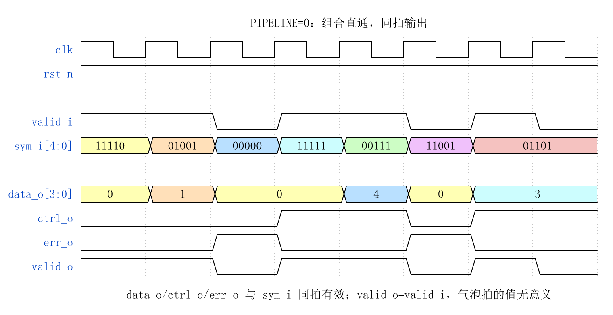
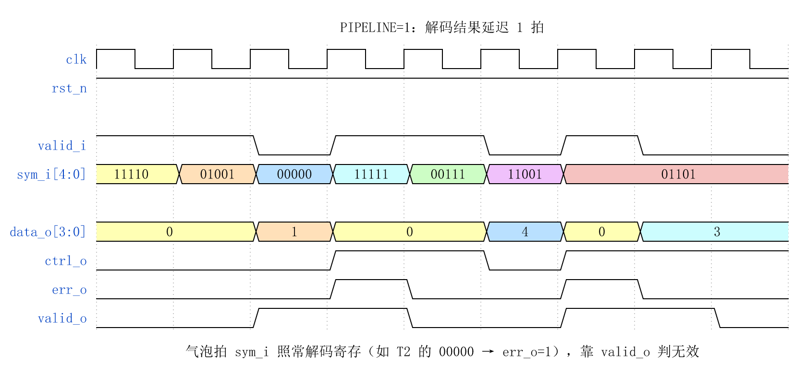
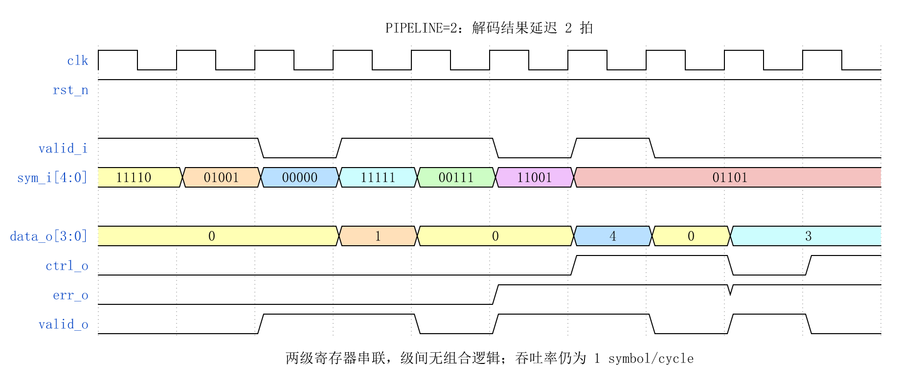
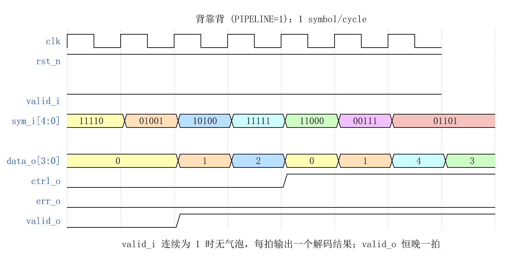
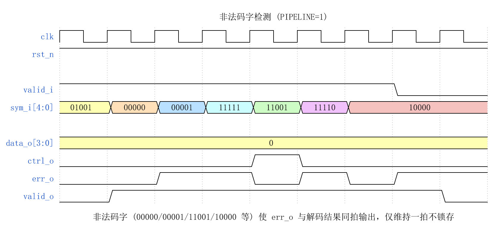

# CBB_4B5B_DEC_UG

---

## 目录

- [1. 功能及应用场景](#1-功能及应用场景)
- [2. 规格](#2-规格)
- [3. 方案分析](#3-方案分析)
- [4. 配置参数](#4-配置参数)
- [5. 接口](#5-接口)
- [6. 时序图](#6-时序图)
- [7. PPA](#7-ppa)

---

## 1. 功能及应用场景

`cbb_4b5b_dec` 是一个参数化 4b/5b 解码器 IP，将 5 位编码符号还原为 4 位原始数据与控制标识，并具备非法码字检测能力。模块属于 `cbb_coding` 线路编码 IP 族，与 `cbb_4b5b_enc`（编码器）和 `cbb_4b5b_unbal`（平衡预测器）配套使用。

### 核心功能

- 接收 5-bit 编码符号 (`sym_i`)，查表还原为 4-bit 原始数据 (`data_o`)
- 识别控制码（IDLE、SSD、ESD、HALT 等），输出控制标识 (`ctrl_o`)
- 检测非法码字（未在编码表中定义的 5-bit 组合），输出错误标志 (`err_o`)
- 支持可配流水线级数，适配不同频率与延迟需求

### 适用场景

- 100BASE-TX 以太网物理层接收通路（4b/5b → NRZI 解码链路）
- FDDI (Fiber Distributed Data Interface) 接收端
- IEEE 802.3 兼容的 4b/5b 编码通信系统
- 其他采用 4b/5b 线路编码的串行通信接收端

### 系统位置

```
NRZI Decoder ──▶ [cbb_4b5b_dec] ──▶ [MAC / PCS 上层]
                      │
                sym_i (5-bit encoded)
                data_o (4-bit decoded)
                ctrl_o (control flag)
                err_o  (illegal codeword)
```

解码器位于物理层 NRZI 解码器与 MAC/PCS 上层之间，将线路码符号还原为原始数据并完成控制码解析。

---

## 2. 规格

该 CBB 的关键规格如下。每条规格以 DS 点编号标识，命名规则为 `DS.[IP_NAME].[TYPE][SPEC_ID]`。TYPE 按规格类型取值：`INTF`（接口）、`CFG`（配置）、`FUNC`（功能）、`PERF`（性能）。

**规格汇总表**：将所有 DS 点逐条列入下表，按 TYPE 分组并依 `INTF`（接口）→ `CFG`（配置）→ `FUNC`（功能）→ `PERF`（性能）的顺序排列。表格共三列：DS 编号、类型、简述。表中每一行与下方一条详细规格分节（2.x）一一对应，并保持相同顺序。

| DS 编号 | 类型 | 简述 |
|---------|:---:|------|
| `DS.4B5B_DEC.INTF.001` | INTF | Valid 握手协议 |
| `DS.4B5B_DEC.INTF.002` | INTF | 解码输出格式 |
| `DS.4B5B_DEC.CFG.001` | CFG | 流水线级数可选 (0/1/2) |
| `DS.4B5B_DEC.FUNC.001` | FUNC | 4b/5b 解码 (5-bit 符号 → 4-bit 数据) |
| `DS.4B5B_DEC.FUNC.002` | FUNC | 控制码识别与标识 |
| `DS.4B5B_DEC.FUNC.003` | FUNC | 非法码字检测 |
| `DS.4B5B_DEC.PERF.001` | PERF | 吞吐率 1 symbol/cycle |

> 规格明细分节 (2.x) 应保持与汇总表相同的排序：INTF → CFG → FUNC → PERF。

### 2.1 Valid 握手协议 — DS.4B5B_DEC.INTF.001

模块采用 valid-only 握手协议：

- 上游在 `valid_i = 1` 时提供有效 `sym_i[4:0]`
- 模块在 `valid_o = 1` 时输出有效 `data_o[3:0]`、`ctrl_o` 和 `err_o`
- `valid_o` 为 `valid_i` 经 `PIPELINE` 级寄存器延迟后的结果
- `valid_i = 0` 时本拍为气泡：`sym_i` 仍照常解码并寄存，`valid_o` 拉低标记该拍无效

### 2.2 解码输出格式 — DS.4B5B_DEC.INTF.002

解码输出由 `data_o`、`ctrl_o`、`err_o` 三路组合表达，优先级为：

- `err_o = 1`：最高优先级，表示输入非法，`data_o` 和 `ctrl_o` 无意义
- `ctrl_o = 1` 且 `err_o = 0`：控制码，`data_o` 的低位表示控制码类型
- `ctrl_o = 0` 且 `err_o = 0`：数据码，`data_o[3:0]` 为原始 4-bit 数据

### 2.3 流水线级数可选 — DS.4B5B_DEC.CFG.001

`PIPELINE` 控制输出寄存器级数：

| 值 | 延迟 | 结构 | 适用频率 |
|:--:|:---:|------|:---:|
| 0 | 0 cycle | 纯组合输出 (LUT ROM → 译码逻辑) | ≤500 MHz |
| 1 (默认) | 1 cycle | LUT ROM → 寄存器 → 输出 | ≤1 GHz |
| 2 | 2 cycles | LUT ROM → 寄存器 (Stage1) → 寄存器 (Stage2) → 输出 | >1 GHz |

PIPELINE=0 时 `clk`/`rst_n` 不参与组合逻辑但端口保留，保证例化兼容性。PIPELINE=2 时两级寄存器之间无额外组合逻辑，纯粹将 LUT 读出的 7-bit 结果再打一拍——在工艺拐角较慢或目标频率 >1 GHz 时用于隔离片外时序。

### 2.4 4b/5b 解码 — DS.4B5B_DEC.FUNC.001

模块接收 5-bit 编码符号，通过查表方式将其还原为 4-bit 原始数据：

- 输入 `sym_i[4:0]` 为 5 位编码符号，编码规范遵循 IEEE 802.3 / FDDI 标准 4b/5b 码表
- 若 `sym_i` 命中 16 个有效数据码之一，则 `data_o[3:0]` 输出对应的 4-bit 数据，同时 `ctrl_o = 0`
- 若 `sym_i` 命中控制码，`ctrl_o = 1`，`data_o` 输出控制码类型标识（编码见 §5）
- 若 `sym_i` 未命中任何有效码字，`err_o = 1`，`data_o` 输出为全零

### 2.5 控制码识别与标识 — DS.4B5B_DEC.FUNC.002

解码器识别 IEEE 802.3 4b/5b 标准定义的全部控制符号：

| 控制码名称 | sym_i[4:0] | 含义 |
|------|:---:|------|
| IDLE | 11111 | 空闲，链路无数据传输 |
| J (SSD1) | 11000 | 帧起始定界符第一部分 |
| K (SSD2) | 10001 | 帧起始定界符第二部分 |
| T (ESD1) | 01101 | 帧结束定界符第一部分 |
| R (ESD2) | 00111 | 帧结束定界符第二部分 |
| H (HALT) | 00100 | 暂停，链路异常指示 |

控制码通过 `ctrl_o = 1` 标识，`data_o` 的低位输出控制码类型序号（0~5），供上层协议栈解析帧边界。

### 2.6 非法码字检测 — DS.4B5B_DEC.FUNC.003

5-bit 编码空间共 32 个码点，其中 16 个分配给数据码，6 个分配给控制码，其余 10 个码点为非法码字。解码器在输入符号不属于任何有效数据码或控制码时，将 `err_o` 拉高：

- 非法码字检测与解码同拍完成（PIPELINE=0）或同拍输出（PIPELINE=1/2）
- `err_o = 1` 时 `data_o` 输出全零，`ctrl_o` 无效，防止上层误判
- 非法码字指示可被上层用于链路错误统计与链路状态机决策

> 有效码字共 22 个：16 数据 + 6 控制。非法码字 10 个：5'b00000, 5'b00001, 5'b00010, 5'b00011, 5'b00101, 5'b00110, 5'b01000, 5'b01100, 5'b10000, 5'b11001。
>
> **注意**：IEEE 802.3 Clause 24 (100BASE-TX) 直接采用 FDDI PMD 的 4b/5b 码组定义，两者的数据码表、控制码分配及非法码字集合完全相同。解码器码表须与 `cbb_4b5b_enc` 镜像对应，确保自环一致。

### 2.7 吞吐率 — DS.4B5B_DEC.PERF.001

流水线填充后吞吐率为 **1 symbol/cycle**。PIPELINE=0 时零延迟（组合路径延迟 < 0.5 ns 典型），PIPELINE=1/2 时初始延迟分别为 1/2 cycles。

---

## 3. 方案分析

方案分析先做原理分析，说明几种主流实现方法，对比优劣后确定本设计选用方法并详解其核心原理；再讲设计方案，结合原理图分点阐述具体实现步骤。

### 原理分析

**4b/5b 编码与解码原理**：4b/5b 编码将 4-bit 数据（16 种可能）映射到 5-bit 符号（32 种可能中的 16 个），此后串接 NRZI 编码形成物理信号。NRZI 遇 '1' 翻转、遇 '0' 保持，因此物理信号的电平跳变次数等于码字中 **'1' 的个数**。16 个数据码每个至少包含 2 个 '1'（范围 2~4），确保每符号至少有 2 次 NRZI 跳变，为接收端 CDR 提供足够的跳变密度。同时，数据码满足 (0,3) RLL 边界约束（开头最多 1 个前导零，结尾最多 2 个尾随零），任意合法序列中连续零不超过 3。32 个码点中，包含 "000" 的 8 个全部被排除出数据码，其中 6 个分配给控制符号，其余为非法。

> **注意**：跳变密度指的是 NRZI 物理信号的电平翻转次数，而非 5-bit 码字本身的比特翻转次数。以数据码 11110 为例：5-bit 内部的比特翻转仅有 1 次（末尾 1→0），但它有 4 个 '1'，NRZI 输出产生 4 次电平翻转，完全满足跳变密度要求。阅读码表时请始终以 "'1' 的个数" 为判断依据。

解码即为编码的逆映射：查表将 5-bit 符号还原为 4-bit 数据或控制码类型。

**标准 4b/5b 数据码表 (FDDI / IEEE 802.3)**：

| 4-bit 数据 (Hex) | 5-bit 符号 | 4-bit 数据 (Hex) | 5-bit 符号 |
|:---:|:---:|:---:|:---:|
| 0x0 | 11110 | 0x8 | 10010 |
| 0x1 | 01001 | 0x9 | 10011 |
| 0x2 | 10100 | 0xA | 10110 |
| 0x3 | 10101 | 0xB | 10111 |
| 0x4 | 01010 | 0xC | 11010 |
| 0x5 | 01011 | 0xD | 11011 |
| 0x6 | 01110 | 0xE | 11100 |
| 0x7 | 01111 | 0xF | 11101 |

**解码方案对比**：

| 方案 | 实现方式 | 面积 (等效门) | 关键路径 |
|------|------|:---:|:---:|
| 纯组合译码 | case/SOP 最小项展开 | ~80 | 3~4 级逻辑门 |
| LUT ROM (本设计) | ROM (32×7) 直接查表输出 | ~120 | 约 5 级逻辑门 (5-to-32 地址译码 + OR-plane 读出) |

**选型结论**：采用 **LUT ROM + 寄存器输出** 方案。码表遵循 IEEE 802.3 / FDDI 标准，编译期硬编码于 ROM 中，不通过 parameter 开放可编程能力——面积最优、时序确定性最好，且与本模块族其余成员（enc/dec/unbal）保持一致的设计哲学。

**非法码字检测机制**：ROM 中为非法码点存储 `err_flag = 1`，其余为 0。解码时 `sym_i` 作为 ROM 地址，读出的 `err_flag` 直接驱动 `err_o`。非法码字判定延迟与正常解码完全一致，无额外逻辑级数。

### 设计方案

**模块层次**：

```
cbb_4b5b_dec (顶层)
├── cbb_4b5b_dec_lut          — 解码 ROM (32×7 bit, 纯组合)
└── 流水线寄存器               — 0/1/2 级可选
```

**解码流程**：

```
             ┌──────────────────────────┐
             │     cbb_4b5b_dec_lut     │
             │   (32 × 7 bit ROM)       │
  sym_i ────▶│                          │──▶ {err, ctrl, data[3:0]}
  [4:0]      │  addr → {err, ctrl, data}│     [6:0]
             └──────────────────────────┘
                          │
                    ┌─────┴──────┐
                    │  Pipeline   │
                    │  Register   │  (PIPELINE=1: 1 级, PIPELINE=2: 2 级串联)
                    │  0 / 1 / 2  │
                    └─────┬──────┘
                          ▼
              err_o, ctrl_o, data_o[3:0]
```

`valid_i` 信号经与数据通路对齐的流水线寄存器打拍后输出为 `valid_o`。

**流水线架构**：

| 模式 | 延迟 | 结构 | 适用场景 |
|:---:|:---:|------|------|
| PIPE=0 | 0 | sym_i 直接接入 LUT，输出为纯组合 | 低频 / 延迟敏感 |
| PIPE=1 (默认) | 1 | LUT → 寄存器 → 输出 | 通用 (≤1 GHz) |
| PIPE=2 | 2 | LUT → 寄存器 (Stage1) → 寄存器 (Stage2) → 输出 | 高频 (>1 GHz) / 慢工艺拐角 |

PIPE=1 模式下，ROM 读操作与寄存器写操作组合为单个时序路径，寄存器输出保证对外时序收敛。PIPE=2 在 PIPE=1 之后额外插入一级寄存器，将片外时序路径的起点从 LUT 输出再延迟一拍——对纯组合 LUT 的延迟无改善，但将寄存器到片外的路径降为零逻辑级数，对后端物理设计的时序收敛友好。

---

## 4. 配置参数

| 参数 | 配置范围 | 默认值 | 描述 |
|------|----------|:------:|------|
| `PIPELINE` | 0 / 1 / 2 | 1 | 输出流水线级数：0 = 纯组合, 1 = 一级寄存器, 2 = 两级寄存器 |

> 4b/5b 解码器仅需 `PIPELINE` 一个可配参数。数据位宽固定（5→4），码表硬编码为标准 IEEE 802.3 / FDDI 定义，不开放可编程码表。
>
> **关于 `RD_EXT` 参数**：编码模块族中 `RD_EXT` 为 8b/10b 模块专用参数，用于控制 Running Disparity 外部端口的暴露。4b/5b 编码不含 RD 状态机，故本模块及 4b/5b enc/unbal 均无此参数。

---

## 5. 接口

| 信号名 | 位宽 | I/O | 时钟域 | 描述 |
|--------|------|:---:|--------|------|
| `clk` | 1 | I | clk | 系统时钟 |
| `rst_n` | 1 | I | - | 异步复位，低有效 |
| `sym_i` | 5 | I | clk | 5-bit 编码输入符号，与 `valid_i` 同拍对齐 |
| `valid_i` | 1 | I | clk | 输入有效指示 |
| `data_o` | 4 | O | clk | 4-bit 解码输出数据 / 控制码标识 |
| `ctrl_o` | 1 | O | clk | 控制码指示：1 = 控制码, 0 = 数据码 |
| `err_o` | 1 | O | clk | 非法码字检测标志：1 = 非法码字 |
| `valid_o` | 1 | O | clk | 输出有效指示，`valid_i` 经流水线延迟 |

**解码输出编码**：

| `err_o` | `ctrl_o` | `data_o[3:0]` | 含义 |
|:---:|:---:|------|------|
| 0 | 0 | 4-bit 原始数据 (0x0~0xF) | 有效数据码解码结果 |
| 0 | 1 | 控制码类型序号 (0~5) | 有效控制码，详见下表 |
| 1 | X | 4'b0000 | 非法码字，data_o/ctrl_o 无意义 |

> 当 `valid_o = 0` 时，`data_o`、`ctrl_o`、`err_o` 维持上一拍值或为无效。

**控制码标识**：当 `err_o = 0` 且 `ctrl_o = 1` 时，`data_o[3:0]` 的值标识了具体的控制码类型。

| `data_o[3:0]` | 控制码 | `sym_i[4:0]` | 含义 |
|:---:|------|:---:|------|
| 4'd0 | IDLE | 11111 | 空闲，链路无数据传输 |
| 4'd1 | J (SSD1) | 11000 | 帧起始定界符，前半 |
| 4'd2 | K (SSD2) | 10001 | 帧起始定界符，后半 |
| 4'd3 | T (ESD1) | 01101 | 帧结束定界符，前半 |
| 4'd4 | R (ESD2) | 00111 | 帧结束定界符，后半 |
| 4'd5 | H (HALT) | 00100 | 暂停 / 链路异常 |

控制码通过 `ctrl_o = 1` + `data_o[3:0]` 编码输出，与编码器 `cbb_4b5b_enc` 的 `ctrl_i` + `data_i` 输入格式保持镜像对称，确保编码族接口统一。

---

## 6. 时序图

### PIPELINE = 0 (组合逻辑)



- `data_o` / `ctrl_o` / `err_o` 与 `sym_i` 同一周期有效
- `valid_o` 等同于 `valid_i`
- 组合路径延迟由 LUT ROM 决定（预估 <2 级门延迟），无寄存器

### PIPELINE = 1 (一级流水)



- `data_o` / `ctrl_o` / `err_o` 延迟 1 拍
- 吞吐率 1 symbol/cycle，无气泡

### PIPELINE = 2 (两级流水)



- `data_o` / `ctrl_o` / `err_o` 延迟 2 拍
- 两级寄存器串联，不增加组合逻辑级数
- 吞吐率保持 1 symbol/cycle，仅初始填充延迟增加至 2 cycles

### 背靠背 (PIPELINE = 1)



- `valid_i` 连续为 1 时无气泡，每个周期输出一个解码结果

### 非法码字检测 (PIPELINE = 1)



- `sym_i` 输入为非法码字（如 5'b00000）时，`err_o` 与 `data_o` 同拍拉高
- `err_o` 仅维持一个周期（对应非法输入所在拍），不锁存

---

## 7. PPA

> 综合条件：TSMC 12nm FinFET CLL (tcbn12ffcll)，SS 0.9V 125°C，Design Compiler W-2024.09-SP3。

### 7.1 基础配置: 1 级流水

**参数设置：**

| 参数 | 设置值 | 说明 |
|------|:------:|------|
| PIPELINE | 1 | 一级寄存器输出 |

**PPA 数据：**

| 项目 | 实测值 |
|------|:------:|
| 频率 | 1 GHz (slack +0.84 ns) |
| 面积 | 13.18 µm² (44 cells: 37 comb + 7 seq) |
| 功耗 | 27.68 µW 动态 + 65.66 nW 漏电 |

### 7.2 低延迟配置: 组合逻辑

**参数设置：**

| 参数 | 设置值 | 说明 |
|------|:------:|------|
| PIPELINE | 0 | 纯组合输出 |

**PPA 数据：**

| 项目 | 实测值 |
|------|:------:|
| 频率 | 1 GHz (slack +0.81 ns) |
| 面积 | 5.99 µm² (34 cells: 34 comb + 0 seq) |
| 功耗 | 27.68 µW 动态 + 65.66 nW 漏电 |

### 7.3 时序说明

- `PIPELINE=0`：`data_o`、`ctrl_o`、`err_o` 均为纯组合输出，关键路径为 LUT ROM 地址译码 → SOP 门展开（32 选 1 译码约 5 级逻辑门），在 500 MHz 下时序可满足。外部需自行打拍以适配更高频率。
- `PIPELINE=1`：所有输出均为寄存器输出，CBB 内部逻辑级数为 0（寄存器 Q → 输出端口直连），外部可承受全部组合逻辑。
- `PIPELINE=2`：两级寄存器串联输出，CBB 内部从第二级寄存器 Q 端直连输出端口，逻辑级数为 0。第一级与第二级之间无组合逻辑，仅在寄存器间做直通连接（6-bit 数据 + 1-bit valid）。适用于对 CBB 输出到片外逻辑的时序路径有严格约束的场景。

