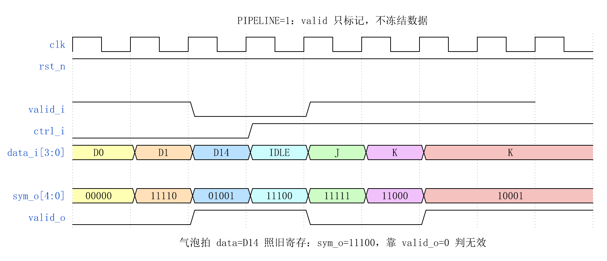
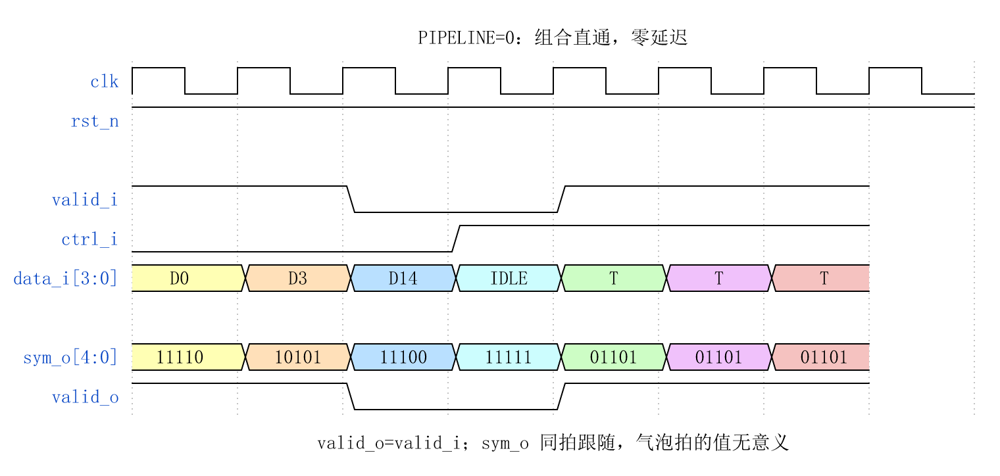
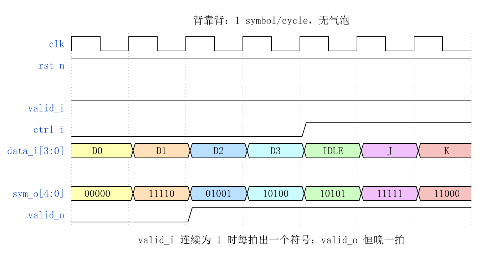
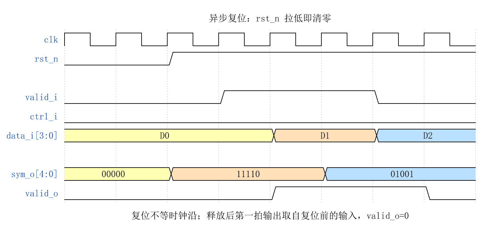

# CBB_4B5B_ENC_UG

---

## 目录

- [1. 功能及应用场景](#1-功能及应用场景)
- [2. 规格](#2-规格)
- [3. 方案分析](#3-方案分析)
- [4. 配置参数](#4-配置参数)
- [5. 接口](#5-接口)
- [6. 时序图](#6-时序图)
- [7. PPA](#7-ppa)

---

## 1. 功能及应用场景

### 1.1 核心功能

`cbb_4b5b_enc` 是 4b/5b 线路编码模块族中的**编码器**，完成以下核心变换：

```
4-bit 数据 + 1-bit 控制标识  ──▶  5-bit 线路符号
```

编码后的 5-bit 符号保证每码字**至少两次电平跳变**，为接收端 CDR (Clock and Data Recovery) 提供足够的跳变密度，是 NRZI / MLT-3 等物理层线路编码的前置编码级。

### 1.2 在模块族中的位置

```
cbb_coding 模块族
├── 编码器 (enc)
│   ├── cbb_4b5b_enc     ← 本文档覆盖的模块
│   └── cbb_8b10b_enc
├── 解码器 (dec)
│   ├── cbb_4b5b_dec
│   └── cbb_8b10b_dec
└── 平衡预测器 (unbal)
    ├── cbb_4b5b_unbal
    └── cbb_8b10b_unbal
```

### 1.3 适用场景

| 场景 | 说明 |
|------|------|
| 100BASE-TX 以太网 PHY | 4b/5b + NRZI + MLT-3 三级编码链路的第一级 |
| USB 通信 | 配合 NRZI 线路编码使用 |
| FDDI (光纤分布式数据接口) | 原始的 4b/5b 编码标准来源 |
| 通用串行背板 | 需要 AC 耦合、时钟嵌入的串行链路 |

### 1.4 设计约束

- 本模块为**单符号接口**：每拍处理 1 个 4-bit 数据，输出 1 个 5-bit 符号。若 SoC 数据通路较宽（如 32-bit、64-bit），应在外部多次例化或通过 wrapper 组合。
- 本模块不支持反压 (ready)。需要反压的场景应在模块外部添加 FIFO。

---

## 2. 规格

每条规格以 DS 点编号标识，命名规则为 `DS.[IP_NAME].[TYPE][SPEC_ID]`，例如 `DS.CBB_4B5B_ENC.FUNC.001`。TYPE 按规格类型取值：`FUNC`（功能）、`PERF`（性能）、`INTF`（接口）、`CFG`（配置）。

**规格汇总表**：将所有 DS 点逐条列入下表，按 TYPE 分组并依 `INTF`（接口）→ `CFG`（配置）→ `FUNC`（功能）→ `PERF`（性能）的顺序排列。表格共三列：DS 编号、类型、简述。表中每一行与下方一条详细规格分节（2.x）一一对应，并保持相同顺序。

| DS 编号 | 类型 | 简述 |
|---------|:---:|------|
| `DS.CBB_4B5B_ENC.INTF.001` | INTF | Valid 握手协议（valid-only，无反压） |
| `DS.CBB_4B5B_ENC.CFG.001` | CFG | 输出流水线级数可配（0/1） |
| `DS.CBB_4B5B_ENC.FUNC.001` | FUNC | 4b/5b 数据编码（4-bit 数据 → 5-bit 符号） |
| `DS.CBB_4B5B_ENC.FUNC.002` | FUNC | 控制码编码（控制码类型 → 5-bit 控制符号） |
| `DS.CBB_4B5B_ENC.FUNC.003` | FUNC | 跳变密度保证（每符号 ≥2 次 NRZI 跳变） |
| `DS.CBB_4B5B_ENC.PERF.001` | PERF | 吞吐率 1 symbol/cycle |

> 规格明细分节 (2.x) 应保持与汇总表相同的排序：INTF → CFG → FUNC → PERF。

### 2.1 Valid 握手协议 — DS.CBB_4B5B_ENC.INTF.001

- `valid_i = 1` 时，`data_i` 和 `ctrl_i` 被采样
- `valid_i = 0` 时本拍为气泡：输出寄存器无使能，`sym_o` 仍随输入更新，仅 `valid_o` 拉低标记该拍无效（消费方须以 `valid_o` 限定）
- `valid_o` 是 `valid_i` 经 `PIPELINE` 级寄存后的精确副本
- `valid_o = 1` 时，`sym_o` 上的数据有效

### 2.2 流水线配置 — DS.CBB_4B5B_ENC.CFG.001

通过 parameter `PIPELINE` 配置输出寄存器级数：

| PIPELINE | 模式 | 延迟 | 说明 |
|:---:|------|:---:|------|
| 0 | 纯组合逻辑 | 0 cycle | 输入到输出为组合路径，`clk`/`rst_n` 端口保留但不参与逻辑 |
| 1 | 一级流水 (默认) | 1 cycle | 输出经一级寄存器寄存，适配大多数场景 |

### 2.3 4b/5b 数据编码 — DS.CBB_4B5B_ENC.FUNC.001

当 `ctrl_i = 0` 时，模块将 4-bit 输入数据 `data_i[3:0]` 按 4b/5b 编码表映射为 5-bit 符号 `sym_o[4:0]`。

- 支持全部 16 种数据码字 (0x0 ~ 0xF)
- 每个 5-bit 符号至少包含 2 次电平跳变
- 编码表保证 DC 平衡（每符号中 '1' 的个数为 2~3，即不平衡度为 ±1）

### 2.4 控制码编码 — DS.CBB_4B5B_ENC.FUNC.002

当 `ctrl_i = 1` 时，模块将 `data_i` 的低位解释为控制码类型选择，按控制码编码表映射为 5-bit 控制符号。

- 最多支持 16 种控制码 (`data_i[3:0]` 全范围可选)
- 标准 4b/5b 控制码至少包括：IDLE、SSD (J/K)、ESD (T/R)、HALT
- 未定义的控制码索引产生预定义的 5-bit 输出（不出错，错误检测由解码器负责）

### 2.5 跳变密度保证 (NRZI) — DS.CBB_4B5B_ENC.FUNC.003

每个有效**数据码**的编码符号中 '1' 的个数 ≥ 2（范围 2~4），确保后级 NRZI 编码后每符号至少产生 2 次电平翻转，为接收端 CDR 提供充足跳变密度。

- 即使数据侧连续发送全 0 或全 1，线路侧也不会出现长期无跳变的直流漂移
- **注意**：控制码中 IDLE (11111)、J (11000)、Q (00000) 等符号的 '1' 个数或比特跳变数不满足数据码的 ≥2 约束——这些符号具有特定的协议语义（IDLE 连续发送时 NRZI 产生持续翻转；Q 表示链路静默），其跳变特性由协议层自行管理

### 2.6 吞吐率 — DS.CBB_4B5B_ENC.PERF.001

- 最大吞吐率：**1 symbol/cycle**，支持背靠背 (back-to-back) 无气泡连续传输
- 输入到输出的延迟 = `PIPELINE` 个时钟周期

---

## 3. 方案分析

### 3.1 4b/5b 编码原理

#### 3.1.1 为什么需要 4b/5b 编码

基带串行传输中，接收端需要从数据流中恢复时钟。若连续出现长串的 0 或 1，接收端 PLL/DLL 会因缺少跳变而漂移，导致 bit 错误。4b/5b 编码通过将 4-bit 数据映射到精心选择的 5-bit 码字，保证：

1. **跳变密度**：每 5-bit 码字至少 2 次跳变
2. **DC 平衡**：每码字 '1' 的个数接近 2.5（实际为 2 或 3），减小直流分量
3. **控制信道**：利用 5-bit 空间中数据码未占用的码点承载链路控制信息

#### 3.1.2 码空间分析

4b/5b 编码的码空间：

```
5-bit 总码点数: 2^5 = 32
├── 数据码 (D 码): 16 个  (映射 0x0~0xF)
├── 控制码 (K 码): 6~8 个 (IDLE, J, K, T, R, H 等)
└── 非法码字:      8~10 个 (含全 0、全 1 等跳变不足的码点)
```

码字选择准则：
- **跳变 ≥ 2**：排除 00000 (0 跳变)、11111 (0 跳变)、10000/01000/00100/00010/00001 (1 跳变) 等
- **DC 平衡**：优选 '1' 个数为 2 或 3 的码点（即不平衡度 |#1 - #0| ≤ 1）

满足"至少 2 次跳变"的 5-bit 码点共 22 个（排除 0 次和 1 次比特翻转的码点：全 0/全 1 为 0 次，以及仅 1 次比特翻转的 8 个码点），其中 16 个分配给数据码，剩余 6 个分配给标准控制码。

#### 3.1.3 标准 4b/5b 编码表 (100BASE-TX / FDDI)

**数据码 (Dx)**：

| data_i[3:0] | 码名 | sym_o[4:0] | '1' 个数 (NRZI跳变数) |
|:---:|:---:|:---:|:---:|
| 0000 | D0  | 11110 | 4 |
| 0001 | D1  | 01001 | 2 |
| 0010 | D2  | 10100 | 2 |
| 0011 | D3  | 10101 | 3 |
| 0100 | D4  | 01010 | 2 |
| 0101 | D5  | 01011 | 3 |
| 0110 | D6  | 01110 | 3 |
| 0111 | D7  | 01111 | 4 |
| 1000 | D8  | 10010 | 2 |
| 1001 | D9  | 10011 | 3 |
| 1010 | D10 | 10110 | 3 |
| 1011 | D11 | 10111 | 4 |
| 1100 | D12 | 11010 | 3 |
| 1101 | D13 | 11011 | 4 |
| 1110 | D14 | 11100 | 3 |
| 1111 | D15 | 11101 | 4 |

> **关于跳变密度**：4b/5b 编码后通常串接 NRZI 线路编码。NRZI 遇 '1' 翻转、遇 '0' 保持，因此物理信号的电平翻转次数 = 码字中 **'1' 的个数**（而非 5-bit 内部的比特翻转次数）。16 个数据码每个至少包含 2 个 '1'（范围 2~4），保证每符号至少 2 次 NRZI 电平翻转，为接收端 CDR 提供充足跳变密度。

**控制码 (Kx)**：

| ctrl_i=1 时 data_i[3:0] | 码名 | sym_o[4:0] | 用途 |
|:---:|:---:|:---:|------|
| 0000 | I (IDLE) | 11111 | 链路空闲填充 |
| 0001 | J (SSD1) | 11000 | 帧起始定界符第 1 符号 |
| 0010 | K (SSD2) | 10001 | 帧起始定界符第 2 符号 |
| 0011 | T (ESD1) | 01101 | 帧结束定界符第 1 符号 |
| 0100 | R (ESD2) | 00111 | 帧结束定界符第 2 符号 |
| 0101 | H (HALT) | 00100 | 链路暂停 |
| 0110 | Q (QUIET) | 00000 | 静默 (无传输) |
| 0111 ~ 1111 | RSVD | — | 保留 / 用户自定义 |

> **注意**：表中控制码 I (11111) 和 Q (00000) 为 0 跳变码字，属特殊情况——IDLE 用作连续填充时，在 NRZI 级会转化为连续的跳变；QUIET 表示链路无信号。具体控制码映射可根据应用需求定制，以上为 100BASE-TX 标准映射，供参考。

### 3.2 主流编码方案对比

| 编码方案 | 效率 | 跳变保证 | DC 平衡 | 复杂度 | 典型应用 |
|------|:---:|:---:|:---:|:---:|------|
| NRZ (无编码) | 100% | 无保证 | 差 | 最低 | 并行总线 |
| Manchester | 50% | 每 bit 至少 1 次 | 完美 | 低 | 10BASE-T |
| **4b/5b** | **80%** | **每符号 ≥2 次** | **良好 (±1)** | **低** | **100BASE-TX, FDDI** |
| 8b/10b | 80% | 每符号 ≥3 次 | 完美 (RD 控制) | 中 | PCIe, SATA, USB 3.x |
| 64b/66b | 97% | 统计保证 | 统计平衡 | 高 | 10GbE+ |
| 128b/130b | 98.5% | 统计保证 | 统计平衡 | 高 | PCIe 3.0+ |

**选用 4b/5b 的理由**：
1. 在 100 Mbps 级速率下，80% 效率的开销（125 Mbaud 线路速率）在可接受范围内
2. 实现简单——一张 32-entry 查找表即可完成，无需 RD 状态机（对比 8b/10b）
3. 与 NRZI/MLT-3 配合成熟，已在 100BASE-TX 大规模部署验证

### 3.3 设计方案

#### 3.3.1 整体架构

```
                   ┌──────────────────────────┐
                   │    cbb_4b5b_enc           │
                   │                          │
  data_i[3:0] ────▶│                          │
  ctrl_i ─────────▶│  ┌──────────────────┐    │
  valid_i ────────▶│  │  4b/5b 编码表    │    │────▶ sym_o[4:0]
                   │  │  (32-entry LUT)  │    │
                   │  │  ┌─────────────┐ │    │
                   │  │  │ 数据码表    │ │    │
                   │  │  │ (16 entries)│ │    │
                   │  │  ├─────────────┤ │    │
                   │  │  │ 控制码表    │ │    │
                   │  │  │ (16 entries)│ │    │
                   │  │  └─────────────┘ │    │
                   │  └────────┬─────────┘    │
                   │           │              │
                   │     ┌─────▼──────┐       │
                   │     │  PIPELINE  │       │────▶ valid_o
                   │     │  寄存器    │       │
                   │     └────────────┘       │
                   └──────────────────────────┘
```

#### 3.3.2 核心实现步骤

**Step 1 — 地址生成**：
将 `{ctrl_i, data_i[3:0]}` 拼接为 5-bit LUT 地址：
```
lut_addr[4:0] = {ctrl_i, data_i[3:0]}
```
- `lut_addr[4] = 0` → 访问数据码表 (16 entries)
- `lut_addr[4] = 1` → 访问控制码表 (16 entries)

**Step 2 — 查表编码**：
32-entry LUT，每 entry 5-bit，直接输出 `sym_o[4:0]`。该 LUT 综合为 32×5 的 ROM 或 5 个 5 输入 LUT (取决于综合工具优化策略)。

**Step 3 — 流水线寄存 (PIPELINE=1 时)**：
编码结果和 `valid_i` 经一级寄存器输出：
```verilog
always @(posedge clk or negedge rst_n) begin
    if (!rst_n) begin
        sym_o   <= 5'd0;
        valid_o <= 1'd0;
    end else begin
        sym_o   <= lut[addr];
        valid_o <= valid_i;
    end
end
```

PIPELINE=0 时，上述寄存器被旁路，编码结果组合输出：
```verilog
assign sym_o   = lut[addr];
assign valid_o = valid_i;
```

#### 3.3.3 设计要点

- **无状态机**：4b/5b 编码器是纯组合查表操作（+ 可选输出寄存），不维护 Running Disparity 等内部状态。复位仅清零输出寄存器。
- **单符号接口**：每个时钟周期处理独立的一笔 4-bit 数据，编码器对前后数据无依赖。这保证了背靠背吞吐率 1 symbol/cycle。
- **跨 PIPELINE 兼容**：PIPELINE=0 和 PIPELINE=1 的例化端口完全一致（`clk`/`rst_n` 在 PIPE=0 时保留但不使用），上层可无痛切换。

---

## 4. 配置参数

| 参数 | 类型 | 默认值 | 范围 | 描述 |
|------|------|:---:|:---:|------|
| `PIPELINE` | int | 1 | 0, 1 | 输出流水线级数。0 = 纯组合输出；1 = 一级寄存器输出 |

### 4.1 PIPELINE 配置指南

| PIPELINE | 适用场景 | 优势 | 劣势 |
|:---:|------|------|------|
| 0 | 编码器嵌入在更大组合逻辑云中；或需要零周期延迟的特殊场景 | 零延迟，无时钟域依赖 | 组合路径延迟大，可能成为关键路径 |
| 1 (默认) | 绝大多数标准应用场景 | 改善时序收敛，输出稳定可预测 | 增加 1 周期延迟 |

**推荐**：新设计默认使用 PIPELINE=1，仅在满足以下两个条件时使用 PIPELINE=0：
1. 外部已有时序寄存器，编码组合逻辑不构成关键路径
2. 零延迟有明确的协议/系统层面约束

---

## 5. 接口

### 5.1 信号清单

| 信号名 | 位宽 | I/O | 时钟域 | 描述 |
|--------|:---:|:---:|:---:|------|
| `clk` | 1 | I | `clk` | 系统时钟，所有寄存器在上升沿触发。PIPELINE=0 时端口存在但不使用 |
| `rst_n` | 1 | I | — | 异步复位，低有效。复位后 `sym_o` 清零、`valid_o` 清零。PIPELINE=0 时端口存在但不使用 |
| `data_i` | 4 | I | `clk` | 待编码的 4-bit 原始数据。`ctrl_i=0` 时作为数据码索引查表；`ctrl_i=1` 时低位作为控制码类型选择 |
| `ctrl_i` | 1 | I | `clk` | 控制码标识：0 = 数据码 (D 码)，1 = 控制码 (K 码) |
| `valid_i` | 1 | I | `clk` | 输入有效指示。`valid_i=1` 时 `data_i` 和 `ctrl_i` 被采样 |
| `sym_o` | 5 | O | `clk` | 编码后的 5-bit 线路符号。当 PIPELINE=1 时为寄存器输出；PIPELINE=0 时为组合输出 |
| `valid_o` | 1 | O | `clk` | 输出有效指示。`valid_o=1` 时 `sym_o` 上的数据有效。延迟 = PIPELINE 个周期 |

### 5.2 信号详细说明

#### data_i[3:0]

| ctrl_i | data_i[3:0] | 含义 |
|:---:|:---:|------|
| 0 | 0x0 ~ 0xF | 16 个数据码字 (D0~D15)，按编码表映射 |
| 1 | 0x0 ~ 0xF | 控制码类型选择，按控制码编码表映射 |

实际有效使用的控制码数量取决于应用场景（典型为 6~8 个），未使用的控制码索引在编码器中仍产生 5-bit 输出，其合法性由对端解码器判定。

#### ctrl_i

- `ctrl_i = 0`：本拍输入为普通数据负载
- `ctrl_i = 1`：本拍输入为链路控制信息（帧定界、空闲、暂停等）

ctrl_i 与 data_i 在同一 `valid_i` 窗口内采样，必须保持对齐。

#### sym_o[4:0]

5-bit 编码符号，位序约定：`sym_o[4]` 为 MSB（最先发送/最高位），`sym_o[0]` 为 LSB（最后发送/最低位）。

---

## 6. 时序图

### 6.1 基本传输 (PIPELINE = 1, 默认配置)



- T0 时刻：`valid_i=1`，`data_i=D0`，`ctrl_i=0`（数据码），输入被采样
- T1 时刻：`valid_o=1`，`sym_o=S(D0)`，编码结果输出（延迟 1 拍）
- T1~T2：`valid_i=0`，本拍为气泡，`sym_o` 仍随输入更新，但 `valid_o=0`，该拍数据无效
- T2~T4：背靠背有效数据 D1/D2/D3 连续输入
- T3：D2 为数据码 (ctrl=0)，D3 为控制码 (ctrl=1)，均在 1 拍后对应输出

### 6.2 PIPELINE = 0 (组合逻辑模式)



- `valid_o` = `valid_i`（直通，无延迟）
- `sym_o` = `lut[{ctrl_i, data_i}]`（组合逻辑，同周期输出）
- 虚线表示组合路径传播延迟（远小于时钟周期，不构成时序违规即可）

### 6.3 背靠背连续传输 (PIPELINE = 1)



- 当 `valid_i` 连续为 1 时，编码器每个周期接收一个 4-bit 数据并输出一个 5-bit 符号
- 吞吐率 = 1 symbol/cycle，流水线满载无气泡
- `valid_o` 始终比 `valid_i` 延迟 1 拍（PIPELINE=1 时），为持续高电平

### 6.4 复位时序



- `rst_n = 0` 期间：`sym_o` 和 `valid_o` 强制清零（异步复位，不依赖 `clk`）
- `rst_n` 释放（上升沿）后：模块在第一个 `clk` 上升沿开始正常工作
- 复位释放后第一个有效输入在 PIPELINE 拍后正常输出

---

## 7. PPA

> 综合条件：TSMC 12nm FinFET CLL (tcbn12ffcll)，SS 0.9V 125°C，Design Compiler W-2024.09-SP3。

### 7.1 配置 A：PIPELINE = 1（默认，一级寄存器输出）

**参数设置：**

| 参数 | 设置值 | 说明 |
|------|:---:|------|
| `PIPELINE` | 1 | 一级寄存器输出，标准配置 |

**PPA 数据：**

| 项目 | 实测值 |
|------|:------:|
| 频率 | 1 GHz (slack +0.87 ns) |
| 面积 | 9.35 µm² (26 cells: 20 comb + 6 seq) |
| 功耗 | 23.74 µW 动态 + 47.69 nW 漏电 |

### 7.2 配置 B：PIPELINE = 0（纯组合逻辑）

**参数设置：**

| 参数 | 设置值 | 说明 |
|------|:---:|------|
| `PIPELINE` | 0 | 纯组合输出，无寄存器 |

**PPA 数据：**

| 项目 | 实测值 |
|------|:------:|
| 频率 | 1 GHz (slack +0.85 ns) |
| 面积 | 3.55 µm² (20 cells: 20 comb + 0 seq) |
| 功耗 | 23.74 µW 动态 + 47.69 nW 漏电 |

### 7.3 时序说明

**PIPELINE = 1 (默认)**：
- 输入侧：`data_i`、`ctrl_i`、`valid_i` 为组合逻辑输入，不直接驱动寄存器（编码表 LUT 为组合云，输出侧有寄存器截断）
- 输出侧：`sym_o`、`valid_o` 为寄存器输出，clk→Q 延迟即为模块输出延迟
- 外部逻辑在模块输入侧的组合级数不构成级联累加
- 在 1 GHz 目标频率下，setup slack 为 +0.87 ns，时序余量充裕

**PIPELINE = 0**：
- 所有输出为组合逻辑，输入→输出路径 = 5-input LUT 查表延迟
- 在 1 GHz 目标频率下仍满足时序（slack +0.87 ns），组合延迟远小于时钟周期
- 外部需确保编码器所在组合路径满足其时序约束

---

## 附录 A: 跨模块互联参考

### A.1 enc → dec 直连（自环测试）

```
  ┌──────────────┐         ┌──────────────┐
  │ cbb_4b5b_enc │  sym_o  │ cbb_4b5b_dec │
  │              ├────────▶│              │
  │       valid_o├────────▶│valid_i       │
  └──────────────┘         └──────────────┘
```

- `enc.sym_o[4:0]` → `dec.sym_i[4:0]`（位宽自然匹配）
- `enc.valid_o` → `dec.valid_i`
- 往返延迟 = `PIPELINE_enc + PIPELINE_dec` 周期
- 可用于 BIST 或链路训练

### A.2 unbal → enc 预判通路

```
  ┌──────────────┐
  │cbb_4b5b_unbal├──▶ bal_o ──▶ 调度器 (均衡决策)
  └──────┬───────┘
         │ data_i (扇出同源)
  ┌──────┴───────┐
  │ cbb_4b5b_enc ├──▶ sym_o ──▶ 串行发送链路
  └──────────────┘
```

平衡预测器提前输出编码后的跳变/平衡信息，供上层调度器在数据进入编码器之前做出预加重或加扰决策。

---
