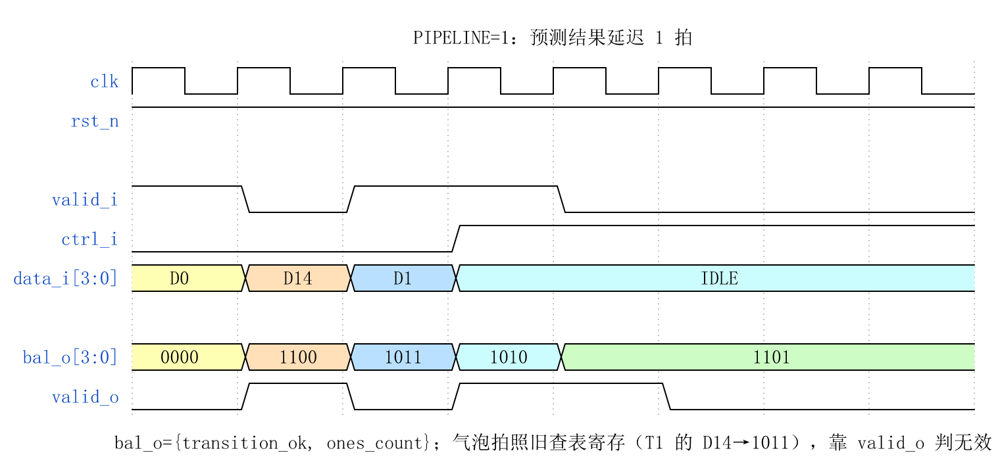
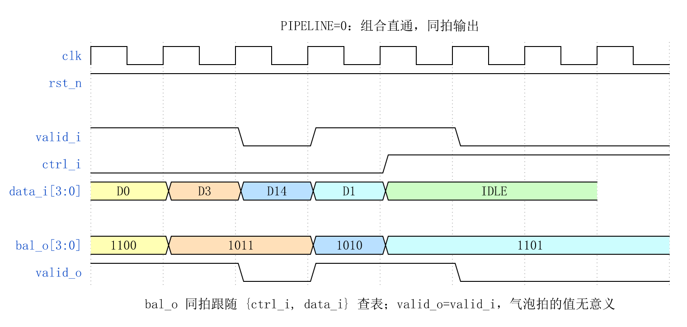
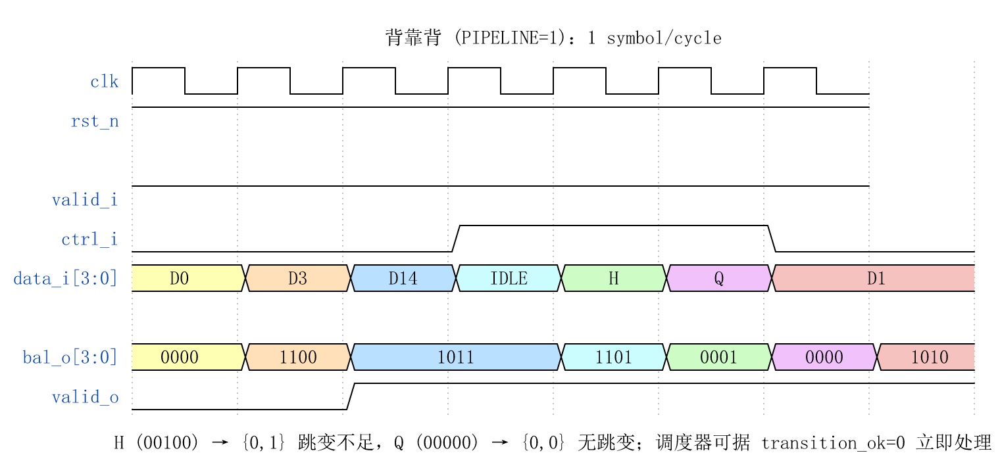
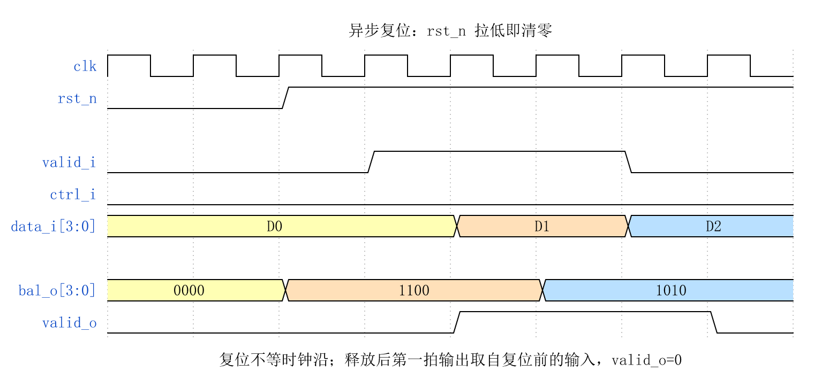

# CBB_4B5B_UNBAL_UG

---

## 目录

- [1. 功能及应用场景](#1-功能及应用场景)
- [2. 规格](#2-规格)
- [3. 方案分析](#3-方案分析)
- [4. 配置参数](#4-配置参数)
- [5. 接口](#5-接口)
- [6. 时序图](#6-时序图)
- [7. PPA](#7-ppa)

---

## 1. 功能及应用场景

### 1.1 核心功能

`cbb_4b5b_unbal` 是 4b/5b 线路编码模块族中的**平衡预测器 (unbal)**，在数据实际编码**之前**预测编码后 5-bit 符号的 DC 平衡与跳变密度特性：

```
4-bit 数据 + 1-bit 控制标识  ──▶  平衡信息 (ones 计数 + 跳变达标标志)
```

预测结果供上游调度器在数据送入编码器之前做出**预加重、加扰或均衡决策**，无需等待实际编码完成即可提前感知线路侧的传输质量特征。

### 1.2 在模块族中的位置

```
cbb_coding 模块族
├── 编码器 (enc)
│   ├── cbb_4b5b_enc     — 4-bit → 5-bit 编码
│   └── cbb_8b10b_enc    — 8-bit → 10-bit 编码 + RD 状态机
├── 解码器 (dec)
│   ├── cbb_4b5b_dec     — 5-bit → 4-bit 解码 + 非法检测
│   └── cbb_8b10b_dec    — 10-bit → 8-bit 解码 + RD 校验
└── 平衡预测器 (unbal)
    ├── cbb_4b5b_unbal   ← 本文档覆盖的模块
    └── cbb_8b10b_unbal  — 8b/10b RD 预判
```

| 类型 | 核心变换 | 特有信号 | 独有职责 |
|:---:|------|------|------|
| enc | data → sym | `sym_o` | 编码 + DC 平衡 (8b/10b 含 RD 状态机) |
| dec | sym → data | `sym_i`, `err_o` | 解码 + 错误检测 |
| **unbal** | **data → metadata** | **`bal_o`** | **预分析，不产生编码输出** |

### 1.3 适用场景

| 场景 | 说明 |
|------|------|
| 链路均衡控制 | 根据预测的 ones 计数提前调整发送端均衡器参数 (去加重幅度、预加重 tap 系数) |
| 预加重决策 | 当预测跳变密度不足时，上层可决定插入额外跳变或启用加扰器 |
| 加扰旁路判断 | 若连续多个符号预测 ones 计数偏低 (DC 不平衡)，提前启动加扰或插入填充码 |
| 链路质量预评估 | 在 BIST/训练阶段，预测器提供逐符号的 DC 平衡统计，辅助链路训练状态机决策 |
| 编码器前端调度 | 与 `cbb_4b5b_enc` 共享输入总线 (扇出同源)，预测器比编码器提前输出平衡信息供调度 |

### 1.4 设计约束

- 本模块为**单符号接口**：每拍处理 1 个 4-bit 数据，输出 1 组 4-bit 平衡信息。若 SoC 数据通路较宽 (如 32-bit、64-bit)，应在外部多次例化或通过 wrapper 组合。
- 本模块不支持反压 (ready)。需要反压的场景应在模块外部添加 FIFO。
- 本模块**不包含 RD (Running Disparity) 状态机**，这是 4b/5b 编码族的固有属性——仅 8b/10b 模块族维护 RD 状态。因此本模块无 `RD_EXT` 参数和 `rd_o` 端口。

---

## 2. 规格

每条规格以 DS 点编号标识，命名规则为 `DS.[IP_NAME].[TYPE][SPEC_ID]`。TYPE 按规格类型取值：`FUNC`（功能）、`PERF`（性能）、`INTF`（接口）、`CFG`（配置）。

**规格汇总表**：将所有 DS 点逐条列入下表，按 TYPE 分组并依 `INTF`（接口）→ `CFG`（配置）→ `FUNC`（功能）→ `PERF`（性能）的顺序排列。表格共三列：DS 编号、类型、简述。表中每一行与下方一条详细规格分节（2.x）一一对应，并保持相同顺序。

| DS 编号 | 类型 | 简述 |
|---------|:---:|------|
| `DS.4B5B_UNBAL.INTF.001` | INTF | Valid 握手协议（valid-only，无反压） |
| `DS.4B5B_UNBAL.INTF.002` | INTF | `bal_o` 输出编码格式 |
| `DS.4B5B_UNBAL.CFG.001` | CFG | 流水线级数可选（0/1） |
| `DS.4B5B_UNBAL.FUNC.001` | FUNC | 编码后 ones 计数预测 |
| `DS.4B5B_UNBAL.FUNC.002` | FUNC | 跳变密度达标预判 |
| `DS.4B5B_UNBAL.FUNC.003` | FUNC | 控制码平衡特性预测 |
| `DS.4B5B_UNBAL.PERF.001` | PERF | 吞吐率 1 symbol/cycle |

> 规格明细分节 (2.x) 应保持与汇总表相同的排序：INTF → CFG → FUNC → PERF。

### 2.1 Valid 握手协议 — DS.4B5B_UNBAL.INTF.001

- `valid_i = 1` 时，`data_i` 和 `ctrl_i` 被采样
- `valid_i = 0` 时本拍为气泡：`bal_o` 仍随输入更新，`valid_o` 拉低标记该拍无效
- `valid_o` 是 `valid_i` 经 `PIPELINE` 级寄存后的精确副本
- `valid_o = 1` 时，`bal_o` 上的平衡信息有效

### 2.2 bal_o 输出编码格式 — DS.4B5B_UNBAL.INTF.002

```
bal_o[3:0] = {transition_ok, ones_count[2:0]}
```

| 位域 | 位宽 | 位置 | 描述 |
|------|:---:|:---:|------|
| `transition_ok` | 1 | `bal_o[3]` | 跳变密度达标标志：1 = ones ≥ 2 (满足 CDR 最低跳变要求) |
| `ones_count` | 3 | `bal_o[2:0]` | 编码后 5-bit 符号中 '1' 的个数，范围 0~5 |

### 2.3 流水线级数可选 — DS.4B5B_UNBAL.CFG.001

通过 parameter `PIPELINE` 配置输出寄存器级数：

| PIPELINE | 模式 | 延迟 | 说明 |
|:---:|------|:---:|------|
| 0 | 纯组合逻辑 | 0 cycle | 输入到输出为组合路径，`clk`/`rst_n` 端口保留但不参与逻辑 |
| 1 | 一级流水 (默认) | 1 cycle | 输出经一级寄存器寄存，适配大多数场景 |

### 2.4 编码后 ones 计数预测 — DS.4B5B_UNBAL.FUNC.001

模块接收 4-bit 数据与 1-bit 控制标识，通过查表方式预测该数据经 `cbb_4b5b_enc` 编码后 5-bit 符号中 '1' 的个数：

- `ones_count[2:0]` 输出范围 0~5 (3-bit 无符号数)
- 数据码 (`ctrl_i=0`)：ones 计数范围为 2~4 (标准 4b/5b 数据码保证 2~4 个 '1')
- 控制码 (`ctrl_i=1`)：ones 计数范围为 0~5 (控制码包括全 1 (IDLE) 到单 1 (HALT) 到全 0 (QUIET))
- 预测结果与 `cbb_4b5b_enc` 实际编码输出的 ones 计数严格一致

> **原理**：4b/5b 编码后接 NRZI 线路编码，NRZI 遇 '1' 翻转、遇 '0' 保持。因此物理信号的电平跳变次数 = 5-bit 符号中 '1' 的个数。`ones_count` 直接反映该符号的 NRZI 跳变次数，是衡量 DC 平衡与跳变密度的核心指标。

### 2.5 跳变密度达标预判 — DS.4B5B_UNBAL.FUNC.002

模块输出 `transition_ok` 标志，指示编码后符号是否满足最小跳变密度要求：

- `transition_ok = 1`：编码后符号中 '1' 的个数 ≥ 2，NRZI 跳变次数满足 CDR 锁定时钟的最低要求
- `transition_ok = 0`：编码后符号中 '1' 的个数 < 2，NRZI 跳变次数不足 (仅 QUIET、HALT 等特殊控制码可能出现)
- 所有 16 个标准数据码均满足 `transition_ok = 1`
- 上层可依据此标志触发链路异常处理 (如检测到连续 `transition_ok = 0` 时判定链路静默或挂起)

### 2.6 控制码平衡特性预测 — DS.4B5B_UNBAL.FUNC.003

当 `ctrl_i = 1` 时，模块按控制码编码表预测对应 5-bit 控制符号的平衡特性：

- 不同控制码的 ones 计数和跳变达标情况差异显著 (IDLE=5, HALT=1, QUIET=0)
- `ctrl_i = 1` 时 `data_i[3:0]` 作为控制码类型选择，标准控制码索引 0~6 (IDLE/J/K/T/R/H/Q) 产生与编码器一致的独立预测值；索引 7~15 为保留码点，编码器统一映射为 5'b00000，预测器对应输出 ones_count=0, transition_ok=0
- 控制码中未使用的保留码点也产生确定的预测输出 (不出错)，合法性判定由对端解码器负责

### 2.7 吞吐率 — DS.4B5B_UNBAL.PERF.001

- 最大吞吐率：**1 symbol/cycle**，支持背靠背 (back-to-back) 无气泡连续传输
- 输入到输出的延迟 = `PIPELINE` 个时钟周期
- 流水线填充后每个时钟周期输出一组平衡预测结果

---

## 3. 方案分析

方案分析先做原理分析，说明功能的几种主流实现方法，对比优劣后确定本设计选用方法并详解其核心原理；再讲设计方案，结合原理图分点阐述基于选定原理的具体实现步骤，明确核心操作与特殊功能执行方式，可附典型场景示例辅助说明。

### 3.1 原理分析

#### 3.1.1 为什么需要平衡预测

4b/5b 编码后的 NRZI 物理信号质量直接影响接收端 CDR (Clock and Data Recovery) 的锁定时钟能力。核心关切的传输质量指标：

1. **DC 平衡 (ones 计数)**：5-bit 符号中 '1' 的个数决定了 NRZI 波形中高电平的占比。理想情况下每个符号有 2~3 个 '1' (DC 不平衡度 ≤ ±1)，连续多个 4 个 '1' 或 1 个 '1' 的符号会导致基线漂移 (baseline wander)。
2. **跳变密度 (transition_ok)**：NRZI 每次遇 '1' 翻转电平，'1' 的个数即跳变次数。CDR 需要至少 2 次跳变/符号来维持锁相环的相位锁定——跳变不足的符号 (如 HALT=00100，仅 1 次跳变) 若连续出现将导致时钟漂移。
3. **预判价值**：若调度器在数据进入编码器**之前**就能预知编码后的平衡特性，即可提前采取措施 (预加重、加扰、替换码字等)，而不必等待编码器输出后再做反馈——这是典型的**前馈预判 (feed-forward prediction)** 架构。

#### 3.1.2 4b/5b 编码后 ones 计数的码表分析

平衡预测器与编码器共享同一套 4b/5b 编码码表，但 ROM 中存储的是预计算的平衡元数据而非编码符号本身。

**数据码 ones 计数速查**：

| data_i[3:0] | 码名 | sym_o[4:0] (编码器输出) | ones 数 | transition_ok |
|:---:|:---:|:---:|:---:|:---:|
| 0000 | D0  | 11110 | 4 | 1 |
| 0001 | D1  | 01001 | 2 | 1 |
| 0010 | D2  | 10100 | 2 | 1 |
| 0011 | D3  | 10101 | 3 | 1 |
| 0100 | D4  | 01010 | 2 | 1 |
| 0101 | D5  | 01011 | 3 | 1 |
| 0110 | D6  | 01110 | 3 | 1 |
| 0111 | D7  | 01111 | 4 | 1 |
| 1000 | D8  | 10010 | 2 | 1 |
| 1001 | D9  | 10011 | 3 | 1 |
| 1010 | D10 | 10110 | 3 | 1 |
| 1011 | D11 | 10111 | 4 | 1 |
| 1100 | D12 | 11010 | 3 | 1 |
| 1101 | D13 | 11011 | 4 | 1 |
| 1110 | D14 | 11100 | 3 | 1 |
| 1111 | D15 | 11101 | 4 | 1 |

> 数据码 ones 计数分布：2 个 '1' (4 个码字: D1/D2/D4/D8)、3 个 '1' (7 个码字: D3/D5/D6/D9/D10/D12/D14)、4 个 '1' (5 个码字: D0/D7/D11/D13/D15)。全部满足 `transition_ok = 1` (ones ≥ 2)。

**控制码 ones 计数速查**：

| ctrl_i=1 时 data_i[3:0] | 码名 | sym_o[4:0] | ones 数 | transition_ok |
|:---:|:---:|:---:|:---:|:---:|
| 0000 | I (IDLE) | 11111 | 5 | 1 |
| 0001 | J (SSD1) | 11000 | 2 | 1 |
| 0010 | K (SSD2) | 10001 | 2 | 1 |
| 0011 | T (ESD1) | 01101 | 3 | 1 |
| 0100 | R (ESD2) | 00111 | 3 | 1 |
| 0101 | H (HALT) | 00100 | 1 | 0 |
| 0110 | Q (QUIET) | 00000 | 0 | 0 |
| 0111~1111 | RSVD[7]~RSVD[15] | 00000 | 0 | 0 |

> 控制码的 ones 计数覆盖全范围 0~5。IDLE (11111, 5 ones) 为满跳变——在 NRZI 级每个 bit 都翻转，提供最强时钟分量；HALT (00100, 1 one) 和 QUIET (00000, 0 ones) 的跳变密度不达标，CDR 在遇到这些符号时需依赖历史锁定的相位维持。保留控制码 (data_i=7~15) 在编码器中统一映射为 sym_o=00000 (QUIET)，因此预测器同样输出 ones_count=0, transition_ok=0——这是确定值而非 "don't-care"，保证预测结果与编码器实际输出严格一致。

#### 3.1.3 预测方案对比

| 方案 | 实现方式 | 面积 (等效门) | 关键路径 | 灵活性 |
|------|------|:---:|:---:|:---:|
| **全编码 + 后分析** | 先例化完整 4b/5b 编码器 → 对 5-bit 输出用组合逻辑数 '1' | ~200 | 编码 LUT + 加法器 (popcount) 级联 | 低，浪费编码器面积 |
| **独立平衡 ROM (本设计)** | 32×4 ROM 直接存储 {transition_ok, ones_count} | ~80 | 1 级 ROM 读 | 中，ROM 内容编译期固定 |

**选型结论**：采用**独立平衡 ROM** 方案。理由：

1. **面积最优**：32×4 bit ROM 仅需约 80 等效门，远小于全编码器 + popcount 方案
2. **时序最优**：关键路径仅 1 级 ROM 读，无级联组合逻辑
3. **解耦独立**：预测器与编码器独立例化，可灵活选择是否部署预测器 (低功耗场景可省略)
4. **与编码器输入兼容**：共享 `data_i`/`ctrl_i` 总线，可作为编码器的扇出前端

### 3.2 设计方案

#### 3.2.1 整体架构

```
                   ┌──────────────────────────┐
                   │    cbb_4b5b_unbal         │
                   │                          │
  data_i[3:0] ────▶│                          │
  ctrl_i ─────────▶│  ┌──────────────────┐    │
  valid_i ────────▶│  │  平衡信息 ROM    │    │────▶ bal_o[3:0]
                   │  │  (32 × 4 bit)    │    │
                   │  │  ┌─────────────┐ │    │
                   │  │  │ 数据码预测  │ │    │
                   │  │  │ (16 entries)│ │    │
                   │  │  ├─────────────┤ │    │
                   │  │  │ 控制码预测  │ │    │
                   │  │  │ (16 entries)│ │    │
                   │  │  └─────────────┘ │    │
                   │  └────────┬─────────┘    │
                   │           │              │
                   │     ┌─────▼──────┐       │
                   │     │  PIPELINE  │       │────▶ valid_o
                   │     │  寄存器    │       │
                   │     └────────────┘       │
                   └──────────────────────────┘
```

模块核心是一个 32-entry × 4-bit 的平衡信息 ROM，与 `cbb_4b5b_enc` 的编码 ROM 共享相同的地址生成逻辑，但存储内容为预计算的平衡元数据。

#### 3.2.2 核心实现步骤

**Step 1 — 地址生成**：
将 `{ctrl_i, data_i[3:0]}` 拼接为 5-bit ROM 地址 (与编码器完全一致)：
```
rom_addr[4:0] = {ctrl_i, data_i[3:0]}
```
- `rom_addr[4] = 0` → 访问数据码预测表 (16 entries)
- `rom_addr[4] = 1` → 访问控制码预测表 (16 entries)

**Step 2 — ROM 查表**：
32×4 ROM 直接输出 `bal_o[3:0] = {transition_ok, ones_count[2:0]}`。该 ROM 在综合时映射为 4 个 5 输入 LUT (每个 LUT 负责 1 个输出 bit)，或由综合工具按面积/时序目标优化为最小 SOP 表达式。

**Step 3 — 流水线寄存 (PIPELINE=1 时)**：
平衡预测结果和 `valid_i` 经一级寄存器输出：
```verilog
always @(posedge clk or negedge rst_n) begin
    if (!rst_n) begin
        bal_o   <= 4'd0;
        valid_o <= 1'd0;
    end else begin
        bal_o   <= balance_rom[rom_addr];
        valid_o <= valid_i;
    end
end
```

PIPELINE=0 时，上述寄存器被旁路，预测结果组合输出：
```verilog
assign bal_o   = balance_rom[rom_addr];
assign valid_o = valid_i;
```

#### 3.2.3 设计要点

- **无状态机**：4b/5b 平衡预测器是纯组合查表操作 (+ 可选输出寄存)，不维护 Running Disparity 等内部状态。复位仅清零输出寄存器。这是 4b/5b 编码族与 8b/10b 编码族的关键差异——后者因 RD 状态机而具有跨符号状态依赖。
- **单符号接口**：每个时钟周期处理独立的一笔 4-bit 数据，预测器对前后数据无依赖，保证背靠背吞吐率 1 symbol/cycle。
- **与编码器 ROM 独立**：平衡 ROM 与编码 ROM 为两套独立的物理存储，各自针对不同优化目标——编码 ROM 以码表规范性为准，平衡 ROM 以面积最小化为准 (4-bit vs 5-bit 位宽)。
- **跨 PIPELINE 兼容**：PIPELINE=0 和 PIPELINE=1 的例化端口完全一致 (`clk`/`rst_n` 在 PIPE=0 时保留但不使用)，上层可无痛切换。

---

## 4. 配置参数

| 参数 | 配置范围 | 默认值 | 描述 |
|------|----------|:---:|------|
| `PIPELINE` | 0, 1 | 1 | 输出流水线级数。0 = 纯组合输出；1 = 一级寄存器输出 |

> **关于 `RD_EXT` 参数**：用于控制 Running Disparity 外部端口的暴露。4b/5b 编码不含 RD 状态机，故本模块及 4b/5b enc/dec 均无此参数。

### 4.1 PIPELINE 配置指南

| PIPELINE | 适用场景 | 优势 | 劣势 |
|:---:|------|------|------|
| 0 | 预测器嵌入在更大组合逻辑云中；或调度器需要同周期做出决策 | 零延迟，预测与决策同拍完成 | 组合路径延迟大，可能成为关键路径 |
| 1 (默认) | 绝大多数标准应用场景 | 改善时序收敛，输出稳定可预测 | 增加 1 周期预测延迟 |

**推荐**：新设计默认使用 PIPELINE=1。若调度器的预判决策逻辑已占用大部分时序裕量，使用 PIPELINE=1 将预测器的 ROM 读延迟与调度器的决策延迟隔离，避免组合路径级联。

---

## 5. 接口

### 5.1 信号清单

| 信号名 | 位宽 | I/O | 时钟域 | 描述 |
|--------|:---:|:---:|:---:|------|
| `clk` | 1 | I | `clk` | 系统时钟，所有寄存器在上升沿触发。PIPELINE=0 时端口存在但不使用 |
| `rst_n` | 1 | I | — | 异步复位，低有效。复位后 `bal_o` 清零、`valid_o` 清零。PIPELINE=0 时端口存在但不使用 |
| `data_i` | 4 | I | `clk` | 待分析的 4-bit 原始数据。`ctrl_i=0` 时作为数据码索引查表；`ctrl_i=1` 时低位作为控制码类型选择 |
| `ctrl_i` | 1 | I | `clk` | 控制码标识：0 = 数据码 (D 码)，1 = 控制码 (K 码)。与 `data_i` 在同一个 `valid_i` 窗口内对齐 |
| `valid_i` | 1 | I | `clk` | 输入有效指示。`valid_i=1` 时 `data_i` 和 `ctrl_i` 被采样 |
| `bal_o` | 4 | O | `clk` | 编码平衡信息：`{transition_ok, ones_count[2:0]}`。详见 §5.4 |
| `valid_o` | 1 | O | `clk` | 输出有效指示。`valid_o=1` 时 `bal_o` 上的数据有效。延迟 = PIPELINE 个周期 |

### 5.2 信号详细说明

#### data_i[3:0]

| ctrl_i | data_i[3:0] | 含义 |
|:---:|:---:|------|
| 0 | 0x0 ~ 0xF | 16 个数据码字 (D0~D15)，按编码表预测 ones 计数 (2~4) |
| 1 | 0x0 ~ 0xF | 控制码类型选择，按控制码编码表预测 ones 计数 (0~5) |

实际有效使用的控制码数量取决于应用场景 (典型为 6~8 个)。未使用的控制码索引在预测器中仍产生确定的 `bal_o` 输出值 (与对应编码符号的 ones 计数一致)，正确性判定由对端解码器负责。

#### ctrl_i

- `ctrl_i = 0`：本拍输入为普通数据负载。所有 16 个数据码 `transition_ok = 1`，`ones_count = 2~4`
- `ctrl_i = 1`：本拍输入为链路控制信息 (帧定界、空闲、暂停等)。控制码的 ones 计数覆盖 0~5 全范围，部分控制码 `transition_ok = 0`

ctrl_i 与 data_i 在同一 `valid_i` 窗口内采样，必须保持对齐。

#### bal_o[3:0]

4-bit 平衡预测信息，位序约定：`bal_o[3]` = transition_ok (MSB)，`bal_o[2:0]` = ones_count。这是模块的核心输出——调度器直接使用此信息做均衡/加扰决策，无需关心编码器内部码表细节。

### 5.4 bal_o 输出编码

| bal_o[3:0] | transition_ok | ones_count | 含义 | 典型码字示例 |
|:---:|:---:|:---:|------|------|
| 4'b1010 | 1 | 2 | 2 个 '1'，跳变密度达标 | D1/D2/D4/D8 (标准数据码) |
| 4'b1011 | 1 | 3 | 3 个 '1'，DC 平衡最优 | D3/D6/D10/D14 (理想平衡) |
| 4'b1100 | 1 | 4 | 4 个 '1'，轻微正偏 | D0/D7/D11/D15 |
| 4'b1101 | 1 | 5 | 5 个 '1'，满跳变 (IDLE) | IDLE |
| 4'b0001 | 0 | 1 | 1 个 '1'，跳变不足 (HALT) | HALT |
| 4'b0000 | 0 | 0 | 0 个 '1'，无跳变 (QUIET) | QUIET |

> **调度器使用建议**：`ones_count` 偏离中心值 2.5 越远，DC 不平衡越严重。`transition_ok = 0` 时调度器应优先处理——连续多个 `transition_ok = 0` 的符号意味着接收端 CDR 将丢失时钟锁定。

---

## 6. 时序图

### 6.1 基本传输 (PIPELINE = 1)



- T0 时刻：`valid_i=1`，`data_i=D0`，`ctrl_i=0` (数据码)，输入被采样
- T1 时刻：`valid_o=1`，`bal_o=B(D0)` = `{1, 3'd4}` = 4'b1100，预测 D0 编码后含 4 个 '1'，跳变达标
- T1~T2：`valid_i=0`，本拍为气泡，`bal_o` 仍随输入更新但 `valid_o=0`，该拍数据无效
- T3 时刻：`ctrl_i=1` (D3 为控制码)，预测结果反映对应控制符号的平衡特性

### 6.2 PIPELINE = 0 (组合逻辑模式)



- `valid_o` = `valid_i` (直通，无延迟)
- `bal_o` = `balance_rom[{ctrl_i, data_i}]` (组合逻辑，同周期输出)
- 虚线表示组合路径传播延迟 (远小于时钟周期，不构成时序违规即可)

### 6.3 背靠背连续传输 (PIPELINE = 1)



- 当 `valid_i` 连续为 1 时，预测器每个周期输出一组平衡信息
- 吞吐率 = 1 symbol/cycle，流水线满载无气泡
- 注意 HALT (ones=1, transition_ok=0)：调度器可依据此异常标志立即触发处理——如插入一个高质量的填充符号 (IDLE) 来恢复跳变密度

### 6.4 复位时序



- `rst_n = 0` 期间：`bal_o` 和 `valid_o` 强制清零 (异步复位，不依赖 `clk`)
- `rst_n` 释放 (上升沿) 后：模块在第一个 `clk` 上升沿开始正常工作
- 复位释放后第一个有效输入在 PIPELINE 拍后正常输出预测结果

---

## 7. PPA

> 综合条件：TSMC 12nm FinFET CLL (tcbn12ffcll)，SS 0.9V 125°C，Design Compiler W-2024.09-SP3。

### 7.1 配置 A：PIPELINE = 1 (默认，一级寄存器输出)

**参数设置：**

| 参数 | 设置值 | 说明 |
|------|:---:|------|
| `PIPELINE` | 1 | 一级寄存器输出，标准配置 |

**PPA 数据：**

| 项目 | 实测值 |
|------|:------:|
| 频率 | 1 GHz (slack +0.86 ns) |
| 面积 | 8.43 µm² (26 cells: 21 comb + 5 seq) |
| 功耗 | 20.05 µW 动态 + 41.76 nW 漏电 |

### 7.2 配置 B：PIPELINE = 0 (纯组合逻辑)

**参数设置：**

| 参数 | 设置值 | 说明 |
|------|:---:|------|
| `PIPELINE` | 0 | 纯组合输出，无寄存器 |

**PPA 数据：**

| 项目 | 实测值 |
|------|:------:|
| 频率 | 1 GHz (slack +0.84 ns) |
| 面积 | 3.59 µm² (21 cells: 21 comb + 0 seq) |
| 功耗 | 20.05 µW 动态 + 41.76 nW 漏电 |

### 7.3 时序说明

**PIPELINE = 1 (默认)**：
- 输入侧：`data_i`、`ctrl_i`、`valid_i` 为组合逻辑输入，不直接驱动寄存器 (平衡 ROM 为组合云，输出侧有寄存器截断)
- 输出侧：`bal_o`、`valid_o` 为寄存器输出，clk→Q 延迟即为模块输出延迟
- 外部逻辑在模块输入侧的组合级数不构成级联累加
- 在 1 GHz 目标频率下，setup slack 为 +0.86 ns，时序余量充裕

**PIPELINE = 0**：
- 所有输出为组合逻辑，输入→输出路径 = 5-input ROM 查表延迟 (32×4 ROM)
- 在 1 GHz 目标频率下仍满足时序（slack +0.86 ns），组合延迟远小于时钟周期
- 外部需确保预测器所在组合路径满足其时序约束

---
