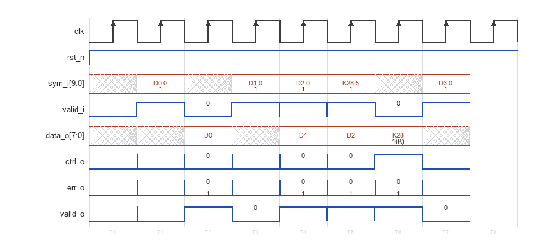
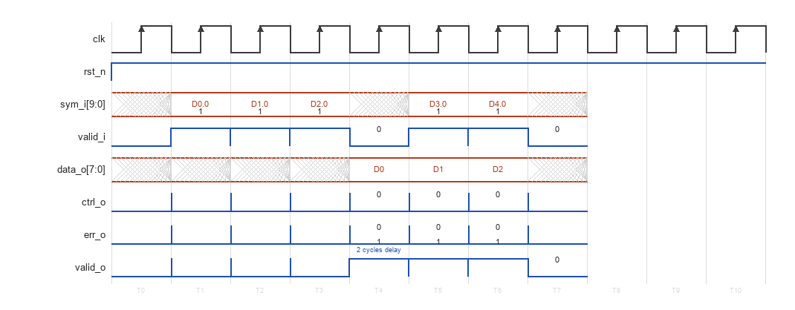
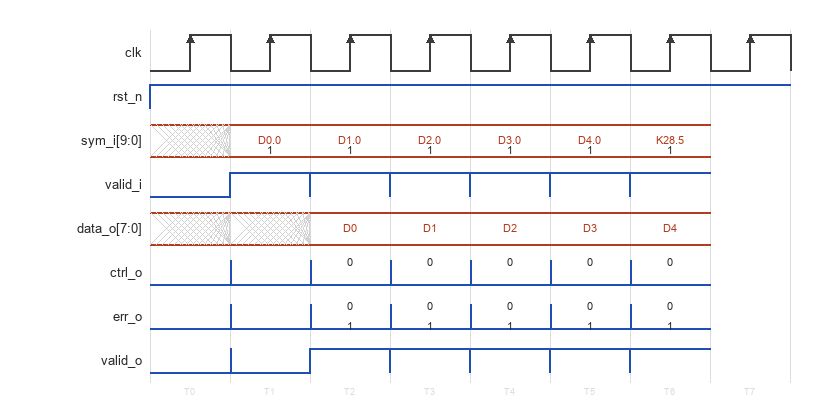
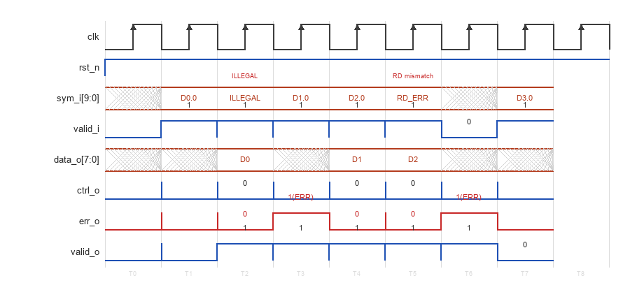

# CBB_8B10B_DEC_UG

---

## 目录

- [1. 功能及应用场景](#1-功能及应用场景)
- [2. 规格](#2-规格)
- [3. 方案分析](#3-方案分析)
- [4. 配置参数](#4-配置参数)
- [5. 接口](#5-接口)
- [6. 时序图](#6-时序图)
- [7. PPA](#7-ppa)

---

## 1. 功能及应用场景

`cbb_8b10b_dec` 是一个参数化 8b/10b 解码器 IP，将 10 位编码符号还原为 8 位原始数据与 1 位控制标识 (K 码)，并具备非法码字检测与运行不一致 (Running Disparity, RD) 校验能力。模块属于 `cbb_coding` 线路编码 IP 族，与 `cbb_8b10b_enc`（编码器）和 `cbb_8b10b_unbal`（平衡预测器）配套使用。

核心功能：接收 10-bit 编码符号 (`sym_i`)，通过 8b/10b 解码查表还原为 8-bit 原始数据 (`data_o`)；识别 K 码控制字符，输出控制标识 (`ctrl_o`)；内部维护 RD 状态机 (RD− / RD+)，跟踪当前运行不一致状态并在解码过程中校验 RD 一致性；检测非法码字（不在 8b/10b 标准码表中的 10-bit 组合）与 RD 不一致错误，统一经 `err_o` 输出；可选通过 `RD_EXT` 参数暴露 `rd_o` 端口供外部观测或级联；支持可配流水线级数 (0/1/2)，适配不同频率与延迟需求。

适用场景：PCIe 各代协议接收通路、SATA/SAS 高速串行存储接口接收端、Fiber Channel 光纤通道接收端、JESD204B/C 高速数据转换器接口接收端、其他采用 8b/10b 线路编码的高速串行通信协议接收端。解码器位于物理层 SerDes 接收端与链路层/PCS 上层之间，将线路符号还原为原始数据字节，同时完成控制字符解析与传输错误检测。

本模块是 `cbb_coding` 线路编码模块族的子模块之一，与编码器 `cbb_8b10b_enc`、平衡预测器 `cbb_8b10b_unbal` 及 4b/5b 同族模块 (`cbb_4b5b_enc`/`cbb_4b5b_dec`/`cbb_4b5b_unbal`) 共同构成完整的线路编码 IP 解决方案。所有模块遵循统一接口规范 CBB_CODING_INTF.md。

---

## 2. 规格

8b/10b 解码器的关键特性/规格涵盖功能 (FUNC)、接口 (INTF)、配置 (CFG)、性能 (PERF) 四类。每条规格以 DS 点编号标识，命名规则为 `DS.[IP_NAME].[TYPE][SPEC_ID]`，如 `DS.8B10B_DEC.FUNC.001`。TYPE 按规格类型取值：`FUNC`（功能）、`PERF`（性能）、`INTF`（接口）、`CFG`（配置）。

**规格汇总表**：将所有 DS 点逐条列入下表，按 TYPE 分组并依 `INTF`（接口）→ `CFG`（配置）→ `FUNC`（功能）→ `PERF`（性能）的顺序排列。表格共三列：DS 编号、类型、简述。表中每一行与下方一条详细规格分节（2.x）一一对应，并保持相同顺序。

| DS 编号 | 类型 | 简述 |
|---------|:---:|------|
| `DS.8B10B_DEC.INTF.001` | INTF | Valid 握手协议（valid-only，无反压） |
| `DS.8B10B_DEC.INTF.002` | INTF | 解码输出格式（data_o/ctrl_o/err_o 组合表达） |
| `DS.8B10B_DEC.INTF.003` | INTF | RD 外部端口（RD_EXT=1 时暴露 rd_o） |
| `DS.8B10B_DEC.CFG.001` | CFG | 流水线级数可选（0/1/2） |
| `DS.8B10B_DEC.CFG.002` | CFG | RD 外部端口开关（RD_EXT） |
| `DS.8B10B_DEC.FUNC.001` | FUNC | 8b/10b 解码（10-bit 符号 → 8-bit 数据） |
| `DS.8B10B_DEC.FUNC.002` | FUNC | K 码控制字符识别 |
| `DS.8B10B_DEC.FUNC.003` | FUNC | 非法码字检测 |
| `DS.8B10B_DEC.FUNC.004` | FUNC | RD 状态机跟踪与 RD 一致性校验 |
| `DS.8B10B_DEC.PERF.001` | PERF | 吞吐率 1 symbol/cycle |

> 规格明细分节 (2.x) 应保持与汇总表相同的排序：INTF → CFG → FUNC → PERF。

### 2.1 Valid 握手协议 — DS.8B10B_DEC.INTF.001

模块采用 valid-only 单向握手协议。上游在 `valid_i = 1` 时提供有效 `sym_i[9:0]`，`valid_i = 0` 时输入数据被忽略，流水线不推进，RD 状态机保持。`valid_o` 为 `valid_i` 经 `PIPELINE` 级寄存器延迟后的精确副本，`valid_o = 1` 时输出数据有效。吞吐率可达 1 symbol/cycle (背靠背传输无气泡)。不支持 `ready` 反压；若需反压，应在模块外部添加 FIFO。

### 2.2 解码输出格式 — DS.8B10B_DEC.INTF.002

解码输出由 `data_o`、`ctrl_o`、`err_o` 三路组合表达：`err_o = 0, ctrl_o = 0` 时 `data_o` 为 8-bit 原始数据 (0x00~0xFF)；`err_o = 0, ctrl_o = 1` 时 `data_o` 为 K 码 8-bit 标识；`err_o = 1` 时 `data_o` 为子译码器尝试值（语义不作承诺），`ctrl_o` 无意义，上层应依据 `err_o` 处置。当 `valid_o = 0` 时，输出维持上一拍值或为无效，上层应依据 `valid_o` 判断输出有效性。

### 2.3 RD 外部端口 — DS.8B10B_DEC.INTF.003

模块通过 parameter `RD_EXT` 控制 RD 外部端口是否生效。`RD_EXT = 0` (默认) 时 RD 完全在模块内部维护，`rd_o` 端口在端口列表中静态存在但恒为 0（Verilog 端口列表不随 parameter 增删），适用于大多数常规解码场景。`RD_EXT = 1` 时 `rd_o` 输出生效 (1-bit，0 = RD−, 1 = RD+)，适用于多芯片级联或协议分析场景。`rd_o` 输出的 RD 状态为解码并校验后的当前 RD 值，级联互联拓扑详见 CBB_CODING_INTF.md §7.3。

### 2.4 流水线级数可选 — DS.8B10B_DEC.CFG.001

`PIPELINE` 控制输出寄存器级数：0 = 纯组合输出；1 = 一级寄存器输出（默认）；2 = 两级寄存器串联输出。各配置的实测频率见 [§7 PPA](#7-ppa)。PIPELINE=0 时 `clk`/`rst_n` 端口保留但不参与组合逻辑，保证跨 PIPELINE 配置的例化兼容性。PIPELINE=2 时两级寄存器之间无额外组合逻辑，仅直通打拍。

### 2.5 RD 外部端口开关 — DS.8B10B_DEC.CFG.002

`RD_EXT` 控制 RD 端口是否生效：0 (默认) 时 RD 状态机完全内部，`rd_o` 端口保留但恒为 0；1 时 `rd_o` 输出生效，供外部观测。

### 2.6 8b/10b 解码 — DS.8B10B_DEC.FUNC.001

模块接收 10-bit 编码符号，通过解码逻辑将其还原为 8-bit 原始数据。输入 `sym_i[9:0]` 为 10 位编码符号，编码规范遵循 IEEE 802.3 第 36 条款 / ANSI INCITS 230 (Fibre Channel) 8b/10b 标准码表。若 `sym_i` 命中有效数据码 (D 码)，则 `data_o[7:0]` 输出对应的 8-bit 数据，同时 `ctrl_o = 0`。若 `sym_i` 命中有效 K 码控制字符，`ctrl_o = 1`，`data_o` 输出 K 码类型标识。8b/10b 码表包含 256 个数据码 (Dx.y) 和 12 个 K 码控制字符 (Kx.y)，共 268 个有效码字 (256 D 码 + 12 K 码)，每个存在至多两个可能的 10-bit 表示 (RD− 和 RD+，其中部分平衡码字的两种表示相同)，解码器根据当前 RD 选择并校验。

### 2.7 K 码控制字符识别 — DS.8B10B_DEC.FUNC.002

解码器识别 8b/10b 标准定义的全部 12 个 K 码控制字符：K28.0 (SKIP)、K28.1 (流控)、K28.2 (流控/同步)、K28.3 (Comma 逗号检测/字对齐)、K28.4 (通道绑定)、K28.5 (逗号检测，最常用)、K28.6 (时钟校正)、K28.7 (EIE/跳过)、K23.7、K27.7、K29.7、K30.7 (特殊控制)。K 码通过 `ctrl_o = 1` 标识，`data_o` 输出 K 码的 8-bit 标识值 (0x1C~0xFC)，供上层协议栈解析。

### 2.8 非法码字检测 — DS.8B10B_DEC.FUNC.003

10-bit 编码空间共 1024 个码点，其中仅约 536 个为有效码字。解码器在输入符号不匹配任何有效 D 码或 K 码的任一 RD 表示时，将 `err_o` 拉高。`err_o = 1` 时 `data_o` 为子译码器尝试值（语义不作承诺）、`ctrl_o` 无效，上层应依据 `err_o` 处置，防止误判。非法码字检测与解码同拍完成 (PIPELINE=0) 或同拍输出 (PIPELINE≥1)。

### 2.9 RD 状态机跟踪与 RD 一致性校验 — DS.8B10B_DEC.FUNC.004

模块内部维护 RD (Running Disparity) 状态机：RD− (0) 与 RD+ (1) 之间切换。复位后初始为 RD−。每拍解码有效符号后，根据当前 RD 和码字的 disparity 计算下一周期 RD 值：完美平衡 (0 disparity) 时 RD 不变；非平衡时 RD 取反。若解码得出的 disparity 方向与预期的当前 RD 不符，触发 RD 不一致错误，`err_o = 1`。RD 状态机仅在 `valid_i = 1` 时更新。两种错误类型 (非法码字 + RD 不一致) 统一从 `err_o` (1-bit) 合并输出，不区分错误类型，详见 CBB_CODING_INTF.md §5.4。

### 2.10 吞吐率 — DS.8B10B_DEC.PERF.001

流水线填充后吞吐率为 1 symbol/cycle。PIPELINE=0 时零延迟输出 (组合路径延迟 < 1.5 ns 典型)；PIPELINE=1/2 时初始延迟分别为 1/2 cycles，填充后每拍产出 1 个解码结果。

---

## 3. 方案分析

方案分析先做原理分析，说明功能的几种主流实现方法，对比优劣后确定本设计选用方法并详解其核心原理；再讲设计方案，结合原理图分点阐述基于选定原理的具体实现步骤，明确核心操作与特殊功能执行方式，可附典型场景示例辅助说明。

### 3.1 原理分析

8b/10b 编码由 IBM 于 1983 年开发，将 8-bit 数据映射为 10-bit 符号，保证 DC 平衡 (RD 状态机使 '0' 和 '1' 长期计数趋于平衡，最大直流不平衡 ≤ 1 bit)、足够跳变密度 (符号内最多连续相同比特 ≤ 5，保证 CDR 时钟恢复) 和控制字符 (12 个 K 码用于字对齐、帧定界、流控等)。8-bit 输入经 5b/6b 和 3b/4b 子编码器分别编码后拼接为 10-bit 输出，每个 8-bit 值对应两个可能的 10-bit 表示 (RD− 和 RD+)，由当前 RD 状态选择。解码即为逆过程，需查表还原 8-bit 数据并校验 RD 一致性。

解码方案对比：

| 方案 | 实现方式 | 面积 (等效门) | 关键路径 | 可扩展性 |
|------|------|:---:|:---:|:---:|
| 全展开组合译码 | case/SOP 最小项展开 1024 条目 | ~2000 | 8~10 级逻辑门 | 低 |
| 扁平 ROM | 1024×12 ROM + RD 状态机 | ~3000 | 1 级 ROM 读 | **无** — 64b/66b 不可行 |
| **5b/6b + 3b/4b 子解码器 (本设计)** | **分级查小表 (64×7 + 16×5) + popcount disparity** | **~1500** | **2~3 级** | **高** — 通用模式 |

**选型结论**：采用 **5b/6b + 3b/4b 子解码器** 方案。核心洞察：

1. **拆分输入**：`sym_i[9:0] = {sym_6b[5:0], sym_4b[3:0]}`，分别送入 5b/6b 子解码器 (64 条目) 和 3b/4b 子解码器 (16 条目)
2. **popcount 算 disparity**：disparity 不需存储——直接数 `sym_i` 中 '1' 的个数。5 个 '1' = 平衡，6 个 '1' = 正 disparity，4 个 '1' = 负 disparity，其他 = 非法
3. **K 码检测**：`is_k6 & data5==0x1C` → K28.y 家族，y 值经 `rd_mid_d`（6b 子块 disparity 推导 RD，K28 6b 恒非平衡、不依赖内部状态机）对 4b 重映射消歧——.1/.2/.5/.6 的 K 变体对与 D 表物理码交换，光看 4b 无法定 y。`is_k4 & data5 ∈ {0x17,0x1B,0x1D,0x1E}` → K23.7/K27.7/K29.7/K30.7：四个码的 6b 部分分别是 D23/D27/D29/D30 码字，物理层完全可区分，按 `{y,x}` 规则分别输出 0xF7/0xFB/0xFD/0xFE。注意 6b 码字 011111/100000 为 ±4 非平衡，在 8b/10b 中永远非法（0111111000/1000000111 是非法码，不是什么"共享 K.7 码字"），判 K 之前必须先过 disparity 合法性检查
4. **ROM 总量**：64×7 + 16×5 = **528 bit**（对比扁平方案 12,288 bit，缩小 **23 倍**）
5. 此方案模式通用：对 64b/66b 解码器，同样可拆分为 scrambler 多项式 + sync header 检测子模块

错误检测包含两类：非法码字检测 (子解码器未命中或 popcount 非 4/5/6 → `err_o = 1`)；RD 不一致检测 (码字 disparity 方向与当前 RD 状态冲突 → `err_o = 1`)。两类错误统一经 1-bit `err_o` 合并输出。

RD 状态机规则：复位后 RD 初始为 RD− (0)。每拍 `valid_i = 1` 时，解码得出当前码字的 disparity：若为 0 (完美平衡)，RD 不变；否则 RD 取反。

### 3.2 设计方案

模块层次结构：

```
cbb_8b10b_dec (顶层)
├── 5b/6b 子解码器 (64×7 bit, 纯组合) → {err6, is_k6, data5[4:0]}
├── 3b/4b 子解码器 (16×5 bit, 纯组合) → {err4, is_k4, data3[2:0]}
├── popcount disparity 计算 (纯组合加法器)
├── K 码检测 + 子块组合 (纯组合)
├── RD 状态机 (寄存器)
└── 流水线寄存器 (0/1/2 级可选)
```

解码流程：`sym_i[9:0]` 拆分为高 6-bit (`sym_i[9:4]`) 和低 4-bit (`sym_i[3:0]`)，分别查两个子解码器。两个子解码器各自返回 `{err, is_k, data_bits}`。组合模块判定最终 `err_raw`（子块非法或 popcount 非 4/5/6）、`ctrl_raw`（K28 家族或 K.7 家族命中，`ctrl_raw = (err_raw==0) & valid_k`）和 `data_raw`（`{data3_eff, data5}` 拼接；K28 家族的 `data3_eff` 为 rd_mid_d 消歧后的 `k28_y`，其余取子解码器 `data3`）。RD 校验模块用 popcount 结果比对当前 RD 状态。数据通路经可配流水线寄存器输出。

流水线架构：

| 模式 | 延迟 | 结构 | 适用场景 |
|:---:|:---:|------|------|
| PIPE=0 | 0 | sym_i 直接接入 LUT + RD 校验，纯组合输出 | 低频 / 延迟敏感 |
| PIPE=1 (默认) | 1 | LUT + RD 校验 → 寄存器 → 输出 | 通用 (≤800 MHz) |
| PIPE=2 | 2 | LUT + RD 校验 → 寄存器 (Stage1) → 寄存器 (Stage2) → 输出 | 高频 (>800 MHz) |

PIPE=1 时解码逻辑与寄存器输出组合为单个时序路径，寄存器输出保证对外时序收敛。PIPE=2 在 PIPE=1 之后额外插入一级纯直通寄存器，将片外时序路径起点再延迟一拍，寄存器到片外的路径降为零逻辑级数，对后端物理设计时序收敛友好。

#### 3.2.1 RD 状态机与校验逻辑

**RD 状态定义**：
- RD− (0)：运行不一致为负，编码器期望发送正 disparity 码字 (6'1+4'0)
- RD+ (1)：运行不一致为正，编码器期望发送负 disparity 码字 (4'1+6'0)
- 复位初始状态：RD− (0)

**RD 校验规则**（`valid_i = 1` 时生效）：

| disp_info | 含义 | 当前 RD 要求 | 下一 RD | 校验失败条件 |
|:---:|------|:---:|:---:|------|
| 00 | 完美平衡 (disparity=0) | 无要求 (RD−/RD+ 均可) | 不变 | 无 |
| 01 | 正 disparity (+2) | 必须为 RD− (0) | 翻转为 RD+ (1) | current_rd == RD+ 时触发 err_o |
| 10 | 负 disparity (−2) | 必须为 RD+ (1) | 翻转为 RD− (0) | current_rd == RD− 时触发 err_o |
| 11 | 非法码字 | N/A | 保持不变 | err_o = 1 |

**err_o 合并逻辑**：`err_o = err_raw | rd_mismatch`。两类错误统一经 1-bit `err_o` 输出，不区分类型。

---

## 4. 配置参数

| 参数 | 配置范围 | 默认值 | 描述 |
|------|----------|--------|------|
| `PIPELINE` | 0 / 1 / 2 | 1 | 输出流水线级数：0 = 纯组合逻辑, 1 = 一级寄存器输出, 2 = 两级寄存器串联输出 |
| `RD_EXT` | 0 / 1 | 0 | RD 外部端口开关：0 = RD 状态机内部维护、不暴露 `rd_o`, 1 = 暴露 `rd_o` 供外部观测 |

> 数据位宽 (8-bit) 与符号位宽 (10-bit) 为 8b/10b 编码标准固有属性，非 parameter 可配。模块保持单符号接口，若 SoC 数据通路较宽，应在外部多次例化或通过 wrapper 组合。本模块与 CBB_CODING_INTF.md §3.5 的参数模型完全一致。

---

## 5. 接口

| 信号名 | 位宽 | I/O | 时钟域 | 描述 |
|--------|------|-----|--------|------|
| `clk` | 1 | I | clk | 系统时钟，所有寄存器在 `clk` 上升沿触发 |
| `rst_n` | 1 | I | — | 异步复位，低有效。复位后 RD 状态机回到 RD−，所有输出寄存器清零 |
| `sym_i` | 10 | I | clk | 10-bit 编码输入符号，与 `valid_i` 同拍对齐 |
| `valid_i` | 1 | I | clk | 输入有效指示。`valid_i = 1` 时 `sym_i` 有效，`valid_i = 0` 时输入忽略 |
| `data_o` | 8 | O | clk | 8-bit 解码输出数据 (D 码) 或 K 码标识 |
| `ctrl_o` | 1 | O | clk | 控制码指示：1 = K 码, 0 = D 码 (数据) |
| `err_o` | 1 | O | clk | 错误检测标志：1 = 非法码字或 RD 不一致 |
| `rd_o` | 1 | O | clk | (RD_EXT=1 时生效，RD_EXT=0 时恒为 0) 当前 RD 状态观测输出：0 = RD−, 1 = RD+ |
| `valid_o` | 1 | O | clk | 输出有效指示，`valid_i` 经 `PIPELINE` 级流水线延迟后的副本 |

解码输出编码：`err_o=0, ctrl_o=0` → `data_o` 为 8-bit 原始数据 (0x00~0xFF)；`err_o=0, ctrl_o=1` → `data_o` 为 K 码 8-bit 标识；`err_o=1` → `data_o` 为子译码器尝试值（不作承诺），`ctrl_o` 无意义。K 码通过 `ctrl_o = 1` + `data_o` 编码输出，与编码器 `cbb_8b10b_enc` 的 `ctrl_i` + `data_i` 格式保持镜像对称。

**K 码 8-bit 标识表 (12 个标准 K 码)**：

| K 码名 | data_o[7:0] (hex) | 用途 |
|--------|:---:|------|
| K28.0 | 8'h1C | SKIP (跳过/时钟补偿) |
| K28.1 | 8'h3C | FCTL (流控) |
| K28.2 | 8'h5C | 流控/同步 |
| K28.3 | 8'h7C | Comma 逗号检测/字对齐 |
| K28.4 | 8'h9C | 通道绑定 |
| K28.5 | 8'hBC | Comma 逗号检测 (最常用) |
| K28.6 | 8'hDC | 时钟校正 |
| K28.7 | 8'hFC | EIE (错误指示/跳过) |
| K23.7 | 8'hF7 | 特殊控制 |
| K27.7 | 8'hFB | 特殊控制 |
| K29.7 | 8'hFD | 特殊控制 |
| K30.7 | 8'hFE | 特殊控制 |

> K 码标识编码：`data_o[7:0] = {y[2:0], x[4:0]}`，其中 `Kx.y` 的 x 为低 5-bit (0~31) 对应 `data_o[4:0]`，y 为高 3-bit (0~7) 对应 `data_o[7:5]`。例如 K28.5：x=28 (5'h1C), y=5 (3'h5)，因此 `data_o = {3'h5, 5'h1C} = 8'hBC`。

RD 外部端口 (RD_EXT=1 时)：`rd_o = 0` 表示 RD−，`rd_o = 1` 表示 RD+，输出为解码并校验后的当前 RD 值。可用于多芯片级联 (`dec.rd_o → enc.rd_i`)、协议分析/调试或 BIST 自测试。端口命名遵循 `<功能>_<方向>` 规则，方向后缀 `_i`/`_o`，不使用 `_in`/`_out`，详见 CBB_CODING_INTF.md §8。

---

## 6. 时序图

PIPELINE=0 (组合逻辑)：`data_o`/`ctrl_o`/`err_o` 与 `sym_i` 同一周期有效，`valid_o` 等同于 `valid_i`；RD 状态机保持复位值 (RD−)，RD 跟踪在纯组合模式下无寄存器更新。

PIPELINE=1 (一级流水)：`data_o`/`ctrl_o`/`err_o` 延迟 1 拍输出，`valid_o` 为 `valid_i` 延迟 1 拍的精确副本，吞吐率 1 symbol/cycle 无气泡。



PIPELINE=2 (两级流水)：`data_o`/`ctrl_o`/`err_o` 延迟 2 拍输出，两级寄存器串联不增加组合逻辑级数，吞吐率保持 1 symbol/cycle，仅初始填充延迟增加至 2 cycles。



背靠背 (PIPELINE=1)：`valid_i` 连续为 1 时无气泡，每周期输出一个解码结果，吞吐率达到 1 symbol/cycle 峰值。



错误检测 (PIPELINE=1)：`sym_i` 输入为非法码字时 `err_o` 与 `data_o` 同拍拉高；RD 不一致 (如 RD+ 状态下收到 RD− 表示的有效码字) 时 `err_o` 同样拉高。`err_o` 仅维持一个周期，不锁存。两类错误合并为同一 `err_o` 信号，不做类型区分。



> 时序波形详见下方各小节描述。PIPELINE 模式和错误检测的完整时序行为参阅 CBB_CODING_INTF §3.2 和 CBB_CODING_INTF §5.4。

---

## 7. PPA

> 综合条件：TSMC 12nm FinFET CLL (tcbn12ffcll)，SS 0.9V 125°C，Design Compiler W-2024.09-SP3。

### 7.1 配置A：基础模式，一级流水，RD 内部

**参数设置：**

| 参数 | 设置值 | 说明 |
|------|--------|------|
| PIPELINE | 1 | 一级寄存器输出 |
| RD_EXT | 0 | RD 状态机内部维护 |

**PPA 数据：**

| 项目 | 实测值 |
|------|:------:|
| 频率 | 1 GHz (slack +0.59 ns) |
| 面积 | 39.17 µm² (157 cells: 145 comb + 12 seq) |
| 功耗 | 60.93 µW 动态 + 199.20 nW 漏电 |

### 7.2 配置B：低延迟模式，组合逻辑，RD 内部

**参数设置：**

| 参数 | 设置值 | 说明 |
|------|--------|------|
| PIPELINE | 0 | 纯组合输出 |
| RD_EXT | 0 | RD 内部 |

**PPA 数据：**

| 项目 | 实测值 |
|------|:------:|
| 频率 | 1 GHz (slack +0.55 ns) |
| 面积 | 26.22 µm² (137 cells: 137 comb + 0 seq) |
| 功耗 | 18.95 µW 动态 + 123.85 nW 漏电 |

### 7.3 配置C：高频模式，两级流水，RD 外部

**参数设置：**

| 参数 | 设置值 | 说明 |
|------|--------|------|
| PIPELINE | 2 | 两级寄存器串联输出 |
| RD_EXT | 1 | 暴露 `rd_o` 端口 |

**PPA 数据：**

| 项目 | 实测值 |
|------|:------:|
| 频率 | 1 GHz (slack +0.57 ns) |
| 面积 | 51.75 µm² (169 cells: 144 comb + 25 seq) |
| 功耗 | 104.94 µW 动态 + 267.98 nW 漏电 |

### 7.4 时序说明

PIPELINE=0 时 `data_o`、`ctrl_o`、`err_o` 均为纯组合输出。在 1 GHz 目标频率下 setup slack 为 +0.55 ns，时序满足。外部需自行打拍以适配更高频率。

PIPELINE=1 时所有输出均为寄存器输出，CBB 内部逻辑级数为 0 (寄存器 Q → 输出端口直连)，外部可承受全部组合逻辑。在 1 GHz 目标频率下 setup slack 为 +0.59 ns。

PIPELINE=2 时两级寄存器串联输出，CBB 内部从第二级寄存器 Q 端直连输出端口，逻辑级数为 0。第一级与第二级之间无额外组合逻辑 (纯直通)，适用于后端物理设计对 CBB 输出到片外逻辑的时序路径有严格约束的场景。在 1 GHz 目标频率下 setup slack 为 +0.57 ns。
