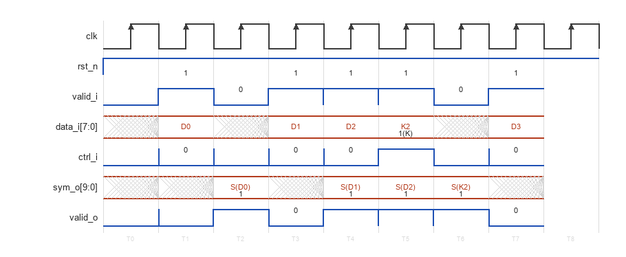
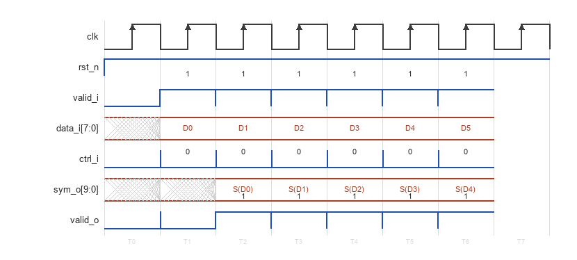
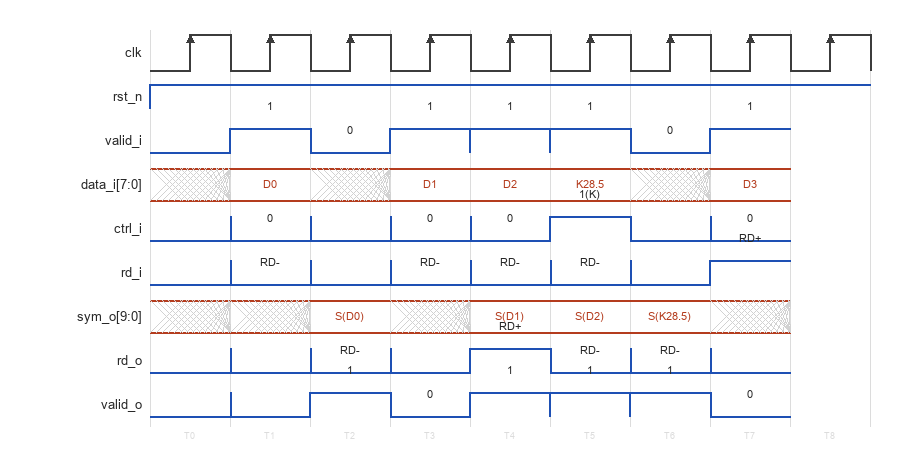

# CBB_8B10B_ENC_UG

---

## 目录

- [1. 功能及应用场景](#1-功能及应用场景)
- [2. 规格](#2-规格)
- [3. 方案分析](#3-方案分析)
- [4. 配置参数](#4-配置参数)
- [5. 接口](#5-接口)
- [6. 时序图](#6-时序图)
- [7. PPA](#7-ppa)

---

## 1. 功能及应用场景

### 1.1 核心功能

`cbb_8b10b_enc` 是 **8b/10b 线路编码器**，实现了 IBM 公司 Widmer 与 Franaszek 于 1983 年提出的 8b/10b 编码算法（ANSI INCITS 230 标准）。核心功能为：

- 将 **8-bit 原始数据** (`data_i`) 与 **1-bit 控制标识** (`ctrl_i`) 编码为 **10-bit 线路符号** (`sym_o`)
- 内置 **Running Disparity (RD) 状态机**，保证编码输出的 DC 平衡（长期 0/1 计数相等）
- 保证输出符号具备 **足够的跳变密度**，确保接收端 CDR (Clock and Data Recovery) 正常工作
- 支持全部 **256 个 D 码** (数据码) 和 **12 个 K 码** (控制码/K码)，完全符合 8b/10b 标准

### 1.2 解决问题

高速串行链路面临两大物理层挑战：

| 挑战 | 8b/10b 编码的解决方案 |
|------|----------------------|
| **DC 漂移** — 长连 0 或长连 1 导致 AC 耦合电容充放电，判决门限漂移 | RD 状态机跟踪累计 disparity，动态选择正/负 disparity 版本，长期 DC 平衡 |
| **CDR 失锁** — 数据长时间无跳变，接收端 PLL/DLL 无法提取时钟 | 编码保证每个 10-bit 符号内部跳变次数 ≥ 2，连续符号间跳变次数 ≥ 1 |

### 1.3 适用场景

- **PCIe 1.0/2.0** (2.5/5.0 GT/s) — 物理层 8b/10b 编码
- **SATA 1.0/2.0/3.0** (1.5/3.0/6.0 Gbps) — 链路层 8b/10b 编码
- **Fiber Channel** (1/2/4/8 GFC) — 传输码
- **DisplayPort 1.0/1.1** — 主链路 8b/10b 编码
- **JESD204A/B** — 高速 ADC/DAC 数据接口
- **XAUI / 1000BASE-X** — 以太网物理层
- **HDMI 1.0~1.2** — TMDS 编码 (变形)

### 1.4 模块族定位

本模块是 `cbb_coding` 线路编码模块族的子成员：

```
cbb_coding 模块族
├── 编码器 (enc)
│   ├── cbb_4b5b_enc     — 4-bit → 5-bit 编码
│   └── cbb_8b10b_enc    — 8-bit → 10-bit 编码 + RD 状态机  ← 本模块
├── 解码器 (dec)
│   ├── cbb_4b5b_dec     — 5-bit → 4-bit 解码 + 非法检测
│   └── cbb_8b10b_dec    — 10-bit → 8-bit 解码 + RD 校验 + 非法检测
└── 平衡预测器 (unbal)
    ├── cbb_4b5b_unbal   — 4b/5b 平衡预分析
    └── cbb_8b10b_unbal  — 8b/10b RD 预判
```

与本模块直接配套的解码器为 `cbb_8b10b_dec`，二者可通过 `sym_o` → `sym_i`、`valid_o` → `valid_i` 直连构成自环测试通路。

---

## 2. 规格

每条规格以 DS 点编号标识，命名规则为 `DS.[IP_NAME].[TYPE][SPEC_ID]`。TYPE 按规格类型取值：`FUNC`（功能）、`PERF`（性能）、`INTF`（接口）、`CFG`（配置）。

**规格汇总表**：将所有 DS 点逐条列入下表，按 TYPE 分组并依 `INTF`（接口）→ `CFG`（配置）→ `FUNC`（功能）→ `PERF`（性能）的顺序排列。表格共三列：DS 编号、类型、简述。表中每一行与下方一条详细规格分节（2.x）一一对应，并保持相同顺序。

| DS 编号 | 类型 | 简述 |
|---------|:---:|------|
| `DS.CBB_8B10B_ENC.INTF.001` | INTF | Valid 握手协议（valid-only，无反压） |
| `DS.CBB_8B10B_ENC.CFG.001` | CFG | 流水线级数可选（0/1/2） |
| `DS.CBB_8B10B_ENC.CFG.002` | CFG | RD 外部端口开关（RD_EXT） |
| `DS.CBB_8B10B_ENC.FUNC.001` | FUNC | 8b/10b 编码功能（256 D 码 + 12 K 码） |
| `DS.CBB_8B10B_ENC.FUNC.002` | FUNC | DC 平衡与 RD 状态机 |
| `DS.CBB_8B10B_ENC.FUNC.003` | FUNC | D 码与 K 码支持 |
| `DS.CBB_8B10B_ENC.FUNC.004` | FUNC | 跳变密度保证 |
| `DS.CBB_8B10B_ENC.PERF.001` | PERF | 吞吐率 1 symbol/cycle，编码效率 80% |

> 规格明细分节 (2.x) 应保持与汇总表相同的排序：INTF → CFG → FUNC → PERF。

### 2.1 Valid 握手协议 — DS.CBB_8B10B_ENC.INTF.001

- `valid_i = 1` 时，`data_i` 和 `ctrl_i` 被采样并编码
- `valid_i = 0` 时，输入被忽略，流水线不推进，RD 状态机保持
- `valid_o` 是 `valid_i` 经 `PIPELINE` 级寄存后的精确副本
- `valid_o = 1` 时，`sym_o` 上的数据有效

### 2.2 流水线模型 — DS.CBB_8B10B_ENC.CFG.001

流水线通过 `PIPELINE` 参数配置，详见 [§4](#4-配置参数)：

- `PIPELINE=0`：纯组合逻辑，零延迟输出
- `PIPELINE=1` (默认)：一级寄存器输出，适配大多数场景
- `PIPELINE=2`：两级流水（两级均寄存完整 10-bit 符号，第 2 级为纯直通打拍），提升高频时序收敛能力

### 2.3 RD 外部端口 — DS.CBB_8B10B_ENC.CFG.002

通过 `RD_EXT` 参数控制 Running Disparity 端口是否生效：

- `RD_EXT=0` (默认)：RD 完全内部管理；`rd_i`/`rd_o` 端口在端口列表中始终存在（Verilog 端口列表为静态，不随 parameter 增删），但逻辑上无效——`rd_i` 不参与任何逻辑，`rd_o` 恒为 0
- `RD_EXT=1`：`rd_i` (外部 RD 注入) 和 `rd_o` (编码后 RD 观测) 生效，用于多芯片级联或 RD 状态同步

### 2.4 编码功能 — DS.CBB_8B10B_ENC.FUNC.001

模块实现完整的 8b/10b 编码查表（D 码 256 项 + K 码 12 项），每条码点具有正/负 disparity 两个 10-bit 码字版本。编码选择由内部 RD 状态机基于当前 RD 值和码字的 disparity 决定。

- `ctrl_i = 0`：将 `data_i[7:0]` 作为 Dx.y 数据码编码
- `ctrl_i = 1`：将 `data_i[7:0] = {y[2:0], x[4:0]}` 作为 Kx.y 控制码编码

### 2.5 DC 平衡与 RD 状态机 — DS.CBB_8B10B_ENC.FUNC.002

内部维护 1-bit Running Disparity 状态寄存器，编码过程如下：

1. 查询当前输入 (D 码或 K 码) 对应的 10-bit 码字及其 disparity (+2, 0, -2)
2. 若 disparity = 0 (完美平衡)，输出唯一码字，RD 不变
3. 若 disparity ≠ 0，根据当前 RD 选择正/负版本：
   - `RD = -1` (RD-) → 选择 disparity = +2 版本，RD 翻转至 +1 (RD+)
   - `RD = +1` (RD+) → 选择 disparity = -2 版本，RD 翻转至 -1 (RD-)
4. 复位后 RD 初始值为 **RD- (-1)**

### 2.6 D 码与 K 码支持 — DS.CBB_8B10B_ENC.FUNC.003

| 码类型 | `ctrl_i` | `data_i` 含义 | 码点范围 | 数量 |
|--------|:--------:|-------------|---------|:---:|
| D 码 (数据) | 0 | 8-bit 原始数据 `D[7:0]` | D0.0 ~ D31.7 | 256 |
| K 码 (控制) | 1 | 8-bit K 码标识 `{y[2:0], x[4:0]}` | K28.0 ~ K28.7, K23.7, K27.7, K29.7, K30.7 | 12 |

> **K 码编码说明**：`data_i[7:0] = {y[2:0], x[4:0]}`，其中 `Kx.y` 为 K 码名称。例如 K28.5：x=28 (0x1C), y=5 → `data_i = {3'h5, 5'h1C} = 8'hBC`。

### 2.7 跳变密度保证 — DS.CBB_8B10B_ENC.FUNC.004

编码输出 `sym_o[9:0]` 满足以下跳变密度约束：

- 每个 10-bit 符号内部 **跳变次数 ≥ 2** (0→1 或 1→0 计 1 次)
- 连续两个符号之间 **跳变次数 ≥ 1**
- 任何 6-bit 滑动窗口内 0/1 个数之差 ≤ 2

该约束由 8b/10b 标准码表本身保证，编码器逻辑无需附加跳变检测电路。

### 2.8 吞吐率 — DS.CBB_8B10B_ENC.PERF.001

- 吞吐率：**1 symbol/cycle** (背靠背传输无气泡)
- 编码效率：**80%** (8-bit → 10-bit)
- 延迟：`PIPELINE` 个时钟周期 (valid_o 与 valid_i 的偏移)
- 最大工作频率：见 [§7 PPA](#7-ppa)

---

## 3. 方案分析

### 3.1 8b/10b 编码原理

8b/10b 编码由 Widmer 和 Franaszek (IBM, 1983) 提出，核心思想是将 8-bit 字分解为两个子块分别编码：

```
8-bit 输入: HGF EDCBA  (H→A 为 MSB→LSB)
              │    │
        ┌─────┘    └─────┐
        ▼                ▼
   5b/6b 子编码器    3b/4b 子编码器
   (EDCBA → abcdei)  (HGF → fghj)
        │                │
        └────┬───────────┘
             ▼
   10-bit 输出: abcdei fghj
   (a→j 为 LSB→MSB 串行发送顺序)
```

**5b/6b 子块**：将低 5-bit `EDCBA` 编码为 6-bit `abcdei`
**3b/4b 子块**：将高 3-bit `HGF` 编码为 4-bit `fghj`

两个子块的编码均受 RD 状态机控制，分别基于各自子块的 disparity 和当前 RD 值选择正/负版本。

### 3.2 RD 状态机

Running Disparity 是 8b/10b 编码的核心机制。定义：

- **子块 disparity**：6b 或 4b 子块编码后 1 的数量 − 0 的数量，只可能为 +2、0、-2
- **RD**：始于 RD- (-1)，每编码一个符号后，若子块 disparity ≠ 0，RD 翻转 (±1 ↔ ∓1)

RD 状态转移规则 (以 RD- 为例)：

```
当前 RD = RD- (-1):
  ┌──────────────────────────────────────┐
  │ 6b 子块:                             │
  │   若 disparity_6b > 0 → 选正版本, RD 变 +1    │
  │   若 disparity_6b = 0 → 选唯一版本, RD 不变   │
  │   若 disparity_6b < 0 → 选负版本, RD 不变     │
  │                                      │
  │ 4b 子块 (基于 6b 子块结束后的 RD):     │
  │   同理...                             │
  └──────────────────────────────────────┘
```

### 3.3 D 码与 K 码映射表

**D 码编码 (ctrl_i=0)**：

`data_i[7:0]` → Dxx.y 命名规则：`xx = data_i[4:0]` (0~31)，`y = data_i[7:5]` (0~7)。共 256 个码点。

**K 码编码 (ctrl_i=1)**：

| K 码名称 | `data_i[7:0]` | 计算 (y<<5 \| x) | 用途 (典型) |
|---------|:---:|:---:|------|
| K28.0 | 0x1C | {0,28} | SKP (Skip)，时钟补偿 |
| K28.1 | 0x3C | {1,28} | FIS 帧头 (SATA) |
| K28.2 | 0x5C | {2,28} | SDP 帧头 |
| K28.3 | 0x7C | {3,28} | IDLE (SATA) |
| K28.4 | 0x9C | {4,28} | 保留 |
| K28.5 | 0xBC | {5,28} | COM (PCIe) — 最常用 |
| K28.6 | 0xDC | {6,28} | 保留 |
| K28.7 | 0xFC | {7,28} | EIE (SATA) |
| K23.7 | 0xF7 | {7,23} | ALIGN (SATA) |
| K27.7 | 0xFB | {7,27} | SYNC (SATA) |
| K29.7 | 0xFD | {7,29} | 保留 |
| K30.7 | 0xFE | {7,30} | 保留 |

> `ctrl_i=1` 且 `data_i[4:0]` 不为上述 12 个值的其他组合 → 非法输入，编码行为未定义（建议上层避免）。

### 3.4 实现方案选型

| 方案 | 原理 | 优势 | 劣势 |
|------|------|------|------|
| **纯 ROM/LUT** | 将所有 268 个码点的正/负 disparity 码字预存 ROM 中，RD 状态机索引 | 时序简单，延迟确定 | ROM 面积大 (~536×10-bit)，不适合大位宽扩展 |
| **纯组合逻辑** | 用 XOR/AND 门网表直接实现 5b/6b + 3b/4b 编码方程 | 面积紧凑，无 ROM | 逻辑深度大，高频时序收敛困难 |
| **混合方案 (本模块采用)** | 5b/6b + 3b/4b 子编码器 case 组合查表 + RD 状态机；PIPELINE=0/1/2 依次增加 0/1/2 级输出寄存器（PIPELINE=2 第 2 级为纯直通打拍） | 面积与频率折中，参数化灵活 | 实现复杂度中等 |

**本设计选用混合方案**的理由：
1. `PIPELINE=0` 提供零延迟组合逻辑通路，满足低延迟场景
2. `PIPELINE=1` (默认) 在编码逻辑后加一级寄存器，面积几乎不变但频率显著提升
3. `PIPELINE=2` 在编码逻辑后插入两级寄存器（第 2 级纯直通），缩短输出路径，突破高频瓶颈
4. 三种配置共用同一 RTL 核心 (generate 块切换)，面积按需伸缩

### 3.5 设计实现要点

**编码查表实现**：

5b/6b 子块采用 **32 项 case 组合查表**（综合后映射为 LUT/组合逻辑），3b/4b 子块为 8 项 case 查表，表项直接来自标准码表。3b/4b 子块以 `rd_mid`（5b/6b 子块 disparity 推导的中间 RD）为选择依据；D.x.7 按标准 run-length 规则区分 P7（主编码）/A7（交替编码），K.x.7 使用 A7 图样。

**子块级联**：5b/6b 子块编码完成后，由其 disparity 组合推导 `rd_mid`，3b/4b 子块基于 `rd_mid` 编码。两个子块在同一周期内完成 (组合逻辑级联)；RD 状态寄存器在每个 `valid_i` 有效拍根据整个 10-bit 符号的 disparity 最多翻转 1 次。

**10-bit 输出位序**：

`sym_o[9:0] = {sym_6b, sym_4b}`，即 `{a, b, c, d, e, i, f, g, h, j}`：`a` 位于 bit9、`j` 位于 bit0，MSB→LSB 顺序与标准码表 `abcdei fghj` 写法一致，亦对应串行发送顺序（`a` 首发）。

---

## 4. 配置参数

| 参数 | 类型 | 配置范围 | 默认值 | 描述 |
|------|------|:---:|:---:|------|
| `PIPELINE` | int | 0 / 1 / 2 | 1 | 输出流水线级数 (详见下文) |
| `RD_EXT` | int | 0 / 1 | 0 | RD 外部端口开关 (详见下文) |

### 4.1 PIPELINE — 流水线级数

| 值 | 名称 | 延迟 | 适用场景 |
|:---:|------|:---:|------|
| 0 | 纯组合逻辑 | 0 cycle | 极低延迟要求的直通通路；`clk`/`rst_n` 端口保留但不参与逻辑 |
| 1 (默认) | 一级寄存器 | 1 cycle | 标准配置，适配绝大多数 SerDes 发送通路时序 |
| 2 | 两级流水 | 2 cycles | 高频设计 (>800 MHz)，XOR 树第一级拆分 + 寄存器 + 第二级输出寄存器 |

`valid_o` 相对 `valid_i` 的延迟严格等于 `PIPELINE` 的时钟周期数。所有 PIPELINE 取值下 `clk`/`rst_n` 端口命名与位宽不变，保证跨配置的例化兼容性。

### 4.2 RD_EXT — Running Disparity 外部端口

| 值 | 端口变化 | 适用场景 |
|:---:|------|------|
| 0 (默认) | RD 完全内部管理；`rd_i`/`rd_o` 端口保留但无效（`rd_i` 不参与逻辑，`rd_o` 恒 0） | 单芯片独立编码，无需外部感知 RD 状态 |
| 1 | `rd_i`/`rd_o` 生效：`rd_i` 为外部 RD 注入，`rd_o` 为编码后 RD 输出 | 多芯片级联 RD 同步、协议分析仪、调试用 RD 观测 |

`RD_EXT=1` 时：
- `rd_i` 在 `valid_i=1` 的拍末采样进内部 RD 状态寄存器，作为**下一拍有效符号**编码的起始 RD（级联场景 `dec.rd_o → enc.rd_i` 同拍直连时序恰好正确）
- `rd_o` 输出该符号编码后推导的 RD 状态，与 `sym_o` 同拍有效 (`valid_o=1` 时有效)
- `rd_i=0` 表示 RD-，`rd_i=1` 表示 RD+
- `rd_o=0` 表示 RD-，`rd_o=1` 表示 RD+

---

## 5. 接口

### 5.1 信号清单

| 信号名 | 位宽 | I/O | 条件 | 描述 |
|--------|:---:|:---:|------|------|
| `clk` | 1 | I | 始终存在 | 系统时钟，所有寄存器在 `clk` 上升沿触发 |
| `rst_n` | 1 | I | 始终存在 | 异步复位，低有效。复位后 RD 回到 RD-，所有输出寄存器清零 |
| `data_i` | 8 | I | 始终存在 | 待编码原始数据。`ctrl_i=0` 时为 8-bit 数据码；`ctrl_i=1` 时低 5-bit 为 K 码索引 |
| `ctrl_i` | 1 | I | 始终存在 | 控制码标识：`1` = K 码，`0` = D 码 |
| `valid_i` | 1 | I | 始终存在 | 输入有效指示。`1` 时 `data_i`/`ctrl_i` 有效；`0` 时输入忽略，流水线停等 |
| `rd_i` | 1 | I | `RD_EXT=1` 生效 | 外部 RD 注入：`0` = RD-，`1` = RD+。在 `valid_i=1` 的拍采样，作为下一拍有效符号编码的初始 RD（`RD_EXT=0` 时不参与逻辑） |
| `sym_o` | 10 | O | 始终存在 | 编码后的 10-bit 线路符号。位序 `[9:0]` = `{a,b,c,d,e,i,f,g,h,j}`（标准 `abcdei fghj` 写法，`a` 在 bit9） |
| `valid_o` | 1 | O | 始终存在 | 输出有效指示。`1` 时 `sym_o` (及 `rd_o`，`RD_EXT=1` 时) 有效 |
| `rd_o` | 1 | O | `RD_EXT=1` 生效 | 编码后推导的 RD 状态：`0` = RD-，`1` = RD+。与 `sym_o` 同拍有效（`RD_EXT=0` 时恒为 0） |

### 5.2 端口位宽不变性

本模块所有端口位宽为 **固定值**，非 parameter 可配。8-bit 数据输入和 10-bit 符号输出是 8b/10b 编码标准的固有属性，不可参数化扩大。宽总线场景 (如 32-bit、64-bit 数据通路) 应在外部多次例化本模块或通过 wrapper 组合。

### 5.3 接口与模块族规范对照

| 本模块信号 | CBB_CODING_INTF §4.2 | 一致性 |
|-----------|:---:|:---:|
| `clk` | `clk` | ✅ 完全一致 |
| `rst_n` | `rst_n` | ✅ 完全一致 |
| `data_i[7:0]` | `data_i` (8b/10b 列宽 = 8) | ✅ 完全一致 |
| `ctrl_i` | `ctrl_i` | ✅ 完全一致 |
| `valid_i` | `valid_i` | ✅ 完全一致 |
| `rd_i` | `rd_i` (仅 8b/10b, RD_EXT=1) | ✅ 完全一致 |
| `sym_o[9:0]` | `sym_o` (8b/10b 列宽 = 10) | ✅ 完全一致 |
| `rd_o` | `rd_o` (仅 8b/10b, RD_EXT=1) | ✅ 完全一致 |
| `valid_o` | `valid_o` | ✅ 完全一致 |

---

## 6. 时序图

### 6.1 基本编码时序 (PIPELINE=1, 默认配置)



- 输入 `valid_i=1` 时，`data_i` 和 `ctrl_i` 被采样
- 经 PIPELINE=1 级寄存器延迟后，`valid_o=1` 时 `sym_o` 输出有效编码结果
- `ctrl_i=0` 时 D 码编码，`ctrl_i=1` 时 (D2 拍) K 码编码

### 6.2 背靠背连续传输



- `valid_i` 持续为高的背靠背场景下，吞吐率达 **1 symbol/cycle**
- 流水线无气泡，`valid_o` 在填满流水线后持续为高

### 6.3 PIPELINE 对延迟的影响

`valid_o` 相对 `valid_i` 的延迟严格等于 `PIPELINE` 个时钟周期：

- `PIPELINE=0`：组合直通，零延迟
- `PIPELINE=1`：延迟 1 拍
- `PIPELINE=2`：延迟 2 拍（两级均寄存完整 10-bit 符号，第 2 级为纯直通打拍）

三种配置下输出有效窗口内的 `sym_o` 内容一致，仅延迟不同；背靠背吞吐率均保持 1 symbol/cycle。

### 6.4 RD_EXT=1 模式时序



- `rd_i` 在 `valid_i=1` 的拍被采样进 RD 状态寄存器，作为下一拍有效符号编码的起始 RD
- `rd_o` 与 `sym_o` 同拍输出，表示编码完成后的 RD 状态
- 图中 D0 开始时 `rd_i=0` (RD-)，编码后 RD 翻转为 `rd_o=1` (RD+)
- 可用于下一级编码器的 `rd_i` 级联输入

---

## 7. PPA

> 综合条件：TSMC 12nm FinFET CLL (tcbn12ffcll)，SS 0.9V 125°C，Design Compiler W-2024.09-SP3。

### 7.1 配置 A：组合逻辑模式 (PIPELINE=0, RD_EXT=0)

**参数设置：**

| 参数 | 设置值 | 说明 |
|------|--------|------|
| PIPELINE | 0 | 纯组合逻辑，零延迟 |
| RD_EXT | 0 | RD 内部管理 |

**PPA 数据：**

| 项目 | 实测值 |
|------|:------:|
| 频率 | 1 GHz (slack +0.48 ns) |
| 面积 | 18.16 µm² (98 cells: 98 comb + 0 seq) |
| 功耗 | 13.43 µW 动态 + 97.77 nW 漏电 |

### 7.2 配置 B：标准模式 (PIPELINE=1, RD_EXT=0) (默认)

**参数设置：**

| 参数 | 设置值 | 说明 |
|------|--------|------|
| PIPELINE | 1 | 一级寄存器输出 |
| RD_EXT | 0 | RD 内部管理 |

**PPA 数据：**

| 项目 | 实测值 |
|------|:------:|
| 频率 | 1 GHz (slack +0.34 ns) |
| 面积 | 40.83 µm² (167 cells: 155 comb + 12 seq) |
| 功耗 | 69.82 µW 动态 + 218.47 nW 漏电 |

### 7.3 配置 C：全功能模式 (PIPELINE=2, RD_EXT=1)

**参数设置：**

| 参数 | 设置值 | 说明 |
|------|--------|------|
| PIPELINE | 2 | 两级流水 |
| RD_EXT | 1 | 暴露 rd_i + rd_o 端口 |

**PPA 数据：**

| 项目 | 实测值 |
|------|:------:|
| 频率 | 1 GHz (slack +0.28 ns) |
| 面积 | 54.24 µm² (178 cells: 153 comb + 25 seq) |
| 功耗 | 114.75 µW 动态 + 292.39 nW 漏电 |

### 7.4 时序说明

- **PIPELINE=0**：所有输出为组合逻辑输出，无寄存。输入到输出路径包含 5b/6b XOR 树 + 3b/4b XOR 树 + RD 状态判断。在 1 GHz 目标频率下 setup slack 为 +0.48 ns，时序满足。
- **PIPELINE=1** (默认)：输入寄存 (建议外部) → 组合编码 → 输出寄存器。在 1 GHz 目标频率下 setup slack 为 +0.34 ns，时序余量充裕。
- **PIPELINE=2**：编码逻辑 → 第一级寄存器（完整 10-bit 符号）→ 第二级寄存器（纯直通打拍）。在 1 GHz 目标频率下 setup slack 为 +0.28 ns。

---
