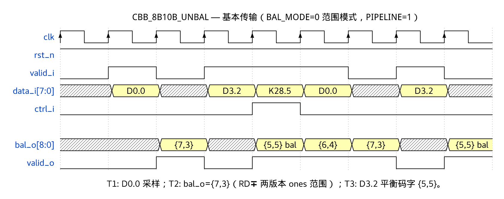
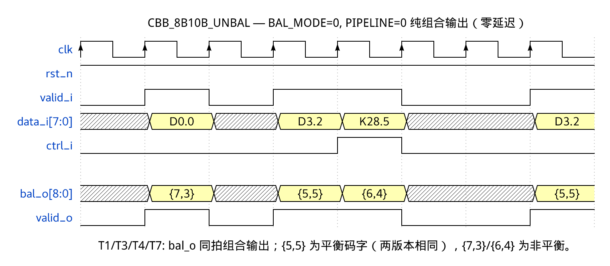
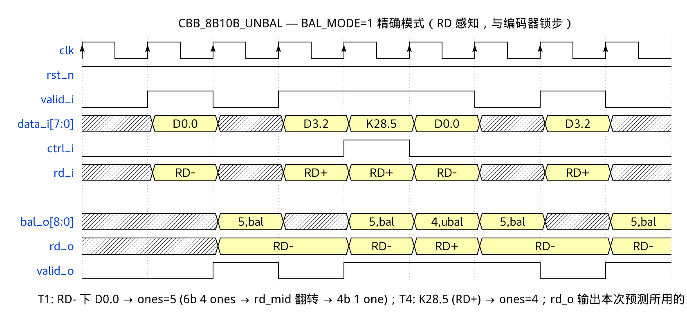
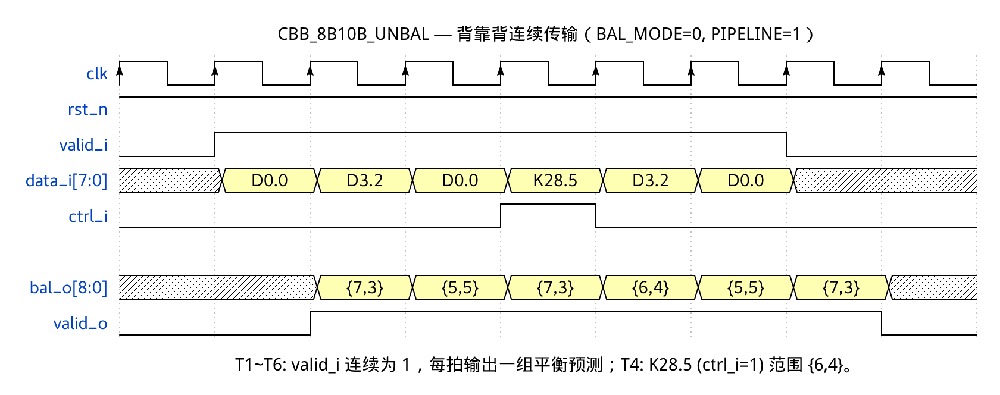

# CBB_8B10B_UNBAL_UG

---

## 目录

- [1. 功能及应用场景](#1-功能及应用场景)
- [2. 规格](#2-规格)
- [3. 方案分析](#3-方案分析)
- [4. 配置参数](#4-配置参数)
- [5. 接口](#5-接口)
- [6. 时序图](#6-时序图)
- [7. PPA](#7-ppa)

---

## 1. 功能及应用场景

### 1.1 核心功能

`cbb_8b10b_unbal` 是 **8b/10b 编码平衡预测器**，在数据实际送入编码器**之前**预判编码后的运行不一致 (Running Disparity, RD) 状态与编码平衡信息：

```
8-bit 数据 + 1-bit 控制标识  ──▶  平衡预测信息 (ones 计数 + 平衡标志 + RD 状态)
```

核心价值在于**前馈预判 (feed-forward prediction)**：调度器在数据进入编码器之前即可获得编码后的 DC 平衡特征，提前做出预加重、加扰或均衡决策，无需等待编码器输出后再做反馈响应。

本模块**不实际执行 8b/10b 编码**，不产生 10-bit 线路符号。它是对编码结果的"特征提取器"——比完整编码器面积更小、延迟更低，专为链路调度决策设计。

### 1.2 解决问题

高速串行发送端面临的关键调度挑战：

| 挑战 | 平衡预测器的解决方案 |
|------|----------------------|
| **预加重参数滞后** — 编码器输出后才能判断 DC 不平衡程度，预加重 tap 系数调整存在反馈延迟 | 预测器置于编码器上游，提前 0~1 拍输出平衡信息，预加重系数可前馈调整 |
| **加扰决策盲区** — 上层不知当前数据编码后跳变密度是否充足，加扰器启停依赖统计滞后 | 逐符号预测 ones 计数与平衡状态，连续不平衡时可立即触发加扰或插入填充码 |
| **多通道均衡调度** — 多 lane 发送端需协调各 lane 的 DC 平衡，但各 lane 数据独立 | 每个 lane 独立例化预测器，并行输出平衡信息供全局调度器统一决策 |
| **RD 状态不可观测** — 编码器 RD 为内部状态，上层无法预知下次编码的 RD 依赖 | BAL_MODE=1 模式下预测器暴露 `rd_o` 端口，RD 状态透明可观测 |

### 1.3 适用场景

- **高速串行收发器预加重控制** — 根据预测的 ones 计数动态调整发送端 de-emphasis 幅度
- **发送端动态均衡决策系统** — 基于逐符号的 DC 平衡预测，前馈调节 FIR 均衡器 tap 系数
- **链路训练序列调度** — 在链路训练阶段预判 TS1/TS2 等有序集的平衡特性，辅助训练状态机决策
- **多 lane 偏移补偿** — 多通道并行发送时，预测各 lane 的 DC 漂移趋势，协调全局均衡策略
- **编码器前端调度** — 与 `cbb_8b10b_enc` 共享输入总线 (扇出同源)，预测器比编码器提前输出平衡信息供调度

### 1.4 模块族定位

本模块是 `cbb_coding` 线路编码模块族的子成员：

```
cbb_coding 模块族
├── 编码器 (enc)
│   ├── cbb_4b5b_enc     — 4-bit → 5-bit 编码
│   └── cbb_8b10b_enc    — 8-bit → 10-bit 编码 + RD 状态机
├── 解码器 (dec)
│   ├── cbb_4b5b_dec     — 5-bit → 4-bit 解码 + 非法检测
│   └── cbb_8b10b_dec    — 10-bit → 8-bit 解码 + RD 校验 + 非法检测
└── 平衡预测器 (unbal)
    ├── cbb_4b5b_unbal   — 4b/5b 平衡预分析
    └── cbb_8b10b_unbal  — 8b/10b RD 预判  ← 本模块
```

| 类型 | 核心变换 | 特有信号 | 独有职责 |
|:---:|------|------|------|
| enc | data → sym | `sym_o` | 编码 + DC 平衡 (8b/10b 含 RD 状态机) |
| dec | sym → data | `sym_i`, `err_o` | 解码 + 错误检测 |
| **unbal** | **data → metadata** | **`bal_o`, `rd_o`** | **预分析，不产生编码输出** |

与本模块直接配套的编码器为 `cbb_8b10b_enc`，预测器可置于编码器上游扇出同源：

```
              ┌──────────────────┐
  data_i ────▶│ cbb_8b10b_unbal  │──▶ bal_o ──▶ 调度器 (均衡/预加重决策)
  ctrl_i ────▶│                  │──▶ rd_o  ──▶ (BAL_MODE=1 时)
              └────────┬─────────┘
                       │ (扇出同源)
              ┌────────┴─────────┐
              │ cbb_8b10b_enc    │──▶ sym_o ──▶ 串行发送链路
              └──────────────────┘
```

---

## 2. 规格

每条规格以 DS 点编号标识，命名规则为 `DS.[IP_NAME].[TYPE][SPEC_ID]`。TYPE 按规格类型取值：`FUNC`（功能）、`PERF`（性能）、`INTF`（接口）、`CFG`（配置）。

**规格汇总表**：将所有 DS 点逐条列入下表，按 TYPE 分组并依 `INTF`（接口）→ `CFG`（配置）→ `FUNC`（功能）→ `PERF`（性能）的顺序排列。表格共三列：DS 编号、类型、简述。表中每一行与下方一条详细规格分节（2.x）一一对应，并保持相同顺序。

| DS 编号 | 类型 | 简述 |
|---------|:---:|------|
| `DS.8B10B_UNBAL.INTF.001` | INTF | Valid 握手协议（valid-only，无反压） |
| `DS.8B10B_UNBAL.INTF.002` | INTF | `bal_o` 输出编码格式 |
| `DS.8B10B_UNBAL.CFG.001` | CFG | 流水线级数可选（0/1） |
| `DS.8B10B_UNBAL.CFG.002` | CFG | 平衡预测模式选择（BAL_MODE 0/1） |
| `DS.8B10B_UNBAL.FUNC.001` | FUNC | 8b/10b 编码平衡预测 |
| `DS.8B10B_UNBAL.FUNC.002` | FUNC | 双模式架构（范围 / RD 感知精确预测） |
| `DS.8B10B_UNBAL.FUNC.003` | FUNC | 模式 A：RD 感知精确预测 |
| `DS.8B10B_UNBAL.FUNC.004` | FUNC | 模式 B：无状态范围预测 |
| `DS.8B10B_UNBAL.PERF.001` | PERF | 吞吐率 1 symbol/cycle |

> 规格明细分节 (2.x) 应保持与汇总表相同的排序：INTF → CFG → FUNC → PERF。

### 2.1 Valid 握手协议 — DS.8B10B_UNBAL.INTF.001

- `valid_i = 1` 时，`data_i` 和 `ctrl_i` (及 `rd_i`，若 BAL_MODE=1) 被采样
- `valid_i = 0` 时本拍为气泡：`bal_o` 仍随输入更新，仅 `valid_o` 拉低标记该拍无效（BAL_MODE=1 下 RD 状态机受 `valid_i` 门控，气泡拍保持不翻转）
- `valid_o` 是 `valid_i` 经 `PIPELINE` 级寄存后的精确副本
- `valid_o = 1` 时，`bal_o` (及 `rd_o`，若 BAL_MODE=1) 上的信息有效
- 吞吐率可达 **1 symbol/cycle** (背靠背传输无气泡)

### 2.2 bal_o 输出编码格式 — DS.8B10B_UNBAL.INTF.002

`bal_o` 为 **9-bit** 固定位宽端口，位域定义随 `BAL_MODE` 不同：

```
bal_o[8:0] 位域分配:
  ┌──────────────────────────────────────────────────────┐
  │ [8]    = is_balanced                                │
  │ [7:4]  = ones_cnt_max[3:0]  (BAL_MODE=0)            │
  │        = ones_cnt[3:0]      (BAL_MODE=1)            │
  │ [3:0]  = ones_cnt_min[3:0]  (BAL_MODE=0)            │
  │        = reserved (4'd0)    (BAL_MODE=1)            │
  └──────────────────────────────────────────────────────┘
```

**BAL_MODE=1 (精确模式) 位域详情：**

| 位域 | 位置 | 描述 |
|------|:---:|------|
| `is_balanced` | `bal_o[8]` | 编码符号完美平衡标志：1 = 0/1 等量 (disparity=0), 0 = 不平衡 |
| `ones_cnt` | `bal_o[7:4]` | 编码符号中 '1' 的精确个数，范围 0~10 (有效 8b/10b 码字范围为 4~6；预测模型说明见 §2.7) |
| reserved | `bal_o[3:0]` | 保留，恒为 4'd0 |

**BAL_MODE=0 (范围模式) 位域详情：**

| 位域 | 位置 | 描述 |
|------|:---:|------|
| `is_balanced` | `bal_o[8]` | 码字完美平衡标志：1 = 两候选版本相同 (min==max, 即码字唯一、disparity=0), 0 = 两版本不同 (非平衡码字) |
| `ones_cnt_max` | `bal_o[7:4]` | 两候选版本中 '1' 的最大个数，范围 0~10 |
| `ones_cnt_min` | `bal_o[3:0]` | 两候选版本中 '1' 的最小个数，范围 0~10 |

> **使用建议**：调度器可通过 `{ones_cnt_max, ones_cnt_min}` 直接判断 DC 平衡的不确定度。`ones_cnt_max − ones_cnt_min` 越大，表示该码字在不同 RD 下的编码差异越大，调度策略需更保守。

### 2.3 流水线级数可选 — DS.8B10B_UNBAL.CFG.001

通过 parameter `PIPELINE` 配置输出寄存器级数：

| PIPELINE | 模式 | 延迟 | 说明 |
|:---:|------|:---:|------|
| 0 | 纯组合逻辑 | 0 cycle | `clk`/`rst_n` 端口保留但不参与逻辑。BAL_MODE=1 下 RD 状态机仍有时钟寄存器 |
| 1 (默认) | 一级寄存器 | 1 cycle | 输出经一级寄存器寄存，适配大多数场景 |

PIPELINE=0 时 BAL_MODE=1 的特殊处理：RD 状态机寄存器本身仍需 `clk`，但 `bal_o` 和 `valid_o` 为组合输出 (`valid_o = valid_i` 组合直通，`bal_o` 为当前 RD 状态下的查表组合结果)。

### 2.4 平衡预测模式选择 — DS.8B10B_UNBAL.CFG.002

通过 parameter `BAL_MODE` 选择工作模式，详见 §2.5 和 §2.6。两种模式共用同一 RTL 顶层，通过 generate 块切换。

### 2.5 8b/10b 编码平衡预测 — DS.8B10B_UNBAL.FUNC.001

模块接收 8-bit 原始数据与 1-bit 控制标识，通过 8b/10b 码表查表预测编码后的 DC 平衡特征：

- `ctrl_i = 0`：将 `data_i[7:0]` 作为 Dx.y 数据码预测，覆盖全部 256 个 D 码码点
- `ctrl_i = 1`：将 `data_i[7:0]` 作为 Kx.y 控制码索引预测。K 码使用完整的 8-bit data_i：K28.0~K28.7 对应 `data_i = {fgh[2:0], 5'h1C}` (fgh=0~7)；K23.7/K27.7/K29.7/K30.7 对应 `data_i = {3'h7, abcde}` (abcde=5'h17/5'h1B/5'h1D/5'h1E)，覆盖全部 12 个有效 K 码码点
- 预测结果包括编码符号中 '1' 的个数 (ones count) 及符号是否完美平衡 (is_balanced)
- 预测不产生 10-bit 线路符号，仅输出平衡元数据

### 2.6 双模式架构 — DS.8B10B_UNBAL.FUNC.002

模块通过 `BAL_MODE` 参数支持两种工作模式，适应不同的精度/资源需求：

| BAL_MODE | 名称 | 内部状态 | 输出类型 | rd_i/rd_o 端口 | 适用场景 |
|:---:|------|:---:|------|:---:|------|
| 0 (默认) | 无状态范围预测 (模式 B) | 无 | 范围 [min, max] | 不存在 | 面积敏感、调度器仅需知道最坏情况边界 |
| 1 | RD 感知精确预测 (模式 A) | RD 状态机 | 精确值 | 存在 | 精度敏感、需与编码器锁步运行或 RD 观测 |

### 2.7 模式 A (BAL_MODE=1)：RD 感知精确预测 — DS.8B10B_UNBAL.FUNC.003

预测器内部维护一个与 `cbb_8b10b_enc` 编码器**锁步运行**的 RD 状态机，查表时能精确预知编码器将选择哪个 disparity 版本，输出精确值：

1. 查询当前输入 (D 码或 K 码) 对应的 10-bit 码字及其 disparity (+2, 0, −2；有效 8b/10b 码字不产生 ±4)
2. 基于内部 RD 状态选择对应 disparity 版本的码字
3. 若 disparity = 0 (完美平衡)，输出唯一码字的特征，RD 不变
4. 若 disparity ≠ 0，根据当前 RD 选择正/负版本，并更新 RD 状态
5. 复位后 RD 初始值为 **RD− (−1)**，与 `cbb_8b10b_enc` 一致

| 预测项 | 位宽 | 输出 |
|------|:---:|------|
| `ones_cnt` | 4-bit (0~10) | 精确的编码符号中 '1' 的个数 |
| `is_balanced` | 1-bit | 符号是否 0/1 等量 (disparity = 0) |
| `rd_o` | 1-bit | 本次预测所用的 RD 状态：0 = RD−, 1 = RD+ (PIPELINE=1 下为查表时锁存的 RD，PIPELINE=0 下为当前 RD) |

**锁步要求**：
- 预测器与编码器共享同一复位源 (`rst_n`) 以同步 RD 初值
- 或通过 `rd_i` 端口从编码器 `rd_o` 回读 RD 作为校正源 (此时即使不复位也能自动校准)

**disparity 与 ones_cnt 的换算关系**：

| ones_cnt | disparity | is_balanced | 含义 |
|:---:|:---:|:---:|------|
| 3 | −4 | 0 | 严重负偏 (3 个 '1', 7 个 '0') |
| 4 | −2 | 0 | 负偏 (4 个 '1', 6 个 '0') |
| 5 | 0 | 1 | 完美平衡 |
| 6 | +2 | 0 | 正偏 (6 个 '1', 4 个 '0') |
| 7 | +4 | 0 | 严重正偏 (7 个 '1', 3 个 '0') |

> 注：disparity = 2 × ones_cnt − 10。用户可按需从 ones_cnt 推导 disparity 值。
>
> **预测模型说明**：BAL_MODE=1 的 ones_cnt 采用与 `cbb_8b10b_enc` 编码器同构的**符号内中间 RD 级联**模型：6b 子块按 `rd_lookup` 选择版本 → 由 6b ones 数推导 `rd_mid` (3 平衡保持 / 4 翻 RD+ / 2 翻 RD−) → 3b/4b 子块按 `rd_mid` 选择版本 → `ones_cnt = ones_6b_sel + ones_4b_sel`。RD 状态按符号总 disparity 结算 (平衡保持，否则翻转)。模型与编码器实际输出逐符号精确一致 (256 D 码 + 12 K 码 × 双 RD 全量比对 0 偏差)。

### 2.8 模式 B (BAL_MODE=0, 默认)：无状态范围预测 — DS.8B10B_UNBAL.FUNC.004

预测器放弃 RD 状态机，对 RD− 和 RD+ 两个候选版本**并行做特征提取**，输出 `[min, max]` 范围。

此模式下预测器为**纯组合逻辑**——不维护内部状态，不需要 `rd_i` 输入。`rd_i`/`rd_o` 端口在端口列表中静态存在但逻辑无效（`rd_o` 恒为 0）。因为没有状态，所以不存在锁步失步问题。

| 预测项 | 位宽 | 输出 |
|------|:---:|------|
| `ones_cnt_min` | 4-bit (0~10) | 两候选版本中 '1' 的最小个数 |
| `ones_cnt_max` | 4-bit (0~10) | 两候选版本中 '1' 的最大个数 |
| `is_balanced` | 1-bit | 码字是否完美平衡：1 = 两候选版本相同 (disparity=0 的唯一码字), 0 = 两版本不同 (非平衡码字) |

**范围语义**：
- 若码字有正/负两个 disparity 版本 (如 6/4 或 4/6 ones)，则 `ones_cnt_min` 和 `ones_cnt_max` 分别对应两个版本的 ones 计数
- 若码字仅有一个版本 (完美平衡，disparity=0)，则 `ones_cnt_min = ones_cnt_max = 5`，`is_balanced = 1`
- 调度器根据范围做出保守决策：例如预加重幅度按最坏情况 (`ones_cnt_max`) 配置

### 2.9 吞吐率 — DS.8B10B_UNBAL.PERF.001

- 最大吞吐率：**1 symbol/cycle** (背靠背传输无气泡)
- 输入到输出的延迟 = `PIPELINE` 个时钟周期
- 流水线填充后每个时钟周期输出一组平衡预测结果
- 最大工作频率：见 [§7 PPA](#7-ppa)

---

## 3. 方案分析

方案分析先做原理分析，说明功能的几种主流实现方法，对比优劣后确定本设计选用方法并详解其核心原理；再讲设计方案，结合原理图分点阐述基于选定原理的具体实现步骤，明确核心操作与特殊功能执行方式，可附典型场景示例辅助说明。

### 3.1 原理分析

#### 3.1.1 为什么需要平衡预测

8b/10b 编码器通过内部 RD 状态机保证输出码流的 DC 平衡，但编码器的 RD 状态对上层调度器是不可见的。当调度器需要在数据进入编码器**之前**做出决策时 (如：本拍数据编码后会导致多大的 DC 漂移？是否需要启用预加重？)，面临信息不对称的问题。

传统的解决方案是在编码器输出端加装 DC 平衡监测器，形成**反馈控制回路**：

```
data_i → [编码器] → sym_o → [DC 监测] → 统计信息 → [调度器] → 控制编码器
                                     ↑                │
                                     └── 反馈延迟 ────┘
```

反馈回路的固有问题是**延迟**——监测器在编码器输出后才能判断不平衡度，调度器收到信息时已有若干符号进入链路。这在高速链路中可能导致 DC 漂移累积超出 AC 耦合电容的容忍范围。

平衡预测器将架构改为**前馈预判**：

```
data_i ──┬──▶ [预测器] ──▶ bal_o ──▶ [调度器] ──▶ 控制决策 (同拍或 1 拍延迟)
         │
         └──▶ [编码器] ──▶ sym_o ──▶ 串行发送
```

预测器与编码器共享相同的输入数据，但预测器面积更小、延迟更低，调度器可获得超前 (或同步) 的平衡信息。

#### 3.1.2 8b/10b 码表的平衡特性分析

8b/10b 编码将 8-bit 数据分解为 5b/6b 子块和 3b/4b 子块，分别编码后拼接为 10-bit 符号。每个子块的 disparity 可能为 +2、0、−2；标准码表保证有效码字的总 disparity 只为 0、±2 (子块 ±4 同向的情况被码表排除)。

**D 码 (256 个) 的 disparity 分布统计**：

| 总 disparity | ones_cnt | 码字数量 | 占比 | 说明 |
|:---:|:---:|:---:|:---:|------|
| 0 | 5 | 134 | ~52% | 完美平衡，两子块均平衡或互补抵消 |
| ±2 | 6 或 4 | 122 | ~48% | 单极性偏置，RD 翻转 1 次 |
| ±4 | 7 或 3 | 0 | 0% | 有效 D 码不产生 ±4 disparity (非法输入组合除外) |

> 注：上表为**编码器实际输出**的 disparity 分布 (标准码表保证 0/±2)。BAL_MODE=0 的范围预测按子块同极性直接相加建模 (范围恒覆盖编码器实际输出)；BAL_MODE=1 的精确预测采用符号内中间 RD 级联模型，与编码器逐符号一致 (详见 §2.7 预测模型说明)。

每个 D 码在码表中存在至多两个 10-bit 表示：RD− 版本 (disparity ≥ 0) 和 RD+ 版本 (disparity ≤ 0)。编码器根据当前 RD 选择对应版本。

- 对于 disparity=0 的码字，RD− 和 RD+ 版本相同 (唯一码字)
- 对于 disparity≠0 的码字，两个版本互为 0/1 反转关系 (不完全精确，但 ones 计数互补：`ones_cnt_RD− + ones_cnt_RD+ = 10`)

**K 码 (12 个) 的平衡特性**：

K 码的 disparity 分布与 D 码不同，且部分 K 码 (如 K28.5 COM 字符) 具有特定的 disparity 属性。K 码编码同样遵循 RD 状态机规则。

#### 3.1.3 预测方案对比

| 方案 | 原理 | 面积 (等效门) | 关键路径 | 适用场景 |
|------|------|:---:|:---:|------|
| **全编码 + 后分析** | 先例化完整 8b/10b 编码器 → 对 10-bit 输出做 popcount 统计 ones 数 | ~1200 | 编码 LUT + XOR 树 + popcount 级联 | 调试用，浪费编码器面积 |
| **独立平衡 ROM (本设计)** | 预计算 ROM 存储每个码点在每个 RD 下的 ones 计数元数据，查表输出 | ~500 (BAL_MODE=0) / ~700 (BAL_MODE=1) | 1~2 级 ROM 读 | 面积最优，延迟最低 |
| **动态计算** | 对码表做在线逻辑最小化，用组合逻辑实时计算 disparity | ~400 | 3~4 级 XOR 树 | 面积更小但时序差，不适合高频 |

**选型结论**：采用**独立平衡 ROM** 方案。理由：

1. **面积与频率折中最优**：ROM 面积约 500~700 等效门，远小于完整编码器 (~1200 门)；关键路径仅 1~2 级 ROM 读，频率潜力高
2. **双模式共用同一 ROM 核心**：BAL_MODE=0 和 BAL_MODE=1 共享 ROM 存储，仅输出选择逻辑不同
3. **与编码器输入兼容**：共享 `data_i`/`ctrl_i` 总线，可作为编码器的扇出前端
4. **解耦独立**：预测器与编码器独立例化，可灵活选择是否部署预测器 (低功耗场景可省略)

### 3.2 设计方案

#### 3.2.1 整体架构

```
                   ┌────────────────────────────────────────┐
                   │          cbb_8b10b_unbal                 │
                   │                                        │
  data_i[7:0] ────▶│  ┌────────────────────────────────┐    │
  ctrl_i ─────────▶│  │  5b/6b + 3b/4b ones-count ROM  │    │
  valid_i ────────▶│  │  ┌──────────────────────────┐  │    │
                   │  │  │ 5b/6b ones 表 (32 entries)│  │    │
                   │  │  │  按 abcde 索引            │  │    │
                   │  │  │  每项: ones_rdm, ones_rdp │  │    │
                   │  │  │  (K.28 在 0x1C 处 ctrl 分支)│ │    │
                   │  │  ├──────────────────────────┤  │    │
                   │  │  │ 3b/4b ones 表 (8 entries) │  │    │
                   │  │  │  按 fgh 索引              │  │    │
                   │  │  │  每项: ones_rdm, ones_rdp │  │    │
                   │  │  └────────────┬─────────────┘  │    │
                   │  │               │ ones 求和       │    │
                   │  │    ┌──────────▼──────────┐      │    │
                   │  │    │   模式选择 / 输出    │      │    │
                   │  │    │  BAL_MODE=0:范围     │──────┼────▶ bal_o[8:0]
                   │  │    │  BAL_MODE=1:精确     │      │    │
                   │  │    └─────────────────────┘      │    │
                   │  └────────────────────────────────┘    │
                   │                                        │
  rd_i ───────────▶│  ┌──────────────────────┐              │
  (BAL_MODE=1)     │  │  RD 状态机           │──────────────┼────▶ rd_o
                   │  │  (仅 BAL_MODE=1)     │              │  (BAL_MODE=1)
                   │  └──────────────────────┘              │
                   │                                        │
                   │  ┌──────────────────────┐              │
                   │  │  PIPELINE 寄存器     │──────────────┼────▶ valid_o
                   │  │  (PIPELINE=1 时)     │              │
                   │  └──────────────────────┘              │
                   └────────────────────────────────────────┘
```

#### 3.2.2 核心实现步骤

**Step 1 — ROM 地址生成**：

按 5b/6b + 3b/4b 结构化子块拆分（与 `cbb_8b10b_enc` 编码器同构）：

```
5b/6b ones 表: 按 abcde = data_i[4:0] 索引, 32 entries (K.28 在 0x1C 处按 ctrl_i 分支)
3b/4b ones 表: 按 fgh = data_i[7:5] 索引, 8 entries
```

ROM 中每项存储两个 ones 计数值：
- `ones_rdm[3:0]`：RD− 假设下的编码符号 ones 计数
- `ones_rdp[3:0]`：RD+ 假设下的编码符号 ones 计数

总 ones 计数为两个子块之和：`ones_total = ones_6b + ones_4b`。

对于完美平衡的码字 (disparity=0)，`ones_rdm == ones_rdp == 5`。

**Step 2 — 模式 B 输出 (BAL_MODE=0)**：

纯组合逻辑，无需 RD 状态：

`bal_o` 组合输出：`{is_balanced, ones_cnt_max[3:0], ones_cnt_min[3:0]}`。

**Step 3 — 模式 A 输出 (BAL_MODE=1)**：

内部 RD 状态机跟踪当前 RD 值，选择对应版本的 ones 计数值：

**Step 4 — 流水线寄存 (PIPELINE 控制)**：

- PIPELINE=0：`bal_o` 和 `valid_o` 为组合输出。`valid_o = valid_i` 组合直通。BAL_MODE=1 下 RD 状态机仍需时钟更新
- PIPELINE=1 (默认)：`bal_o`、`valid_o` (及 `rd_o`，若存在) 经一级寄存器输出

#### 3.2.3 设计要点

- **BAL_MODE=0 无状态**：模式 B 为纯组合逻辑 + 可选输出寄存器，无 RD 状态机。`rd_i`/`rd_o` 端口在端口列表中静态存在但逻辑无效。因为没有状态，所以没有与编码器锁步失步的风险。这是上电默认配置，适用于大多数面积敏感或保守设计场景。

- **BAL_MODE=1 锁步**：模式 A 的 RD 状态机需要与编码器保持同步，两者的 RD 初值必须一致 (均从 RD− 开始)。同步方式有两种：共用同一 `rst_n` 复位源 (推荐)；或通过 `rd_i` 端口从编码器 `rd_o` 注入 RD 校正值。

- **单符号接口**：每个时钟周期处理独立的一笔 8-bit 数据，吞吐率 1 symbol/cycle。若 SoC 数据通路较宽 (如 32-bit、64-bit)，应在外部多次例化或通过 wrapper 组合。

- **码表完备性**：`ctrl_i=1` 时仅 12 个 K 码索引有效：K28.0~K28.7 对应 `{fgh[2:0], 5'h1C}` (fgh=0~7, 8 个)；K23.7 对应 `{3'h7, 5'h17}`；K27.7 对应 `{3'h7, 5'h1B}`；K29.7 对应 `{3'h7, 5'h1D}`；K30.7 对应 `{3'h7, 5'h1E}`。未使用的 K 码组合 (如 ctrl_i=1 但 data_i 不对应任何有效 K 码) 的预测行为由上层约束避免送入（ctrl_i=1 且 abcde=0x1F 不属于有效 K 码，ROM 按 D.31 的 ones (4/2) 预测）。

- **跨配置兼容**：PIPELINE=0 和 PIPELINE=1 的例化端口完全一致 (`clk`/`rst_n` 在 PIPE=0 时保留但不使用于输出通路)，上层可无痛切换。

---

## 4. 配置参数

| 参数 | 类型 | 配置范围 | 默认值 | 描述 |
|------|------|:---:|:---:|------|
| `PIPELINE` | int | 0 / 1 | 1 | 输出流水线级数 (详见 §4.1) |
| `BAL_MODE` | int | 0 / 1 | 0 | 平衡预测模式选择 (详见 §4.2) |

> 数据位宽 (8-bit) 为 8b/10b 编码标准固有属性，非 parameter 可配。模块保持单符号接口，若 SoC 数据通路较宽，应在外部多次例化或通过 wrapper 组合。

### 4.1 PIPELINE — 流水线级数

| 值 | 名称 | 延迟 | 适用场景 |
|:---:|------|:---:|------|
| 0 | 纯组合逻辑 | 0 cycle | 极低延迟要求的直通通路，预测结果与输入同拍可用 |
| 1 (默认) | 一级寄存器 | 1 cycle | 标准配置，适配绝大多数调度器时序要求 |

BAL_MODE=1 时，PIPELINE=0 下 RD 状态机仍需时钟更新，但 `bal_o` 和 `valid_o` 为组合输出。PIPELINE=1 时所有输出均为寄存器输出。所有 PIPELINE 取值下 `clk`/`rst_n` 端口命名与位宽不变，保证跨配置的例化兼容性。

### 4.2 BAL_MODE — 平衡预测模式

| 值 | 名称 | 端口变化 | 适用场景 |
|:---:|------|------|------|
| 0 (默认) | 模式 B — 无状态范围预测 | `rd_i`/`rd_o` 端口保留但逻辑无效。纯组合逻辑 + 可选输出寄存，无内部状态 | 面积敏感、调度器仅需最坏情况边界、无需 RD 跟踪 |
| 1 | 模式 A — RD 感知精确预测 | 增加输入 `rd_i` (外部 RD 注入) 和输出 `rd_o` (本次预测所用的 RD 状态)。内部维护 RD 状态机 | 精度敏感、需与编码器锁步、需 RD 状态观测、协议分析/调试 |

**模式选择指南**：

| 考量维度 | BAL_MODE=0 (默认) | BAL_MODE=1 |
|:---:|:---:|:---:|
| 面积 | 较小 (无 RD 状态机) | 较大 (RD 状态机 + 额外端口) |
| 精度 | 范围 (不确定性) | 精确值 |
| 对编码器 RD 的依赖 | 无 | 需锁步 (同源复位或 rd_i 校正) |
| 推荐场景 | 通用调度、面积敏感 | 精确预判、RD 观测 |

---

## 5. 接口

### 5.1 信号清单

| 信号名 | 位宽 | I/O | 条件 | 描述 |
|--------|:---:|:---:|------|------|
| `clk` | 1 | I | 始终存在 | 系统时钟，所有寄存器在 `clk` 上升沿触发。PIPELINE=0 且 BAL_MODE=0 时端口存在但不参与逻辑 |
| `rst_n` | 1 | I | 始终存在 | 异步复位，低有效。BAL_MODE=1 时复位内部 RD 状态机至 RD−；复位后所有输出寄存器清零 |
| `data_i` | 8 | I | 始终存在 | 待分析的 8-bit 原始数据。`ctrl_i=0` 时为 D 码数据；`ctrl_i=1` 时为完整 8-bit K 码索引 `{y[2:0], x[4:0]}` |
| `ctrl_i` | 1 | I | 始终存在 | 控制码标识：`1` = K 码，`0` = D 码 (数据) |
| `valid_i` | 1 | I | 始终存在 | 输入有效指示。`1` 时 `data_i`/`ctrl_i` (及 `rd_i`，若存在) 有效；`0` 时输入忽略 |
| `rd_i` | 1 | I | `BAL_MODE=1` | 外部 RD 注入：`0` = RD−，`1` = RD+。在 `valid_i=1` 的拍采样，用于校正内部 RD 状态机 |
| `bal_o` | 9 | O | 始终存在 | 编码平衡预测信息，位域定义见 §5.4 |
| `rd_o` | 1 | O | `BAL_MODE=1` | 内部 RD 状态机的当前 RD 状态：`0` = RD−，`1` = RD+。与 `bal_o` 同拍有效 |
| `valid_o` | 1 | O | 始终存在 | 输出有效指示。`1` 时 `bal_o` (及 `rd_o`，若存在) 有效 |

### 5.2 信号详细说明

#### data_i[7:0]

| ctrl_i | data_i | 含义 |
|:---:|------|------|
| 0 | 0x00 ~ 0xFF | 256 个 D 码数据码点 (D0.0 ~ D31.7) |
| 1 | `{y[2:0], x[4:0]}` | K 码控制码索引，使用完整 8-bit：K28.0~K28.7 = `{fgh, 5'h1C}` (fgh=0~7)，K23.7/K27.7/K29.7/K30.7 = `{3'h7, 5'h17/5'h1B/5'h1D/5'h1E}`。12 个有效 K 码索引见 [§3.2.2 Step 1](#322-核心实现步骤) |

#### ctrl_i

- `ctrl_i = 0`：本拍输入为 D 码 (普通数据负载)
- `ctrl_i = 1`：本拍输入为 K 码 (链路控制信息：逗号检测、帧定界、空闲、时钟补偿等)

#### rd_i (仅 BAL_MODE=1)

- `rd_i` 在 `valid_i=1` 的拍被采样，作为外部 RD 校正值注入内部 RD 状态机
- `rd_i = 0`：RD−，`rd_i = 1`：RD+
- 典型用法：连接 `cbb_8b10b_enc` 的 `rd_o` 输出，实现预测器与编码器的 RD 自动校准
- BAL_MODE=0 时此端口逻辑无效（`rd_o` 恒为 0）

#### rd_o (仅 BAL_MODE=1)

- 输出本次预测所用的 RD 状态 (PIPELINE=1 下为查表时锁存的 RD)，与 `bal_o` 同拍有效 (`valid_o=1` 时)
- `rd_o = 0`：RD−，`rd_o = 1`：RD+
- 可用于：级联到下一级编码器的 `rd_i`；协议分析仪 RD 观测；BIST 自测试 RD 状态录制
- BAL_MODE=0 时此端口逻辑无效（`rd_o` 恒为 0）

### 5.4 bal_o 输出编码

`bal_o[8:0]` 的位域定义因 BAL_MODE 不同而异。

#### BAL_MODE=1 (精确模式)

| 位域 | 位置 | 编码 |
|------|:---:|------|
| `is_balanced` | `bal_o[8]` | `1` = 编码符号完美平衡 (5 ones / 5 zeros, disparity=0) |
| `ones_cnt` | `bal_o[7:4]` | 编码符号中 '1' 的精确个数，范围 4~6 (有效 8b/10b 码字，与编码器实际输出逐符号一致) |
| reserved | `bal_o[3:0]` | 保留，恒为 4'd0 |

#### BAL_MODE=0 (范围模式)

| 位域 | 位置 | 编码 |
|------|:---:|------|
| `is_balanced` | `bal_o[8]` | `1` = 码字完美平衡，两候选版本相同 (disparity=0 的唯一码字); `0` = 非平衡码字，两版本不同 |
| `ones_cnt_max` | `bal_o[7:4]` | 两候选版本中 '1' 的最大个数 |
| `ones_cnt_min` | `bal_o[3:0]` | 两候选版本中 '1' 的最小个数 |

#### 典型预测值示例

| 输入 | 码类型 | BAL_MODE=1 (假设 RD−) | BAL_MODE=0 |
|------|:---:|------|------|
| `data_i=0x00, ctrl_i=0` (D0.0) | D 码 (非平衡) | `bal_o = 9'b1_0101_0000` (ones=5, balanced；6b 4 ones → rd_mid 翻转 → 4b 1 one) | `bal_o = 9'b0_0111_0011` (max=7, min=3，范围模式) |
| `data_i=0xBC, ctrl_i=1` (K28.5) | K 码 (COM) | `bal_o = 9'b0_0110_0000` (ones=6 @RD−；@RD+ 为 ones=4) | `bal_o = 9'b0_0110_0100` (max=6, min=4) |
| `data_i=0x43, ctrl_i=0` (D.3.2) | D 码 (平衡) | `bal_o = 9'b1_0101_0000` (ones=5, balanced) | `bal_o = 9'b1_0101_0101` (max=5, min=5, balanced) |

> **调度器使用建议**：BAL_MODE=0 下，`ones_cnt_max − ones_cnt_min` 为 0 时 (完美平衡码字)，编码输出与 RD 状态无关，调度器可做出确定性决策。差值 ≥ 2 时，调度策略应考虑最坏情况 (`ones_cnt_max`)。

---

## 6. 时序图

### 6.1 基本传输 — BAL_MODE=0, PIPELINE=1 (默认配置)



- T1 时刻：`valid_i=1`，`data_i=D0`，`ctrl_i=0` (D 码)，输入被采样
- T2 时刻：`valid_o=1`，`bal_o=B(D0)`，输出预测的 ones 计数范围
- T1~T2：`valid_i=0`，本拍为气泡，`bal_o` 仍随输入更新但 `valid_o=0`，该拍数据无效
- T3 时刻：`data_i=D3.2` (平衡码字)，输出 `{5,5}` (balanced)
- T5 时刻：`ctrl_i=1` (K28.5)，输出对应 K 码的平衡信息 `{6,4}`

### 6.2 BAL_MODE=0, PIPELINE=0 (纯组合逻辑)



- `valid_o = valid_i` (组合直通，无延迟)
- `bal_o` 为组合输出，同拍跟随输入变化
- 虚线表示组合路径传播延迟

### 6.3 BAL_MODE=1, PIPELINE=1 (RD 感知精确预测)



- `rd_o` 在复位后初始为 RD− (`0`)
- `rd_o` 输出本次预测所用的 RD (PIPELINE=1 下为查表时锁存的 RD，即上一拍结算后的 RD 状态)
- `bal_o` 输出精确的 ones_cnt 和 is_balanced (根据当前 RD 选择的版本；预测模型说明见 §2.7)
- 图中注释：`6,ubal` = ones_cnt=6, is_balanced=0；`5,bal` = ones_cnt=5, is_balanced=1

### 6.4 背靠背连续传输 (BAL_MODE=0, PIPELINE=1)



- 当 `valid_i` 连续为 1 时，预测器每个周期输出一组平衡信息
- 吞吐率 = 1 symbol/cycle，流水线满载无气泡
- 图中 `6~4` 表示 `{max=6, min=4}`，`5=5` 表示 `{max=5, min=5}` (完美平衡)
- D3.2 为完美平衡码字 (is_balanced=1，{5,5})，调度器可放心降低预加重强度

### 6.5 BAL_MODE=1 复位与 RD 同步时序

- `rst_n = 0` 期间：`bal_o` 和 `valid_o` 强制清零，内部 RD 状态机复位至 RD− (`rd_o=0`)
- `rst_n` 释放后：模块在第一个 `clk` 上升沿开始正常工作，RD 从 RD− 起步
- RD 状态机随每个有效输入的 disparity 翻转，与编码器锁步一致

### 6.6 BAL_MODE=1 外部 RD 注入 (rd_i 校正)

- `rd_i` 在 `valid_i=1` 的拍被采样，作为该周期编码的起始 RD
- 编码后 `rd_o` 输出更新后的 RD 状态
- 典型互联：`cbb_8b10b_enc.rd_o` → `cbb_8b10b_unbal.rd_i`，实现自动校准，即使不复位也能锁定 RD

---

## 7. PPA

> 综合条件：TSMC 12nm FinFET CLL (tcbn12ffcll)，SS 0.9V 125°C，Design Compiler W-2024.09-SP3。

### 7.1 配置 A：默认范围模式 (BAL_MODE=0, PIPELINE=1)

**功能场景**：无状态范围预测，一级寄存器输出。适用于通用调度场景，面积优先。

**参数设置：**

| 参数 | 设置值 | 说明 |
|------|:---:|------|
| `PIPELINE` | 1 | 一级寄存器输出 |
| `BAL_MODE` | 0 | 无状态范围预测模式 |

**PPA 数据：**

| 项目 | 实测值 |
|------|:------:|
| 频率 | 1 GHz (slack +0.77 ns) |
| 面积 | 13.27 µm² (41 cells: 33 comb + 8 seq) |
| 功耗 | 34.25 µW 动态 + 67.66 nW 漏电 |

### 7.2 配置 B：精确预测模式 (BAL_MODE=1, PIPELINE=1)

**功能场景**：RD 感知精确预测，一级寄存器输出。适用于需要与编码器锁步运行的高精度调度场景。

**参数设置：**

| 参数 | 设置值 | 说明 |
|------|:---:|------|
| `PIPELINE` | 1 | 一级寄存器输出 |
| `BAL_MODE` | 1 | RD 感知精确预测模式 |

**PPA 数据：**

| 项目 | 实测值 |
|------|:------:|
| 频率 | 1 GHz (slack +0.77 ns) |
| 面积 | 13.27 µm² (41 cells: 33 comb + 8 seq) |
| 功耗 | 34.25 µW 动态 + 67.66 nW 漏电 |

### 7.3 配置 C：低延迟组合模式 (BAL_MODE=0, PIPELINE=0)

**功能场景**：纯组合输出，零延迟。适用于预测器嵌入更大组合逻辑云的场景。

**参数设置：**

| 参数 | 设置值 | 说明 |
|------|:---:|------|
| `PIPELINE` | 0 | 纯组合输出 |
| `BAL_MODE` | 0 | 无状态范围预测模式 |

**PPA 数据：**

| 项目 | 实测值 |
|------|:------:|
| 频率 | 1 GHz (slack +0.66 ns) |
| 面积 | 5.53 µm² (33 cells: 33 comb + 0 seq) |
| 功耗 | 34.25 µW 动态 + 67.66 nW 漏电 |

### 7.4 时序说明

- **BAL_MODE=0, PIPELINE=0**：所有输出为组合逻辑输出，无寄存。输入到输出路径包含 ROM 地址译码 + min/max 比较器 + is_balanced 判断。在 1 GHz 目标频率下 setup slack 为 +0.77 ns，时序满足。外部需确保预测器所在组合路径满足其时序约束。

- **BAL_MODE=0, PIPELINE=1** (默认)：输出侧有寄存器截断组合路径。在 1 GHz 目标频率下 setup slack 为 +0.77 ns，时序余量充裕。外部逻辑在模块输入侧的组合级数不构成级联累加。

- **BAL_MODE=1, PIPELINE=1**：除 ROM 查表路径外，增加了 RD 状态机更新逻辑。在 1 GHz 目标频率下 setup slack 为 +0.77 ns。

- **BAL_MODE=1, PIPELINE=0**：RD 状态机仍需时钟更新 (RD 寄存器)。`bal_o` 为组合输出 (含 ROM + RD 选择 MUX)，`valid_o = valid_i` 组合直通。在 1 GHz 目标频率下 setup slack 为 +0.77 ns。

---