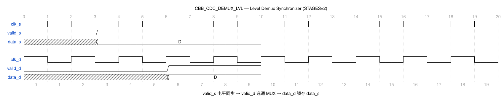

# CBB_CDC_DEMUX_LVL_UG

---

## 目录

- [1. 功能及应用场景](#1-功能及应用场景)
- [2. 规格](#2-规格)
- [3. 方案分析](#3-方案分析)
- [4. 配置参数](#4-配置参数)
- [5. 接口](#5-接口)
- [6. 时序图](#6-时序图)
- [7. PPA](#7-ppa)

---

## 1. 功能及应用场景

cbb_cdc_demux_lvl 是一个电平选择型 DMUX 同步器，用于多 bit 数据从源时钟域到目标时钟域的可靠传输。模块通过采样源域的有效信号 `valid_s`，在目标域产生对应的 `valid_d` 作为数据选通信号，将数据原样传递（含 0 值）。当 `valid_d` 无效时，输出寄存器通过反馈路径保持上一拍有效数据。

**核心功能：**

- 多 bit 数据（WIDTH）跨时钟域同步，数据原样传递
- 电平型 `valid_s` 经同步寄存器链传递到目标域作为数据选通信号
- `valid_d` 独立指示 `data_d` 有效性，数据值 0 不代表无效
- 反馈锁存机制：`valid_d=0` 时 `data_out_reg` 自保持，避免无效数据输出
- 支持参数化数据位宽和同步级数

**适用场景：**

**信号类型：** 多 bit 数据信号（位宽 WIDTH = 1~64，默认 64），带电平型 valid 选通信号。源域以 `valid_s` 电平指示数据有效，目标域输出 `data_d` 和 `valid_d` 电平信号。适用于多 bit 数据以电平 valid 选通方式跨时钟域传输的场景。

**时钟域场景：**
- **慢时钟域 → 快时钟域（推荐）：** 目标时钟频率 ≥ 源时钟频率时，同步链可充分采样 `valid_s` 电平信号。`valid_s=1` 后，数据经 (STAGES+1) 个 `clk_d` 周期稳定输出，`valid_d` 同步置高。
- **快时钟域 → 慢时钟域（受限）：** 需保证 `valid_s` 高电平保持时间 ≥ (STAGES+1) 个 `clk_d` 周期 + 1 个 `clk_s` 周期，否则目标域可能漏采有效窗口。建议频率比 f_src/f_dst ≤ 1/(2×STAGES) 以确保可靠采样。

**设计限制：**
- **位宽范围：** WIDTH 可配置为 1~64，默认 64。
- **数据有效窗口：** `valid_s=1` 的持续时间须 ≥ 正向同步延迟，确保 `valid_d` 在目标域可靠置位。
- `valid_d` 独立指示 `data_d` 有效性，数据值为 0 不代表无效状态。
- `valid_d=0` 时输出寄存器自保持，输出上一拍有效数据不变。

**典型应用：**
- 多 bit 配置数据的定时跨域同步
- 总线数据的选择性同步传输
- 源域数据使能信号为电平形式的跨域场景
- 对延迟不敏感、要求数据可靠传递的跨域应用

---

## 2. 规格

**规格汇总：**

| 规格 ID | 类型 | 规格项 | 描述 |
|---------|------|--------|------|
| DS.CBB_CDC_DEMUX_LVL.INTF.001 | INTF | 双时钟域接口 | clk_s/clk_d 独立时钟域 |
| DS.CBB_CDC_DEMUX_LVL.CFG.001 | CFG | 数据位宽 | WIDTH 1~64，默认 64 |
| DS.CBB_CDC_DEMUX_LVL.CFG.002 | CFG | 同步级数 | STAGES ≥2，默认 2 |
| DS.CBB_CDC_DEMUX_LVL.CFG.003 | CFG | 工艺选择 | TSMC_12/FPGA_XILINX/FPGA_ALTERA/RTL |
| DS.CBB_CDC_DEMUX_LVL.FUNC.001 | FUNC | 数据同步 | valid_s=1 时数据原样传递 |
| DS.CBB_CDC_DEMUX_LVL.FUNC.002 | FUNC | 反馈锁存 | valid_d=0 时输出保持 |

### 2.1 数据同步 — DS.CBB_CDC_DEMUX_LVL.FUNC.001

当 `valid_s=1` 时，`data_s` 被同步到目标域输出 `data_d`，数据原样传递（含 0 值）。`valid_d` 独立指示 `data_d` 的有效性，数据值为 0 不代表无效状态。

### 2.2 反馈锁存 — DS.CBB_CDC_DEMUX_LVL.FUNC.002

当 `valid_d=0` 时，`data_out_reg` 通过反馈路径自保持，输出上一拍有效数据不变。`valid_d=1` 时 MUX 选择新数据通路，寄存器更新为最新输入值。

### 2.3 数据位宽可配置 — DS.CBB_CDC_DEMUX_LVL.CFG.001

数据位宽 WIDTH 可参数化配置，范围为 1~64，默认值 64。

### 2.4 同步级数可配置 — DS.CBB_CDC_DEMUX_LVL.CFG.002

同步寄存器级数 STAGES 可参数化配置，范围为 ≥2。级数越大 MTBF 越高，但同步延迟越大。`valid_s` 及 `data_s` 须保持稳定至少 STAGES 个 `clk_d` 周期（直至目标域采样完成），否则可能漏采。

### 2.5 工艺选择 — DS.CBB_CDC_DEMUX_LVL.CFG.003

支持多工艺目标：TSMC_12、FPGA_XILINX、FPGA_ALTERA、RTL。不同工艺下同步单元与寄存器实现不同。

### 2.6 双时钟域接口 — DS.CBB_CDC_DEMUX_LVL.INTF.001

接口包含独立的源域时钟 `clk_s` 和目标域时钟 `clk_d`。数据在源域锁存保持稳定，仅 `valid_s` 经同步链跨域，目标域 MUX 选通稳定数据，支持任意频率比。

---

## 3. 方案分析

### 3.1 电路结构

电平选择型 DMUX 同步器的核心是为多 bit 数据提供一个可靠的选通信号，避免在目标域直接对异步数据进行采样导致亚稳态传播。

**实现方法对比：**

| 方法             | 优点                         | 缺点                             | 选用         |
| ---------------- | ---------------------------- | -------------------------------- | ------------ |
| 直接同步数据     | 结构简单，无需控制通路       | 多 bit 数据亚稳态风险高，不可靠  | 否           |
| 握手同步         | 可靠性高，支持任意位宽       | 双向握手延迟大，吞吐率低         | 否           |
| 电平选择型 DMUX  | 单向传输，结构中等，数据可靠 | 需电平保持，源端需保持 valid 电平 | **是** |

本设计采用**电平选择型 DMUX + 反馈锁存**方案：

1. `valid_s` 经同步寄存器链（STAGES 级）传递到目标域产生 `valid_d`
2. `valid_d` 作为 MUX 选择信号：为 1 时选通新数据，为 0 时反馈锁存旧数据
3. 数据源域寄存器 `data_reg` 在 `clk_s` 下锁存输入数据，确保数据在传输期间稳定

### 3.2 实现方案

**电路结构：**

```
                       ┌───────────┐
data_s ─────────────→│  data_reg │────→ MUX ──→ data_out_reg ──→ data_d
                       │ (clk_s) │         ↑
valid_s ──→ valid_sync REG (STAGES, clk_d) ──→ valid_d (mux_sel)
                       └───────────┘
                                        反馈锁存: data_out_reg ──→ MUX (valid_d=0 时保持)
```

**工作原理：**

1. 源域寄存器 `data_reg` 在 `clk_s` 时钟下锁存 `data_s`，确保数据在同步期间稳定
2. `valid_s` 为高电平时，源端保持数据有效；该电平信号进入目标域的同步寄存器链
3. 同步寄存器链（STAGES 级寄存器，由 `clk_d` 驱动）将异步 `valid_s` 同步为 `valid_d`
4. 当 `valid_d=1` 时，MUX 选通 `data_reg` 输出，`data_out_reg` 在 `clk_d` 下锁存新数据
5. 当 `valid_d=0` 时，MUX 选通 `data_out_reg` 反馈，输出保持上一拍有效数据

---

## 4. 配置参数

| 参数   | 配置范围 | 默认值 | 描述                                 |
| ------ | -------- | ------ | ------------------------------------ |
| WIDTH  | 1 ~ 64   | 64     | 数据位宽，跨域传输的数据总线宽度     |
| STAGES | ≥ 2      | 2      | 同步寄存器级数，影响同步延迟与 MTBF  |

---

## 5. 接口

| 信号名    | 位宽 | I/O | 时钟域 | 描述                             |
| --------- | ---- | --- | ------ | -------------------------------- |
| clk_s    | 1      | I   | src    | 源域时钟，上升沿有效             |
| rst_s_n  | 1      | I   | src    | 源域异步复位，低有效             |
| init_s_n | 1      | I   | src    | 源域同步复位，低有效             |
| data_s   | WIDTH  | I   | src    | 源域数据输入                     |
| valid_s  | 1      | I   | src    | 源域数据有效指示，高有效电平     |
| clk_d    | 1      | I   | dst    | 目标域时钟，上升沿有效           |
| rst_d_n  | 1      | I   | dst    | 目标域异步复位，低有效           |
| init_d_n | 1      | I   | dst    | 目标域同步复位，低有效           |
| data_d   | WIDTH  | O   | dst    | 目标域数据输出，原样传递         |
| valid_d  | 1      | O   | dst    | 目标域数据有效指示，高有效电平   |
| test     | 1      | I   | -      | 测试模式使能                     |

---

## 6. 时序图

### 6.1 典型时序



- 源时钟 `clk_s` 与目标时钟 `clk_d` 的跨域同步波形
- `valid_s` 拉高后经 STAGES 级同步延迟在目标域产生 `valid_d`
- `data_d` 在 `valid_d=1` 时更新为 `data_s` 值，`valid_d=0` 时保持
- 同步级数（STAGES=2 默认）与事件延迟标注见图脚注

---

## 7. PPA

> **综合工具：** Synopsys DC Ultra W-2024.09-SP3
> **工艺库：** TSMC 12nm tcbn12ffcllbwp7d5t16p96cpd (ssgnp0p9v125c, `/home/test/TSMC_lib/tcbn12ffcllbwp7d5t16p96cpdssgnp0p9v125c.db`)
> **综合策略：** `compile_ultra -retime -no_seq_output_inversion -no_autoungroup` + 增量编译，时钟周期 0.204ns (4.9GHz)
> **物理约束：** input/output delay = 10% 时钟周期，双时钟域各自约束

### 7.1 参数设置

| 参数   | 设置值         | 说明                 |
| ------ | -------------- | -------------------- |
| WIDTH  | 64             | 数据位宽             |
| STAGES | 2              | 2 级同步寄存器链     |
| 工艺   | TSMC 12FFC LL  | 工艺角 ssgnp0p9v125c |
| 频率   | 4.9 GHz (0.204ns) | 双时钟域均约束 4.9GHz |

### 7.2 综合结果（WIDTH=64, STAGES=2）

| 项目     | 数值                   |
| -------- | ---------------------- |
| 频率     | 4.9 GHz (0.204ns)      |
| 面积     | 182.661118 µm²         |
| 单元数   | 424                    |
| 功耗     | 动态 1.9926 mW + 漏电 955.434 nW |
| WNS      | +0.006 ns              |
| 违例路径 | 0                     |

### 7.3 结论

STAGES=2 配置下，TSMC 12nm 工艺库在 0.204ns 周期约束下建立时间无违例（WNS=+0.006ns，0 违例），满足 4.9GHz 双时钟域目标。反馈锁存路径无额外时序压力。面积 182.66µm²、动态功耗 1.99mW（WIDTH=64）。

---
