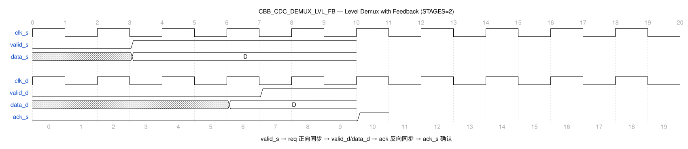

# CBB_CDC_DEMUX_LVL_FB_UG

---

## 目录

- [1. 功能及应用场景](#1-功能及应用场景)
- [2. 规格](#2-规格)
- [3. 方案分析](#3-方案分析)
- [4. 配置参数](#4-配置参数)
- [5. 接口](#5-接口)
- [6. 时序图](#6-时序图)
- [7. PPA](#7-ppa)

---

## 1. 功能及应用场景

cbb_cdc_demux_lvl_fb 是一个带反馈握手的电平选择型 DMUX 同步器，在 `cbb_cdc_demux_lvl` 基础上增加了双向四相位握手机制。目标域完成数据采样后，通过同步链回传确认信号 `ack_s` 至源域，源端收到确认后才允许更新下一笔数据，实现可靠的多 bit 数据跨时钟域传输。

**核心功能：**

- 多 bit 数据（WIDTH）跨时钟域同步，数据原样传递
- 四相位握手协议：请求 req 同步 → 目标域接收 → 确认 ack 同步 → 源域释放
- `ack_s` 反馈确认信号，通知源域当前数据已被目标域安全采样
- 反馈锁存机制：`valid_d=0` 时 `data_out_reg` 自保持，避免无效数据输出
- 支持参数化数据位宽和同步级数

**适用场景：**

**信号类型：** 多 bit 数据信号（位宽 WIDTH = 1~64，默认 64），带电平型 valid 选通信号和 ack 反馈确认机制。源域以 `valid_s` 电平指示数据有效，目标域输出 `data_d` 和 `valid_d` 电平信号，并通过 `ack_s` 回传确认。适用于需要可靠握手确认的多 bit 数据跨域传输场景。

**时钟域场景：**
- **慢时钟域 → 快时钟域（推荐）：** 四相位握手周期中，正向同步延迟 = STAGES+1 个 `clk_d` 周期，反向同步延迟 = STAGES+1 个 `clk_s` 周期。慢→快场景下反向同步为慢→快方向，`ack_s` 反馈延迟可控。
- **快时钟域 → 慢时钟域（受限）：** 正向同步为快→慢方向，需保证 `valid_s` 高电平保持时间 ≥ 正向同步延迟 + 反向同步延迟，否则握手可能不完整。建议频率比 f_src/f_dst ≤ 1/(2×STAGES) 以确保可靠握手。
- **完整握手周期：** 一次数据传输总延迟 = (STAGES+1) 个 `clk_d` 周期 + (STAGES+1) 个 `clk_s` 周期。两次 `valid_s` 有效的最小间隔须 ≥ 完整握手周期。
- **最大传输速率：** 受限于双向同步延迟，最大有效传输速率 ≈ 1 / [(STAGES+1)×(1/f_dst + 1/f_src)]。

**设计限制：**
- **位宽范围：** WIDTH 可配置为 1~64，默认 64。
- **数据有效窗口：** `valid_s=1` 的持续时间须 ≥ 完整握手周期，等待 `ack_s` 确认后方可更新数据。
- `valid_d=0` 时输出寄存器自保持，输出上一拍有效数据不变。

**典型应用：**
- 需要确认机制的可靠多 bit 数据跨域传输
- 源端需要知道数据已被目标域安全接收的场景
- 流控型跨域数据通路（如配置寄存器写入确认）
- 对可靠性要求高于吞吐率的跨域应用

---

## 2. 规格

**规格汇总：**

| 规格 ID | 类型 | 规格项 | 描述 |
|---------|------|--------|------|
| DS.CBB_CDC_DEMUX_LVL_FB.INTF.001 | INTF | 双时钟域接口 | clk_s/clk_d 独立时钟域 |
| DS.CBB_CDC_DEMUX_LVL_FB.CFG.001 | CFG | 数据位宽 | WIDTH 1~64，默认 64 |
| DS.CBB_CDC_DEMUX_LVL_FB.CFG.002 | CFG | 同步级数 | STAGES ≥2，默认 2 |
| DS.CBB_CDC_DEMUX_LVL_FB.CFG.003 | CFG | 工艺选择 | TSMC_12/FPGA_XILINX/FPGA_ALTERA/RTL |
| DS.CBB_CDC_DEMUX_LVL_FB.FUNC.001 | FUNC | 数据同步握手 | valid_s=1 数据同步 + ack 确认 |
| DS.CBB_CDC_DEMUX_LVL_FB.FUNC.002 | FUNC | 四相位握手 | 请求-采样-确认-释放 |
| DS.CBB_CDC_DEMUX_LVL_FB.FUNC.003 | FUNC | 反馈确认 | ack_s 回传确认 |

### 2.1 数据同步与握手 — DS.CBB_CDC_DEMUX_LVL_FB.FUNC.001

当 `valid_s=1` 时，`data_s` 经请求同步链传递到目标域输出 `data_d`。目标域采样完成后回传确认信号 `ack_s`，源端收到确认后方可拉低 `valid_s` 并更新下一笔数据。

### 2.2 四相位握手 — DS.CBB_CDC_DEMUX_LVL_FB.FUNC.002

采用标准四相位握手协议：
- **Phase 1**：源端置 `valid_s=1`，数据稳定
- **Phase 2**：req 经同步链到达目标域，`valid_d=1` 选通数据，`data_out_reg` 锁存
- **Phase 3**：目标域置 ack 有效，经同步链回传至源域产生 `ack_s=1`
- **Phase 4**：源端收到确认后拉低 `valid_s`，目标域随之间 `valid_d=0`、`ack_s=0`，电路回到空闲状态

### 2.3 反馈确认 — DS.CBB_CDC_DEMUX_LVL_FB.FUNC.003

`ack_s` 信号在目标域确认数据采样后，通过同步寄存器链（STAGES 级）回传到源时钟域。源端逻辑依赖 `ack_s` 判断当前传输是否完成。

### 2.4 数据位宽可配置 — DS.CBB_CDC_DEMUX_LVL_FB.CFG.001

数据位宽 WIDTH 可参数化配置，范围为 1~64，默认值 64。

### 2.5 同步级数可配置 — DS.CBB_CDC_DEMUX_LVL_FB.CFG.002

同步寄存器级数 STAGES 可参数化配置，范围为 ≥2。req 前向同步与 ack 反向同步均使用相同级数。`valid_s` 须保持高电平直至源端收到 `ack_s`，两次传输之间须满足完整握手周期（正向 + 反向同步延迟），否则可能漏采。

### 2.6 工艺选择 — DS.CBB_CDC_DEMUX_LVL_FB.CFG.003

支持多工艺目标：TSMC_12、FPGA_XILINX、FPGA_ALTERA、RTL。不同工艺下同步单元与寄存器实现不同。

### 2.7 双时钟域接口 — DS.CBB_CDC_DEMUX_LVL_FB.INTF.001

接口包含独立的源域时钟 `clk_s` 和目标域时钟 `clk_d`。正向请求同步链运行在目标域，反向应答同步链运行在源域，数据在源域锁存保持稳定，支持任意频率比。

---

## 3. 方案分析

### 3.1 电路结构

带反馈握手 DMUX 的核心是在单向电平选择型 DMUX 基础上增加反向确认通路，构成完整的请求-应答闭环。源端只有在收到目标域确认后才能发起下一次传输，避免了数据覆盖或丢失。

**实现方法对比：**

| 方法               | 优点                       | 缺点                         | 选用         |
| ------------------ | -------------------------- | ---------------------------- | ------------ |
| 单向 DMUX（无反馈） | 结构简单，延迟低           | 无确认机制，可能丢失数据     | 否           |
| FIFO 异步同步       | 高吞吐率，支持连续传输     | 面积大，需双端口 RAM         | 否           |
| DMUX + 反馈握手     | 可靠确认，面积适中         | 往返延迟大，吞吐率低         | **是** |

本设计采用**四相位握手 DMUX** 方案：

1. 前向通路：`valid_s` → `req_src_reg` → req 同步链（STAGES 级）→ `valid_d`（MUX 选通信号）
2. 数据通路：源域寄存 → MUX → 目标域输出寄存器（与 `demux_lvl` 相同）
3. 反向通路：`valid_d` → `ack_dst_reg` → ack 同步链（STAGES 级）→ `ack_s`

### 3.2 实现方案

**电路结构：**

```
                       ┌───────────┐
data_s ─────────────→│  data_reg │────→ MUX ──→ data_out_reg ──→ data_d
                       │ (clk_s) │         ↑
valid_s ──→ req_src_reg ──→ req_sync REG (STAGES, clk_d) ──→ valid_d (mux_sel)
                       │           │         ↓
                       │           │     ack_dst_reg (clk_d)
                       │           │         ↓
                       │           │     ack_sync REG (STAGES, clk_s) ──→ ack_s
                       └───────────┘
                                        反馈锁存: data_out_reg ──→ MUX (valid_d=0 时保持)
```

**四相位握手工作流程：**

1. **Phase 1 — 请求**：源端将数据稳定在 `data_s`，置 `valid_s=1`。`req_src_reg` 在 `clk_s` 下锁存请求
2. **Phase 2 — 同步与采样**：req 信号经 STAGES 级同步链（`clk_d` 驱动）到达目标域，产生 `valid_d=1`。MUX 选通新数据，`data_out_reg` 锁存
3. **Phase 3 — 确认**：目标域 `valid_d` 触发 `ack_dst_reg`，ack 信号经 STAGES 级同步链（`clk_s` 驱动）回传到源域，产生 `ack_s=1`
4. **Phase 4 — 释放**：源端检测到 `ack_s=1`，拉低 `valid_s`。req 同步链清零后 `valid_d=0`，进而 `ack_dst_reg` 清零，`ack_s` 恢复为 0。电路回到空闲，准备下一次传输

---

## 4. 配置参数

| 参数   | 配置范围 | 默认值 | 描述                                       |
| ------ | -------- | ------ | ------------------------------------------ |
| WIDTH  | 1 ~ 64   | 64     | 数据位宽，跨域传输的数据总线宽度           |
| STAGES | ≥ 2      | 2      | 同步寄存器级数，req 与 ack 双向均使用此级数 |

---

## 5. 接口

| 信号名    | 位宽 | I/O | 时钟域 | 描述                                   |
| --------- | ---- | --- | ------ | -------------------------------------- |
| clk_s    | 1      | I   | src    | 源域时钟，上升沿有效                   |
| rst_s_n  | 1      | I   | src    | 源域异步复位，低有效                   |
| init_s_n | 1      | I   | src    | 源域同步复位，低有效                   |
| data_s   | WIDTH  | I   | src    | 源域数据输入                           |
| valid_s  | 1      | I   | src    | 源域数据有效指示，高有效电平           |
| clk_d    | 1      | I   | dst    | 目标域时钟，上升沿有效                 |
| rst_d_n  | 1      | I   | dst    | 目标域异步复位，低有效                 |
| init_d_n | 1      | I   | dst    | 目标域同步复位，低有效                 |
| data_d   | WIDTH  | O   | dst    | 目标域数据输出，原样传递               |
| valid_d  | 1      | O   | dst    | 目标域数据有效指示，高有效电平         |
| ack_s    | 1      | O   | src    | 反馈确认信号，高有效，指示目标域已完成数据采样 |
| test     | 1      | I   | -      | 测试模式使能                           |

---

## 6. 时序图

### 6.1 典型时序



- 源时钟 `clk_s` 与目标时钟 `clk_d` 的跨域同步波形
- 四相位握手过程：`valid_s` 发起 → `valid_d` 响应 → `ack_s` 确认 → 释放
- `data_d` 在 `valid_d=1` 时更新，`valid_d=0` 时通过反馈锁存保持
- 同步级数（STAGES=2 默认）与握手延迟标注见图脚注

---

## 7. PPA

> **综合工具：** Synopsys DC Ultra W-2024.09-SP3
> **工艺库：** TSMC 12nm tcbn12ffcllbwp7d5t16p96cpd (ssgnp0p9v125c, `/home/test/TSMC_lib/tcbn12ffcllbwp7d5t16p96cpdssgnp0p9v125c.db`)
> **综合策略：** `compile_ultra -retime -no_seq_output_inversion -no_autoungroup` + 增量编译，时钟周期 0.204ns (4.9GHz)
> **物理约束：** input/output delay = 10% 时钟周期，双时钟域各自约束

### 7.1 参数设置

| 参数   | 设置值         | 说明                 |
| ------ | -------------- | -------------------- |
| WIDTH  | 64             | 数据位宽             |
| STAGES | 2              | 2 级同步寄存器链     |
| 工艺   | TSMC 12FFC LL  | 工艺角 ssgnp0p9v125c |
| 频率   | 4.9 GHz (0.204ns) | 双时钟域均约束 4.9GHz |

### 7.2 综合结果（WIDTH=64, STAGES=2）

| 项目     | 数值                   |
| -------- | ---------------------- |
| 频率     | 4.9 GHz (0.204ns)      |
| 面积     | 182.937599 µm²         |
| 单元数   | 310                    |
| 功耗     | 动态 2.0199 mW + 漏电 1.039 µW |
| WNS      | +0.001 ns              |
| 违例路径 | 0                     |

### 7.3 结论

STAGES=2 配置下，TSMC 12nm 工艺库在 0.204ns 周期约束下建立时间无违例（WNS=+0.001ns，0 违例），满足 4.9GHz 双时钟域目标。双向握手增加了 ack 同步链与反馈逻辑开销，但关键路径仍由数据 MUX 决定。面积 182.94µm²、动态功耗 2.02mW（WIDTH=64）。

---
