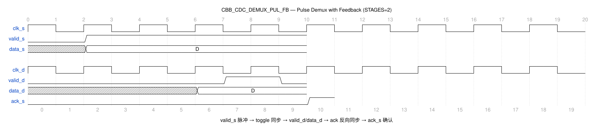

# CBB_CDC_DEMUX_PUL_FB_UG

---

## 目录

- [1. 功能及应用场景](#1-功能及应用场景)
- [2. 规格](#2-规格)
- [3. 方案分析](#3-方案分析)
- [4. 配置参数](#4-配置参数)
- [5. 接口](#5-接口)
- [6. 时序图](#6-时序图)
- [7. PPA](#7-ppa)

---

## 1. 功能及应用场景

`cbb_cdc_demux_pul_fb` 是一个带反馈确认的脉冲选择型 DMUX 同步器（Pulse Demultiplexer with Feedback Handshake），在脉冲选择型 DMUX 基础上增加闭环握手确认机制。源端发出单周期脉冲 `valid_s` 触发多比特数据传输，数据经 toggle 同步链传递到目标域后反馈 `ack_s` 确认，源端收到确认才允许下一次触发。

**核心功能：**

- 单周期 `valid_s` 脉冲触发多比特数据（WIDTH）跨域传输
- 脉冲转电平（Toggle）机制：将窄脉冲展宽为电平信号跨域传递
- 目标域通过 MUX + 反馈锁存保持输出数据稳定，直至下一次脉冲触发
- 四相位握手 + 反馈确认：源端等待 `ack_s` 后才允许下次触发
- 参数化数据位宽 `WIDTH`（1~64）和同步级数 `STAGES`（>=2）
- 异步复位，复位后所有内部状态清零

**适用场景：**

**信号类型：** 多 bit 数据信号（位宽 WIDTH = 1~64，默认 64），带脉冲型 valid 触发信号和 ack 反馈确认机制。源域以 `valid_s` 单周期脉冲触发数据传输，目标域输出 `data_d` 和 `valid_d` 电平信号，并通过 `ack_s` 回传确认。适用于可靠性要求高的多 bit 数据脉冲触发跨域传输场景。

**时钟域场景：**
- **慢时钟域 → 快时钟域（推荐）：** 正向同步延迟 = STAGES+1 个 `clk_d` 周期，反向同步延迟 = STAGES+1 个 `clk_s` 周期。慢→快场景下反向同步为慢→快方向，`ack_s` 反馈延迟可控。
- **快时钟域 → 慢时钟域（受限）：** 正向同步为快→慢方向，需保证目标域完成前一次数据采样并回传 `ack_s` 后，源端才能响应下一次 `valid_s` 脉冲。建议频率比 f_src/f_dst ≤ 1/(2×STAGES) 以确保可靠握手。
- **完整握手周期：** 一次数据传输总延迟 = (STAGES+1) 个 `clk_d` 周期 + (STAGES+1) 个 `clk_s` 周期。两次 `valid_s` 脉冲的最小间隔须 ≥ 完整握手周期。
- **最大传输速率：** 受限于双向同步延迟，最大有效传输速率 ≈ 1 / [(STAGES+1)×(1/f_dst + 1/f_src)]。

**设计限制：**
- **位宽范围：** WIDTH 可配置为 1~64，默认 64。
- **反馈保护：** 源端只有收到 `ack_s=1` 之后，才能响应下一次 `valid_s` 脉冲。在 `ack_s` 未有效期间，新的 `valid_s` 脉冲将被忽略。
- 目标域 `valid_d` 以电平形式输出，在整个数据有效期间保持高电平。
- `valid_d=0` 时输出寄存器自保持，输出上一拍有效数据不变。

**典型应用：**
- 多比特数据的脉冲触发跨域传输（如 SPI 命令、寄存器写脉冲）
- 需要"触发-确认"闭环节奏的关键数据通路
- 高可靠性要求的跨域数据传递（如 DFT 控制信号）
- 源域为脉冲接口、目标域为电平接口的协议适配

---

## 2. 规格

**规格汇总：**

| 规格 ID | 类型 | 规格项 | 描述 |
|---------|------|--------|------|
| DS.CBB_CDC_DEMUX_PUL_FB.INTF.001 | INTF | 双时钟域接口 | clk_s/clk_d 独立时钟域 |
| DS.CBB_CDC_DEMUX_PUL_FB.CFG.001 | CFG | 数据位宽 | WIDTH 1~64，默认 64 |
| DS.CBB_CDC_DEMUX_PUL_FB.CFG.002 | CFG | 同步级数 | STAGES ≥2，默认 2 |
| DS.CBB_CDC_DEMUX_PUL_FB.FUNC.001 | FUNC | 脉冲触发与确认 | valid_s 脉冲触发 + ack 确认 |
| DS.CBB_CDC_DEMUX_PUL_FB.FUNC.002 | FUNC | 反馈保护 | ack_s 有效前忽略新脉冲 |
| DS.CBB_CDC_DEMUX_PUL_FB.FUNC.003 | FUNC | 脉冲电平转换 | Toggle 脉冲↔电平转换 |

### 2.1 脉冲触发与反馈确认 — DS.CBB_CDC_DEMUX_PUL_FB.FUNC.001

源端 `valid_s` 单周期脉冲触发数据锁存与传输。内部 toggle 翻转将脉冲展宽为电平，经同步链传递到目标域。目标域通过 XOR 恢复脉冲 `req_dst_pulse`，该脉冲同时控制 MUX 选通数据和驱动 `valid_d`。目标域同步生成 `ack_dst` 并反向同步至源域，源端收到 `ack_s` 后清除内部请求状态。

### 2.2 反馈保护 — DS.CBB_CDC_DEMUX_PUL_FB.FUNC.002

源端只有收到 `ack_s = 1` 之后，才能响应下一次 `valid_s` 脉冲。在 `ack_s` 未有效期间，新的 `valid_s` 脉冲将被忽略，确保目标域已完成前一次数据的采样。

### 2.3 脉冲-电平-脉冲转换 — DS.CBB_CDC_DEMUX_PUL_FB.FUNC.003

采用 Toggle 翻转实现脉冲->电平转换，经同步链在目标域通过异或门实现电平->脉冲恢复。目标域恢复的脉冲 `req_dst_pulse` 控制 MUX 在"新数据"和"保持旧数据"之间切换，确保输出数据在脉冲间保持稳定。

### 2.4 数据位宽可配置 — DS.CBB_CDC_DEMUX_PUL_FB.CFG.001

参数 `WIDTH` 配置传输数据位宽，支持范围 1~64，默认值 64。数据路径寄存器位宽由 WIDTH 决定。

### 2.5 同步级数可配置 — DS.CBB_CDC_DEMUX_PUL_FB.CFG.002

参数 `STAGES` 配置 toggle 正向同步链与 ack 反向同步链的寄存器级数，默认值为 2，最小值为 2。`valid_s` 相邻两次脉冲之间的间隔须 ≥ 一个完整握手周期（正向 + 反向同步延迟），否则可能漏采。

### 2.6 双时钟域接口 — DS.CBB_CDC_DEMUX_PUL_FB.INTF.001

接口包含独立的源域时钟 `clk_s` 和目标域时钟 `clk_d`。数据在源域锁存保持稳定，仅触发事件经 Toggle 同步链跨域，目标域 MUX 选通稳定数据，反馈 ack 经反向同步链回到源域，支持任意频率比。

---

## 3. 方案分析

### 3.1 电路结构

脉冲选择型 DMUX 的挑战在于：源域发出的是窄脉冲（仅 1 个 `clk_s` 周期），若脉冲宽度小于目标域时钟周期，目标域无法可靠采样。传统 DMUX 的解决方式是：脉冲转换为电平（Toggle 翻转）→ 同步链传递 → 异或恢复脉冲 → 控制 MUX 选通数据。

反馈版本在此基础上增加了 ack 同步链，闭合了握手环路。这解决了以下问题：
- **无反馈版本**：源端不知道目标域何时采样完毕，若连续发脉冲可能导致数据冲突
- **有反馈版本**：源端等待 `ack_s` 后才允许下一次触发，形成可靠闭环

**实现方法对比：**

| 方法               | 优点                             | 缺点                               | 选用         |
| ------------------ | -------------------------------- | ---------------------------------- | ------------ |
| 脉冲 DMUX（无反馈）| 单向延迟，吞吐率高               | 源端无法感知目标域状态             | 否           |
| 脉冲 DMUX + 反馈   | 闭环握手，可靠性高               | 双向同步链，延迟大，吞吐率受限     | **是** |

本设计采用**脉冲触发 + Toggle 同步 + 反馈确认**方案：

1. `valid_s` 脉冲 → `req_src` 置位 → `toggle_req` 翻转（脉冲展宽为电平跳变）
2. `toggle_req` 经 STAGES 级同步链 → 目标域 `toggle_dst`
3. 目标域 XOR 恢复脉冲 `req_dst_pulse = toggle_dst ^ toggle_dly`
4. `req_dst_pulse` 控制 MUX：选通 `data_reg`（新数据）或 `data_out_reg`（保持旧数据）
5. `ack_dst` 跟随 `req_dst_pulse` → 经反向同步链 → `ack_s`
6. 源端 `ack_s` 清除 `req_src` → 准备下一次 `valid_s` 触发

### 3.2 实现方案

**电路结构：**

```
                       ┌─────── 源时钟域 (clk_s) ──────┐
                       │                                  │
  valid_s ───────────→ req_src (D-FF) → toggle_req ────┐│
                       │       ↑             (toggle)    ││
                       │       │                         ││
  data_s ────────────→ data_reg (D-FF, DW bits) ───────┼│───┐
                       │                                  ││   │
  ack_s ←─────────────── ack_sync REG (STAGES)         ││   │
                       │                                  ││   │
                       └──────────────────────────────────││───│──┘
                                                          ││   │
                                                          ↓↓   │ (data path,
                                                          ││   │  no sync)
                       ┌─────── 目标时钟域 (clk_d) ─────┐│   │
                       │                                  ││   │
                       │       toggle_sync REG (STAGES) ←─┘│   │
                       │                ↓                  │    │
                       │       toggle_dst ──→ XOR ← toggle_dly   │
                       │                         ↓          │    │
                       │                  req_dst_pulse ────┼────┤
                       │                     ↓   ↓         │    │
                       │              mux_sel   valid_d  │    │
                       │                 ↓                 │    │
                       │  data_reg ──→ MUX ──→ data_out_reg│←───┘
                       │                 ↑       ↓         │   (feedback
                       │                 └─── hold path     │    latch)
                       │                         ↓         │
                       │                    data_d        │
                       │                                  │
                       │  ack_dst (D-FF) ← req_dst_pulse │
                       │       ↓                          │
                       │  ack_sync → (跨时钟域)           │
                       └──────────────────────────────────┘
```

**工作原理：**

1. **脉冲触发（源端）**：当 `valid_s` 出现单周期脉冲时，源端 `req_src` 寄存器置位为 1。`req_src = 1` 触发 `toggle_req` 翻转（0→1 或 1→0），实现脉冲到电平跳变的转换。同时 `data_reg` 持续锁存 `data_s` 的最新值。

2. **正向同步**：`toggle_req` 经 STAGES 级同步寄存器链（在 `clk_d` 域）逐级传递。经过 STAGES 个 `clk_d` 周期后，`toggle_dst` 反映 `toggle_req` 的值。

3. **脉冲恢复（目标域）**：目标域通过异或逻辑恢复脉冲：`req_dst_pulse = toggle_dst ^ toggle_dly`。其中 `toggle_dly` 是 `toggle_dst` 的延迟一拍版本。每次 `toggle_dst` 翻转时，`req_dst_pulse` 产生一个 `clk_d` 周期的脉冲。

4. **数据选通（目标域）**：MUX 根据 `req_dst_pulse` 选通：
   - `req_dst_pulse = 1`：选通 `data_reg`（来自源域的数据），将新数据写入 `data_out_reg`
   - `req_dst_pulse = 0`：选通 `data_out_reg` 自身（反馈保持），输出数据不变

5. **应答反馈**：目标域 `ack_dst` 寄存器在下一个 `clk_d` 上升沿跟随 `req_dst_pulse` 置位。`ack_dst` 经 STAGES 级反向同步链（在 `clk_s` 域）传递回源域，成为 `ack_s`。

6. **请求清除（源端）**：源域检测到 `ack_s = 1` 后，`req_src` 清零。此后 `toggle_req` 不再翻转，直到下一个 `valid_s` 脉冲。

**反馈锁存机制详解：**

MUX 的反馈路径是关键设计：当 `req_dst_pulse = 0`（脉冲过后），MUX 选通 `data_out_reg` 的当前值，实现数据自保持。这确保 `data_d` 在两次 `valid_s` 脉冲之间保持稳定不变。即使 `data_s` 在源域更新，目标域的输出也不会改变，直到下一次 `req_dst_pulse` 脉冲到来。

---

## 4. 配置参数

| 参数   | 配置范围 | 默认值 | 描述                                                  |
| ------ | -------- | ------ | ----------------------------------------------------- |
| WIDTH  | 1 ~ 64   | 64     | 数据位宽。数据路径寄存器及 MUX 位宽由 WIDTH 决定       |
| STAGES | >= 2     | 2      | 同步寄存器级数。toggle 链与 ack 链使用相同级数         |

---

## 5. 接口

| 信号名     | 位宽             | I/O | 时钟域  | 描述                                               |
| ---------- | ---------------- | --- | ------- | -------------------------------------------------- |
| clk_s     | 1                | I   | src_clk | 源域时钟，上升沿有效                               |
| rst_s_n   | 1                | I   | src_clk | 源域异步复位，低有效                               |
| init_s_n  | 1                | I   | src_clk | 源域同步复位，低有效                               |
| data_s    | WIDTH            | I   | src_clk | 源域输入数据，在 `valid_s` 有效时被锁存            |
| valid_s   | 1                | I   | src_clk | 源域数据有效脉冲，高有效，单周期脉冲触发传输       |
| clk_d     | 1                | I   | dst_clk | 目标域时钟，上升沿有效                             |
| rst_d_n   | 1                | I   | dst_clk | 目标域异步复位，低有效                             |
| init_d_n  | 1                | I   | dst_clk | 目标域同步复位，低有效                             |
| data_d    | WIDTH            | O   | dst_clk | 目标域输出数据，`valid_d=1` 时更新，其余拍保持     |
| valid_d   | 1                | O   | dst_clk | 目标域数据有效指示，高有效脉冲，有效时表示 `data_d` 更新 |
| ack_s     | 1                | O   | src_clk | 反馈确认信号，高有效，有效时源端可发起下一次 `valid_s` |
| test      | 1                | I   | -       | 测试模式使能                                       |

---

## 6. 时序图

### 6.1 典型时序



- T1: 源端 `valid_s` 脉冲触发，`req_src` 置位，`toggle_req` 翻转
- T2~T3: `toggle_req` 经 STAGES=2 同步链到达目标域
- T4: 目标域 XOR 恢复 `req_dst_pulse` 脉冲，`valid_d` 拉高，MUX 选通新数据 `data_d`
- T5: `toggle_dly` 更新，`req_dst_pulse` 归零，MUX 切换到反馈保持模式
- T6: `ack_dst` 拉高，经反向同步链反馈
- T7~T8: `ack_s` 拉高，源端清除 `req_src`，握手完成

附加时序说明：
- 从 `valid_s` 脉冲到 `data_d` 更新：STAGES + 2 个 `clk_d` 周期
- 从 `valid_s` 脉冲到 `ack_s` 有效：STAGES + 1 个 `clk_d` 周期 + STAGES + 1 个 `clk_s` 周期
- 两次 `valid_s` 脉冲的最小间隔 = 正向延迟 + 反向延迟
- `data_d` 在脉冲间通过 MUX 反馈路径保持稳定

---

## 7. PPA

> **综合工具：** Synopsys DC Ultra W-2024.09-SP3
> **工艺库：** TSMC 12nm tcbn12ffcllbwp7d5t16p96cpd (ssgnp0p9v125c)
> **综合策略：** `compile_ultra -retime -no_seq_output_inversion -no_autoungroup` + 增量编译，时钟周期 0.204ns (4.9GHz)
> **物理约束：** input/output delay = 10% 时钟周期，双时钟域各自约束

### 7.1 参数设置

| 参数       | 设置值           | 说明                 |
| ---------- | ---------------- | -------------------- |
| WIDTH     | 64               | 64-bit 数据位宽     |
| STAGES     | 2                | 2 级同步寄存器链     |
| 工艺       | TSMC 12FFC LL    | 工艺角 ssgnp0p9v125c |
| 频率       | 4.9 GHz (0.204ns) | 双时钟域均约束 4.9GHz |

### 7.2 综合结果

| 项目     | 数值                                         |
| -------- | -------------------------------------------- |
| 频率     | 4.9 GHz (0.204ns)                            |
| 面积     | 191.139838 µm²                               |
| 单元数   | 447                                          |
| 功耗     | 动态 2.0445 mW + 漏电 1.004 µW               |
| WNS      | +0.001 ns                                    |
| 违例路径 | 0                                            |

### 7.3 结论

WIDTH=64、STAGES=2 配置下，TSMC 12nm 工艺库在 0.204ns 周期约束下建立时间无违例（WNS=+0.001ns，0 违例），满足 4.9GHz 双时钟域目标。相比无反馈版 DMUX 增加了 ack 同步链和反馈逻辑的开销。数据路径中的 MUX 引入组合逻辑延迟，是时序关键路径的主要贡献者（`data_reg → MUX → data_out_reg`）。反馈锁存机制确保输出数据在脉冲间稳定，适合低频但高可靠的数据传输场景。面积 191.14µm²、动态功耗 2.04mW。

---
