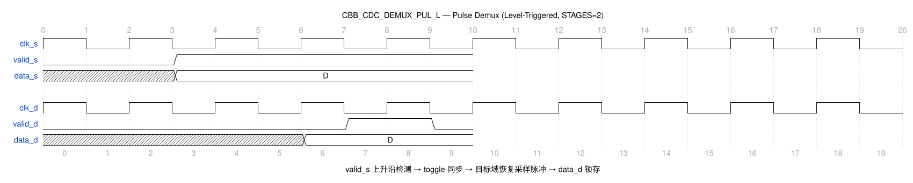

# CBB_CDC_DEMUX_PUL_L_UG

---

## 目录

- [1. 功能及应用场景](#1-功能及应用场景)
- [2. 规格](#2-规格)
- [3. 方案分析](#3-方案分析)
- [4. 配置参数](#4-配置参数)
- [5. 接口](#5-接口)
- [6. 时序图](#6-时序图)
- [7. PPA](#7-ppa)

---

## 1. 功能及应用场景

cbb_cdc_demux_pul_l 是一个脉冲触发-电平输出型 DMUX 同步器，用于多 bit 数据跨时钟域传输。源域 `valid_s` 的上升沿触发内部脉冲产生，经 Toggle 同步链传递到目标域恢复为采样脉冲，触发输出寄存器锁存数据。目标域 `valid_d` 以电平形式输出，指示当前 `data_d` 有效。

**核心功能：**

- 多 bit 数据（WIDTH）跨时钟域同步，数据原样传递
- `valid_s` 上升沿触发传输，模块内部自动检测边沿并转换为脉冲
- Toggle 同步链（脉冲-电平-脉冲）传递触发事件到目标域
- 目标域 `valid_d` 为电平输出，在整个数据有效期间保持高电平
- 反馈锁存机制：`valid_d=0` 时 `data_out_reg` 自保持

**适用场景：**

**信号类型：** 多 bit 数据信号（位宽 WIDTH = 1~64，默认 64），带电平型 valid 触发信号。源域以 `valid_s` 电平信号指示数据就绪，模块内部检测 `valid_s` 上升沿自动触发数据传输，目标域输出 `data_d` 和 `valid_d` 电平信号。适用于多 bit 数据以电平变化触发方式跨时钟域传输的场景。

**时钟域场景：**
- **慢时钟域 → 快时钟域（推荐）：** 目标时钟频率 ≥ 源时钟频率时，边沿检测电路可可靠捕获 `valid_s` 上升沿。`valid_s` 上升沿触发后，经 STAGES+1 个 `clk_d` 周期后目标域输出 `valid_d` 电平置高。
- **快时钟域 → 慢时钟域（受限）：** 需保证 `valid_s` 高电平保持时间 ≥ 1 个 `clk_s` 周期（边沿检测所需），且两次 `valid_s` 上升沿的最小间隔 ≥ 2×STAGES 个 `clk_d` 周期，否则目标域可能漏采触发事件。建议频率比 f_src/f_dst ≤ 1/(2×STAGES) 以确保可靠触发。

**设计限制：**
- **位宽范围：** WIDTH 可配置为 1~64，默认 64。
- **触发间隔：** 两次 `valid_s` 上升沿的最小间隔须 ≥ STAGES+1 个 `clk_d` 周期，确保前一次传输的 `valid_d` 电平已稳定。
- 目标域 `valid_d` 以电平形式输出，在整个数据有效期间保持高电平。
- `valid_d=0` 时输出寄存器自保持，输出上一拍有效数据不变。

**典型应用：**
- 受 valid 电平信号驱动的多 bit 数据跨域传输
- 配置写操作的跨域触发
- 事件触发型数据同步（源端以电平变化表示新数据就绪）
- 与 `demux_pul_p` 的区别：本模块 `valid_s` 为电平信号，模块内部自动检测上升沿

---

## 2. 规格

**规格汇总：**

| 规格 ID | 类型 | 规格项 | 描述 |
|---------|------|--------|------|
| DS.CBB_CDC_DEMUX_PUL_L.INTF.001 | INTF | 双时钟域接口 | clk_s/clk_d 独立时钟域 |
| DS.CBB_CDC_DEMUX_PUL_L.CFG.001 | CFG | 数据位宽 | WIDTH 1~64，默认 64 |
| DS.CBB_CDC_DEMUX_PUL_L.CFG.002 | CFG | 同步级数 | STAGES ≥2，默认 2 |
| DS.CBB_CDC_DEMUX_PUL_L.CFG.003 | CFG | 工艺选择 | TSMC_12/FPGA_XILINX/FPGA_ALTERA/RTL |
| DS.CBB_CDC_DEMUX_PUL_L.FUNC.001 | FUNC | 上升沿触发 | valid_s 上升沿触发传输 |
| DS.CBB_CDC_DEMUX_PUL_L.FUNC.002 | FUNC | 电平输出 | valid_d 电平输出 |
| DS.CBB_CDC_DEMUX_PUL_L.FUNC.003 | FUNC | 反馈锁存 | valid_d=0 时输出保持 |

### 2.1 上升沿触发 — DS.CBB_CDC_DEMUX_PUL_L.FUNC.001

`valid_s` 信号上升沿触发数据传输。模块内部通过边沿检测电路（寄存器打拍 + 逻辑门）检测 `valid_s` 的 0→1 跳变，产生内部触发脉冲。

### 2.2 电平输出 — DS.CBB_CDC_DEMUX_PUL_L.FUNC.002

目标域 `valid_d` 以电平形式输出。当 Toggle 同步链检测到触发事件变化后，`valid_d` 保持高电平直至下一次触发事件，指示 `data_d` 有效。

### 2.3 反馈锁存 — DS.CBB_CDC_DEMUX_PUL_L.FUNC.003

当 `valid_d=0` 时，`data_out_reg` 通过反馈路径自保持，输出上一拍有效数据不变。

### 2.4 数据位宽可配置 — DS.CBB_CDC_DEMUX_PUL_L.CFG.001

数据位宽 WIDTH 可参数化配置，范围为 1~64，默认值 64。

### 2.5 同步级数可配置 — DS.CBB_CDC_DEMUX_PUL_L.CFG.002

同步寄存器级数 STAGES 可参数化配置，范围为 ≥2。Toggle 同步链使用 STAGES 级寄存器。`valid_s` 相邻两次上升沿之间的间隔须 ≥ STAGES 个 `clk_d` 周期（确保目标域完成一次 Toggle 检测），否则可能漏采。

### 2.6 工艺选择 — DS.CBB_CDC_DEMUX_PUL_L.CFG.003

支持多工艺目标：TSMC_12、FPGA_XILINX、FPGA_ALTERA、RTL。不同工艺下同步单元与寄存器实现不同。

### 2.7 双时钟域接口 — DS.CBB_CDC_DEMUX_PUL_L.INTF.001

接口包含独立的源域时钟 `clk_s` 和目标域时钟 `clk_d`。数据在源域锁存保持稳定，仅触发事件经 Toggle 同步链跨域，目标域 MUX 选通稳定数据，支持任意频率比。

---

## 3. 方案分析

### 3.1 电路结构

脉冲触发型 DMUX 同步器的核心是将源域的触发事件（边沿）可靠传递到目标域。直接在目标域采样源域脉冲存在亚稳态风险（脉冲宽度可能小于目标域时钟周期），因此采用 Toggle（脉冲→电平→脉冲）转换机制。

**实现方法对比：**

| 方法                 | 优点                       | 缺点                               | 选用         |
| -------------------- | -------------------------- | ---------------------------------- | ------------ |
| 直接脉冲同步         | 结构最简单                 | 脉冲可能丢失，不可靠               | 否           |
| 电平选择型 DMUX       | 数据可靠，无需脉冲转换     | 需源端保持电平，不适用于脉冲触发   | 否           |
| Toggle 脉冲同步 + DMUX | 可靠传递触发事件，支持脉冲 | 额外 Toggle 逻辑，延迟略增         | **是** |

本设计采用**边沿检测 + Toggle 同步 + DMUX** 方案：

1. 源域边沿检测电路将 `valid_s` 的上升沿转换为 Toggle 翻转信号
2. Toggle 信号（电平）经同步寄存器链可靠传递到目标域
3. 目标域异或门检测 Toggle 前后变化，恢复为采样脉冲
4. 采样脉冲驱动 `valid_d` 电平变化，触发数据寄存器锁存

### 3.2 实现方案

**电路结构：**

```
                       ┌───────────┐
data_s ─────────────→│  data_reg │────→ MUX ──→ data_out_reg ──→ data_d
                       │ (clk_s) │         ↑
valid_s ──→ edge_detect ──→ toggle ──→ toggle_sync REG (STAGES) ──→ 延迟 ──→ XOR ──→ mux_sel/valid_d
                       └───────────┘
                                        反馈锁存: data_out_reg ──→ MUX (valid_d=0 时保持)
```

**工作原理：**

1. 源域边沿检测电路监测 `valid_s`，在上升沿时产生单周期脉冲翻转内部 Toggle 寄存器
2. Toggle 信号（0→1 或 1→0 变化后的稳定电平）经 STAGES 级同步寄存器链（`clk_d` 驱动）传递到目标域
3. 目标域将同步后的 Toggle 信号延迟一拍，异或门检测前后两次值的差异，产生单周期采样脉冲
4. 采样脉冲触发 `valid_d` 电平翻转，同时 MUX 选通新数据，`data_out_reg` 锁存
5. 当 `valid_d=0` 时，MUX 选通 `data_out_reg` 反馈，输出保持上一拍有效数据

---

## 4. 配置参数

| 参数   | 配置范围 | 默认值 | 描述                           |
| ------ | -------- | ------ | ------------------------------ |
| WIDTH  | 1 ~ 64   | 64     | 数据位宽，跨域传输的数据总线宽度 |
| STAGES | ≥ 2      | 2      | Toggle 同步寄存器级数           |

---

## 5. 接口

| 信号名    | 位宽 | I/O | 时钟域 | 描述                               |
| --------- | ---- | --- | ------ | ---------------------------------- |
| clk_s    | 1    | I   | src    | 源域时钟，上升沿有效               |
| rst_s_n  | 1    | I   | src    | 源域异步复位，低有效               |
| init_s_n | 1    | I   | src    | 源域同步复位，低有效               |
| data_s   | WIDTH | I   | src    | 源域数据输入                       |
| valid_s  | 1    | I   | src    | 源域数据有效指示，上升沿触发，高有效 |
| clk_d    | 1    | I   | dst    | 目标域时钟，上升沿有效             |
| rst_d_n  | 1    | I   | dst    | 目标域异步复位，低有效             |
| init_d_n | 1    | I   | dst    | 目标域同步复位，低有效             |
| data_d   | WIDTH | O   | dst    | 目标域数据输出，原样传递           |
| valid_d  | 1    | O   | dst    | 目标域数据有效指示，高有效电平输出 |
| test     | 1    | I   | -      | 测试模式使能                       |

---

## 6. 时序图

### 6.1 典型时序



- 源时钟 `clk_s` 与目标时钟 `clk_d` 的跨域同步波形
- `valid_s` 上升沿触发 Toggle 翻转，经 STAGES 级同步后在目标域恢复采样脉冲
- `valid_d` 电平翻转指示数据有效，`data_d` 更新为 `data_s` 采样值
- 同步级数（STAGES=2 默认）与 Toggle 延迟标注见图脚注

---

## 7. PPA

> **综合工具：** Synopsys DC Ultra W-2024.09-SP3
> **工艺库：** TSMC 12nm tcbn12ffcllbwp7d5t16p96cpd (ssgnp0p9v125c, `/home/test/TSMC_lib/tcbn12ffcllbwp7d5t16p96cpdssgnp0p9v125c.db`)
> **综合策略：** `compile_ultra -retime -no_seq_output_inversion -no_autoungroup` + 增量编译，时钟周期 0.204ns (4.9GHz)
> **物理约束：** input/output delay = 10% 时钟周期，双时钟域各自约束

### 7.1 参数设置

| 参数   | 设置值         | 说明                 |
| ------ | -------------- | -------------------- |
| WIDTH  | 64             | 数据位宽             |
| STAGES | 2              | 2 级同步寄存器链     |
| 工艺   | TSMC 12FFC LL  | 工艺角 ssgnp0p9v125c |
| 频率   | 4.9 GHz (0.204ns) | 双时钟域均约束 4.9GHz |

### 7.2 综合结果（WIDTH=64, STAGES=2）

| 项目     | 数值                   |
| -------- | ---------------------- |
| 频率     | 4.9 GHz (0.204ns)      |
| 面积     | 173.030398 µm²         |
| 单元数   | 327                    |
| 功耗     | 动态 2.0640 mW + 漏电 967.446 nW |
| WNS      | +0.003 ns              |
| 违例路径 | 0                     |

### 7.3 结论

STAGES=2 配置下，TSMC 12nm 工艺库在 0.204ns 周期约束下建立时间无违例（WNS=+0.003ns，0 违例），满足 4.9GHz 双时钟域目标。Toggle 同步链不增加关键路径压力，数据 MUX 路径为主要延迟来源。面积 173.03µm²、动态功耗 2.06mW（WIDTH=64）。

---
