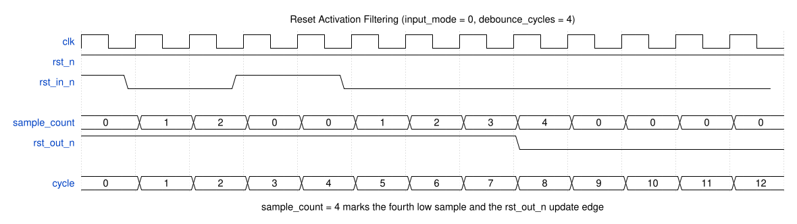
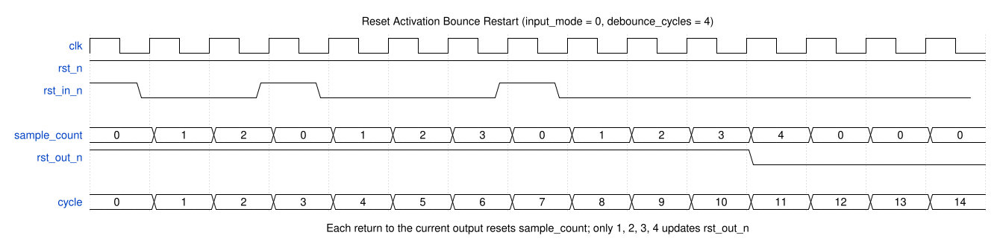
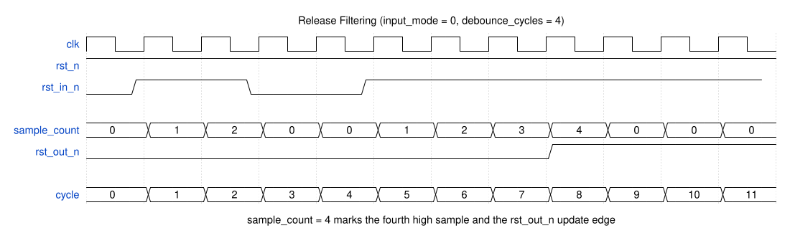
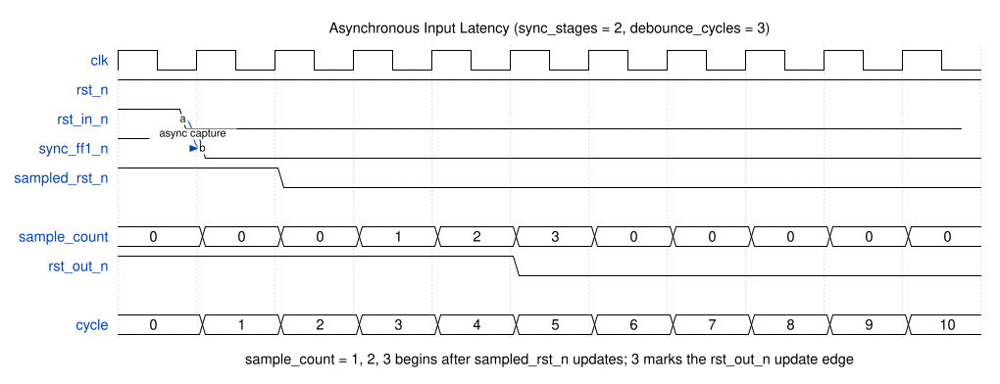

# CBB_CRG_RSTDB_UG

---

## 目录

- [1. 功能及应用场景](#1-功能及应用场景)
- [2. 规格](#2-规格)
- [3. 方案分析](#3-方案分析)
- [4. 配置参数](#4-配置参数)
- [5. 接口](#5-接口)
- [6. 时序图](#6-时序图)
- [7. PPA](#7-ppa)

---

## 1. 功能及应用场景

CBB_CRG_RSTDB 是低有效复位滤波消抖单元。模块在持续运行的采样时钟域内观察复位输入，只有输入连续保持同一候选状态达到参数化阈值后才更新输出；不足阈值的低脉冲和高脉冲均被滤除。该双边消抖机制既避免瞬态低脉冲触发误复位，也避免复位期间的短高脉冲造成过早释放。

模块支持同步输入与异步输入两种静态配置。同步输入直接进入消抖逻辑；异步输入先通过参数化多级电平同步器完成亚稳态安全处理，再进入消抖逻辑。滤波后的 `rst_out_n` 是 CRG 复位源入口处的低有效原始复位请求，可送入复位汇聚或使能单元，再由每个目标时钟域的复位同步撤离单元完成异步生效、同步撤销。

典型应用包括机械按键复位整形、外部复位引脚抗噪声、模拟 POR 或电源状态信号整形，以及存在电源波动或电磁干扰时的复位可靠性增强。系统应根据复位源特征与 `clk` 频率选择 `debounce_cycles`，不同复位源不应默认共用同一时间阈值。

---

## 2. 规格

### 规格汇总

| DS 编号                   | 类型 | 规格概述                                           |
| ------------------------- | ---- | -------------------------------------------------- |
| DS.CBB_CRG_RSTDB.INTF.001 | INTF | always-on 采样时钟接口约束                         |
| DS.CBB_CRG_RSTDB.INTF.002 | INTF | 模块自身复位接口约束                               |
| DS.CBB_CRG_RSTDB.INTF.003 | INTF | 低有效复位输入、输出及系统连接边界                 |
| DS.CBB_CRG_RSTDB.CFG.001  | CFG  | 同步输入与异步输入模式选择                         |
| DS.CBB_CRG_RSTDB.CFG.002  | CFG  | 异步输入同步级数配置                               |
| DS.CBB_CRG_RSTDB.CFG.003  | CFG  | 双边消抖阈值配置                                   |
| DS.CBB_CRG_RSTDB.FUNC.001 | FUNC | 同步后的输入连续为低达到阈值后使输出复位生效       |
| DS.CBB_CRG_RSTDB.FUNC.002 | FUNC | 同步后的输入连续为高达到阈值后释放输出复位         |
| DS.CBB_CRG_RSTDB.FUNC.003 | FUNC | 候选状态中断后清零稳定计数，未达到阈值的脉冲被滤除 |
| DS.CBB_CRG_RSTDB.FUNC.004 | FUNC | 模块自身复位立即建立低电平安全输出                 |
| DS.CBB_CRG_RSTDB.FUNC.005 | FUNC | 采样时钟停止期间保持时序状态，恢复后继续处理       |
| DS.CBB_CRG_RSTDB.PERF.001 | PERF | 同步输入模式的确定性采样延迟                       |
| DS.CBB_CRG_RSTDB.PERF.002 | PERF | 异步输入模式的同步与消抖延迟                       |

### 2.1 采样时钟 — DS.CBB_CRG_RSTDB.INTF.001

`clk` 是消抖计数器和输出寄存器的采样时钟，并作为异步输入模式下 `CBB_CDC_LVL` 的目标时钟。正常工作状态下`clk` 必须是复位处理期间持续运行的稳定时钟。

### 2.2 模块复位接口 — DS.CBB_CRG_RSTDB.INTF.002

`rst_n` 是独立于 `rst_in_n` 的模块自身低有效复位，可异步拉低，但其释放必须相对 `clk` 同步；不得将 `rst_n` 连接到待过滤的 `rst_in_n`。

### 2.3 复位输入、输出与系统连接 — DS.CBB_CRG_RSTDB.INTF.003

`rst_in_n` 和 `rst_out_n` 均为低有效。`rst_out_n` 是 `clk` 域寄存器输出，不是任意目标时钟域可直接使用的最终复位。系统集成时，`rst_out_n` 应作为滤波后的原始复位请求进入复位汇聚或使能单元，再由每个目标时钟域各自的复位同步撤离单元完成异步生效和同步撤销。`rst_in_n` 和 `rst_n` 的合法功能值为 `0` 或 `1`；仿真中的 `X/Z` 属于非法激励，不定义对应硬件功能。

### 2.4 输入模式 — DS.CBB_CRG_RSTDB.CFG.001

`input_mode=0` 表示 `rst_in_n` 已与 `clk` 同步，输入在编译期直接连接到消抖逻辑。`input_mode=1` 表示 `rst_in_n` 可能异步于 `clk`，输入在编译期连接到 `CBB_CDC_LVL`，同步器输出再进入消抖逻辑。`input_mode` 的默认值为 `1`；其他取值为非法配置，必须在 elaboration 阶段失败。

### 2.5 同步级数 — DS.CBB_CRG_RSTDB.CFG.002

`sync_stages` 配置异步输入模式下 `CBB_CDC_LVL` 的同步级数，默认值为 `2`，合法范围为不小于 `2` 的整数。同步输入模式不生成同步链，`sync_stages` 不影响硬件结构，但参数仍须保持合法值。

### 2.6 消抖阈值 — DS.CBB_CRG_RSTDB.CFG.003

`debounce_cycles` 配置复位生效与释放共同使用的连续稳定采样次数，默认值为 `16`，合法范围为不小于 `1` 的整数。`debounce_cycles=1` 时，一次有效采样即可更新输出，相当于关闭额外消抖；异步输入模式仍保留 `sync_stages` 级同步处理。小于 `1` 的取值为非法配置，必须在 elaboration 阶段失败。

### 2.7 双边复位状态更新 — DS.CBB_CRG_RSTDB.FUNC.001 / DS.CBB_CRG_RSTDB.FUNC.002

消抖逻辑在每个 `clk` 上升沿采样内部信号 `sampled_rst_n`。当 `rst_out_n` 为高电平时，`sampled_rst_n` 连续保持低电平达到 `debounce_cycles` 次采样后，`rst_out_n` 在第 `debounce_cycles` 次采样对应的上升沿更新为低电平，使输出复位生效；当 `rst_out_n` 为低电平时，`sampled_rst_n` 连续保持高电平达到相同次数后，`rst_out_n` 在对应上升沿更新为高电平，释放输出复位。两个方向使用相同阈值，参数值表示所需的连续稳定采样总次数。

### 2.8 毛刺滤除与重新计数 — DS.CBB_CRG_RSTDB.FUNC.003

当 `sampled_rst_n` 与 `rst_out_n` 相同时，内部稳定计数清零。当两者不同时，内部稳定计数逐周期增加；在达到阈值前，`sampled_rst_n` 只要恢复为 `rst_out_n` 的当前状态，未完成的计数立即清零。后续再次出现候选状态时从第一次采样重新计数，因此任意少于 `debounce_cycles` 次连续采样的低脉冲或高脉冲均不改变输出。

### 2.9 模块自身复位 — DS.CBB_CRG_RSTDB.FUNC.004

`rst_n` 为低电平时，内部同步链和稳定计数被清零，`rst_out_n` 立即进入低电平有效复位状态。`rst_n` 释放后，即使 `rst_in_n` 已为高电平，`rst_out_n` 仍须经过所选输入模式的同步过程和连续高电平消抖过程后才可释放。

### 2.10 采样时钟运行约束与停钟边界 — DS.CBB_CRG_RSTDB.FUNC.005

正常功能要求 `clk` 在复位源处理期间持续运行。`clk` 停止后没有新的采样上升沿，同步链、稳定计数和 `rst_out_n` 均保持原状态；时钟恢复后，硬件保留停钟前的部分计数，并从恢复后的采样继续处理。若 `rst_in_n` 在停钟期间发生过变化或抖动，停钟前的部分计数不能代表连续稳定采样，因此该恢复续计结果不属于本 IP 的有效消抖保证。若系统不能保证 `clk` 持续运行，必须在停钟前或停钟期间将 `rst_n` 保持为低电平，待 `clk` 稳定恢复后再相对 `clk` 同步释放，以清除停钟前的部分计数。

### 2.11 同步输入延迟 — DS.CBB_CRG_RSTDB.PERF.001

同步输入模式下，若 `rst_in_n` 在某个 `clk` 上升沿前满足建立时间，该上升沿计为候选状态的第一次有效采样，`rst_out_n` 在第 `debounce_cycles` 次连续有效采样对应的上升沿更新。`debounce_cycles=1` 时，输出在第一次有效采样边沿更新。

### 2.12 异步输入延迟 — DS.CBB_CRG_RSTDB.PERF.002

异步输入模式下，以 `CBB_CDC_LVL` 第一级成功采样候选状态的边沿作为延迟起点，`rst_out_n` 在第 `sync_stages + debounce_cycles` 个 `clk` 上升沿更新。异步输入相位和第一级可能出现的亚稳态会改变首次成功采样时刻，因此不规定从外部管脚实际跳变时刻到 `rst_out_n` 更新的固定绝对延迟。后级目标时钟域复位同步撤离产生的延迟不计入本 IP 延迟。

---

## 3. 方案分析

### 3.1 实现方案比较

| 方案             | 原理                                                       | 优点                                                                           | 限制                                           |
| ---------------- | ---------------------------------------------------------- | ------------------------------------------------------------------------------ | ---------------------------------------------- |
| 连续不一致计数器 | 输入采样值与当前输出不同时计数，连续达到阈值后更新输出     | 计数器位宽随`log2(debounce_cycles)` 增长，适合较大阈值；直接满足连续采样语义 | 需要阈值比较逻辑                               |
| 历史移位寄存器   | 保存最近`debounce_cycles` 次采样，全 0 或全 1 时更新输出 | 行为直观，适合固定小阈值                                                       | 寄存器数量随阈值线性增长                       |
| 加减积分计数器   | 高电平累加、低电平递减，到达边界后更新输出                 | 可容忍分散噪声                                                                 | 非连续样本也可累积，不符合连续`N` 次采样规格 |

本设计采用连续不一致计数器。该结构使用一个输出状态寄存器和一个稳定计数器即可对复位生效与释放执行对称处理，不引入运行时配置、额外状态接口或两个方向的独立阈值。

### 3.2 设计结构

```text
rst_in_n
   |
   +-- input_mode=1 --> CBB_CDC_LVL --> sampled_rst_n
   |
   +-- input_mode=0 -----------------> sampled_rst_n
                                           |
                                           v
                                连续不一致计数器
                                           |
                                           v
                                      rst_out_n
                                           |
                                           v
                             复位汇聚/使能 --> 各域复位同步撤离
```

异步输入分支复用 `CBB_CDC_LVL`，其 `STAGES` 参数连接到 `sync_stages`。同步输入分支在 elaboration 时绕过同步器，不生成运行时多路选择器。`CBB_CRG_RSTSC` 不实例化在本 IP 内部，而位于复位汇聚之后按目标时钟域独立使用，避免在滤波前引入异步直通或改变短脉冲宽度。

### 3.3 稳定计数算法

稳定计数器只记录 `sampled_rst_n` 与当前 `rst_out_n` 不同的连续采样次数。两者相同时计数保持为零；第一次不同时记录第 1 次候选采样；后续连续不同时逐周期增加；第 `debounce_cycles` 次候选采样到达时，`rst_out_n` 更新为 `sampled_rst_n` 并清零计数。候选状态在达到阈值前消失时，计数立即清零。

该算法天然形成双边消抖：`rst_out_n=1` 时只接受连续低电平候选，`rst_out_n=0` 时只接受连续高电平候选。二值复位输入在任一时刻只有一个与当前输出相反的候选状态，因此不需要额外候选值寄存器或显式状态机。

### 3.4 复位与时钟边界

模块自身 `rst_n` 直接建立安全初态：同步链为低、稳定计数为零、`rst_out_n` 为低。`rst_n` 释放后，输出不会直接跟随 `rst_in_n`，而是重新执行同步和连续稳定确认。系统必须为本 IP 提供复位处理期间持续运行的时钟；停钟时的状态保持及恢复续计仅是寄存器实现边界，不作为有效消抖功能使用。

---

## 4. 配置参数

| 参数                | 配置范围      | 默认值 | 描述                                                                                          |
| ------------------- | ------------- | ------ | --------------------------------------------------------------------------------------------- |
| `input_mode`      | `0` / `1` | `1`  | 输入模式：`0` 表示输入已与 `clk` 同步并绕过 CDC；`1` 表示异步输入并经过 `CBB_CDC_LVL` |
| `sync_stages`     | 整数且`>=2` | `2`  | 异步输入同步级数；同步输入模式下不影响硬件，但仍须取合法值                                    |
| `debounce_cycles` | 整数且`>=1` | `16` | 复位生效与释放共同使用的连续稳定采样次数；`1` 表示一次采样确认                              |

参数在 elaboration 时确定，不支持运行期间修改。任一参数超出合法范围时，配置必须失败，不使用静默修正值或回退值。

---

## 5. 接口

| 信号名        | 位宽 | I/O | 时钟域                | 描述                                                                                     |
| ------------- | ---- | --- | --------------------- | ---------------------------------------------------------------------------------------- |
| `clk`       | 1    | I   | `clk`               | 模块采样时钟；异步模式下同时作为 CDC 目标时钟，复位处理期间必须持续运行                  |
| `rst_n`     | 1    | I   | `clk`               | 模块自身低有效复位；可异步拉低、相对`clk` 同步释放，不得连接到 `rst_in_n`            |
| `rst_in_n`  | 1    | I   | 由`input_mode` 决定 | 待滤波的低有效复位输入；同步模式下必须满足`clk` 的时序要求，异步模式下可异步于 `clk` |
| `rst_out_n` | 1    | O   | `clk`               | 低有效寄存器输出；作为滤波后的原始复位请求，不直接替代目标时钟域的复位同步撤离           |

模块无握手接口。`rst_out_n` 在未确认新的连续稳定状态时保持原值。

---

## 6. 时序图

以下时序图使用较小阈值展示连续采样规则，参数语义与默认配置相同。图中的周期编号对应 `clk` 上升沿，`sample_count` 表示当前候选状态的连续采样序号，不是模块接口；达到阈值的采样沿标出完整采样次数，内部稳定计数器在该沿同时清零。

### 6.1 短低脉冲滤除与复位生效



该示例采用同步输入和 `debounce_cycles=4`。`rst_in_n` 在采样上升沿前改变，不足 4 次连续采样的低脉冲不改变 `rst_out_n`；后续低电平对应的 `sample_count` 依次为 1、2、3、4，`rst_out_n` 在标记为 4 的上升沿变为低电平。

### 6.2 复位生效方向抖动与重新计数



该示例采用同步输入和 `debounce_cycles=4`。每次低电平候选在达到阈值前恢复为高电平时，`sample_count` 回到 0；只有最后一段低电平形成连续的 1、2、3、4 次采样，并在第 4 次采样沿使输出复位生效。

### 6.3 短高脉冲滤除与复位释放



该示例采用同步输入和 `debounce_cycles=4`。复位有效期间的短高脉冲只形成未达到阈值的 `sample_count`，不释放 `rst_out_n`；后续高电平对应的 `sample_count` 依次为 1、2、3、4，`rst_out_n` 在标记为 4 的上升沿变为高电平。

### 6.4 异步输入同步与消抖延迟



该示例采用 `input_mode=1`、`sync_stages=2` 和 `debounce_cycles=3`。`rst_in_n` 在两个 `clk` 上升沿之间变为低电平，明确表示输入异步；第一级同步寄存器在后续上升沿采样该状态，第二级再更新 `sampled_rst_n`。消抖逻辑随后形成 `sample_count=1、2、3`，并在第 3 次候选采样沿将 `rst_out_n` 更新为低电平。

---

## 7. PPA

以下配置分别表征最小同步输入结构、默认异步结构和扩展阈值结构，每项数据均来自对应参数独立 elaboration 后的最终 incremental 综合报告。

> **综合环境与约束**
>
> - **工艺库：** TSMC 12 nm 标准单元库（库角落名由后端提供）
> - **工艺角：** SS，0.90 V，125 °C
> - **综合工具：** Synopsys Design Compiler W-2024.09-SP3
> - **时钟周期：** `CLK0=1.000 ns`；实际 `clk` 周期为 `0.7×CLK0=0.700 ns`
> - **I/O 与时钟约束：** 最大输入延迟 0.140 ns，最大输出延迟 0.070 ns，setup uncertainty 0.100 ns，hold uncertainty 0.040 ns，最大扇出 32
> - **面积优化目标：** 未设置独立面积上限
> - **综合策略：** 普通 `compile_ultra` 后执行 `compile_ultra -incremental`
> - **功耗模型：** 未提供门级活动文件，采用低努力零延迟活动传播的 vectorless 估算
> - **未设置项：** 外部负载、输入驱动模型、multicycle path 和 false path；采用 ZeroWireload

### 7.1 配置A：最小同步输入配置

**参数设置：**

| 参数                | 设置值 | 说明                                    |
| ------------------- | ------ | --------------------------------------- |
| `input_mode`      | 0      | 输入已与`clk` 同步，不生成 CDC 同步链 |
| `sync_stages`     | 2      | 合法参数值，同步输入模式下不生成同步链  |
| `debounce_cycles` | 1      | 一次采样确认                            |

**PPA 数据：**

| 项目 | 数值 |
| ---- | ---- |
| 约束频率与时序 | 1428.57 MHz（0.700 ns）；最差 setup slack +0.4455 ns；hold：N/A（未形成受约束的 hold 路径） |
| 标准单元面积 | 0.967680 µm² |
| 动态功耗 | 5.0502 µW |
| 漏电功耗 | 5.2791 nW |
| 总功耗 | 5.0555 µW |

### 7.2 配置B：默认异步输入配置

**参数设置：**

| 参数                | 设置值 | 说明                    |
| ------------------- | ------ | ----------------------- |
| `input_mode`      | 1      | 异步输入经过 CDC 同步链 |
| `sync_stages`     | 2      | 两级同步                |
| `debounce_cycles` | 16     | 默认双边消抖阈值        |

**PPA 数据：**

| 项目 | 数值 |
| ---- | ---- |
| 约束频率与时序 | 1428.57 MHz（0.700 ns）；最差 setup slack +0.4592 ns，最差 hold slack +0.0151 ns |
| 标准单元面积 | 10.736640 µm² |
| 动态功耗 | 34.6100 µW |
| 漏电功耗 | 59.6510 nW |
| 总功耗 | 34.6700 µW |

### 7.3 配置C：扩展同步级数与大阈值配置

**参数设置：**

| 参数                | 设置值 | 说明                    |
| ------------------- | ------ | ----------------------- |
| `input_mode`      | 1      | 异步输入经过 CDC 同步链 |
| `sync_stages`     | 4      | 四级同步                |
| `debounce_cycles` | 1024   | 大阈值配置              |

**PPA 数据：**

| 项目 | 数值 |
| ---- | ---- |
| 约束频率与时序 | 1428.57 MHz（0.700 ns）；最差 setup slack +0.3728 ns，最差 hold slack +0.0175 ns |
| 标准单元面积 | 22.671360 µm² |
| 动态功耗 | 70.1558 µW |
| 漏电功耗 | 114.6916 nW |
| 总功耗 | 70.2700 µW |

### 7.4 时序说明

`rst_out_n` 为 `clk` 域寄存器输出。同步输入模式的主要时序路径为 `rst_in_n` 到稳定状态判断、计数器更新及输出寄存器数据端；异步输入模式在该路径之前增加独立的 `CBB_CDC_LVL` 同步链。`debounce_cycles` 增大时计数器位宽和终值比较逻辑增加，`sync_stages` 增大时同步寄存器数量增加。

三个配置在 0.700 ns 约束点均无 setup/hold 违例；最小同步输入配置没有寄存器间最短路径，因此不报告 hold slack。表中频率是综合约束工作点，不是最大工作频率。面积为标准单元面积；功耗为无外部负载、ZeroWireload、pre-CTS 条件下的 vectorless 估算。输出端最小电容提示需在集成时按真实负载闭合。
