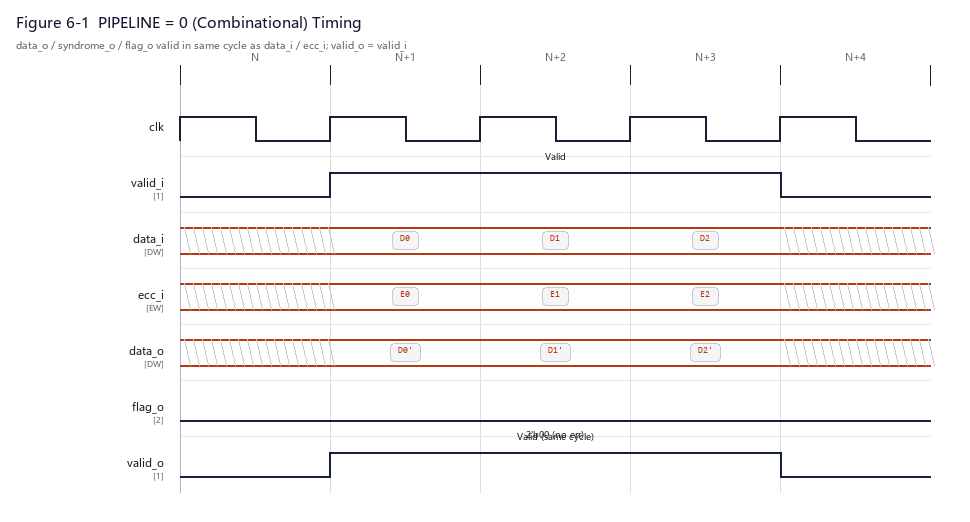

# CBB_ECC_DEC_UG

---

## 目录

- [1. 功能及应用场景](#1-功能及应用场景)
- [2. 规格](#2-规格)
- [3. 方案分析](#3-方案分析)
- [4. 配置参数](#4-配置参数)
- [5. 接口](#5-接口)
- [6. 时序](#6-时序)
- [7. PPA](#7-ppa)

---

## 1. 功能及应用场景

`CBB_ECC_DEC` 是一个参数化 ECC 解码器 IP，基于汉明码 (Hamming Code) 算法对带校验位的数据执行 **SEC-DED**（单错纠正 + 双错检测）。模块接收从存储介质（DDR/SRAM）读回的码字（数据 + ECC 校验位），经 syndrome 计算和错误分类后，自动纠正单比特错误并输出修正后的数据，同时通过标志位上报错误状态。模块为**纯组合实现**（无时钟 / 无流水线），输入稳定后经组合逻辑传播延迟即输出有效结果。

**核心功能：**

- 接收含 ECC 校验位的码字（`data_i` + `ecc_i`），按汉明码规则重算校验位并与接收校验位比对，生成 syndrome
- 根据 syndrome 与全局偶校验结果区分无错、单错、双错三种状态
- 单错时依据 syndrome 定位并翻转错误比特，双错时仅报警不纠正
- **全局偶校验固定使能**，即固定 SEC-DED 模式，不提供仅 SEC 裁剪配置
- 数据位宽、错误位置输出可参数化配置，**无流水线参数**——纯组合直通，无 `clk`/`rst_n` 端口

**适用场景：**

- DDR4/DDR5 内存控制器读通路（DQ 总线数据 + CB 引脚 ECC，经解码器校验纠错后送 CPU）
- 嵌入式 SRAM/DRAM 接口接收端
- 高可靠性存储系统中需容忍软错误 (Soft Error) 的读数据路径

**系统位置：**

```
DRAM  ──▶  [DDR Memory Controller]  ──▶  [CBB_ECC_DEC]  ──▶  [Interconnect]  ──▶  CPU / DMA
                                               │
                                        data_i + ecc_i (from DRAM)
                                        data_o (corrected, to CPU)
                                        flag_o (error report)
```

解码器位于内存控制器与总线互连之间，对读数据流透明——在无错时数据原样直通，仅在检测到错误时执行纠正或报警。纯组合架构下 `valid_o` 与 `valid_i` 同拍有效（零寄存器延迟）。

---

## 2. 规格

该 CBB 的关键特性/规格覆盖功能、接口、配置和性能四类。每条规格以 DS 点编号标识，命名规则为 `DS.[IP_NAME].[TYPE][SPEC_ID]`，如 `DS.ECC_DEC.FUNC.001`。TYPE 按规格类型取值：`FUNC`（功能）、`PERF`（性能）、`INTF`（接口）、`CFG`（配置）。

**规格汇总表**：本 CBB 全部规格按 TYPE 分组，依 `INTF`（接口）→ `CFG`（配置）→ `FUNC`（功能）→ `PERF`（性能）的顺序排列。表中每一行对应下方一条详细规格分节（2.1 ~ 2.13），并保持相同顺序。

| DS 编号 | 类型 | 简述 |
|---------|:---:|------|
| `DS.ECC_DEC.INTF.001` | INTF | valid-only 组合直通握手 |
| `DS.ECC_DEC.INTF.002` | INTF | ECC 校验位输入格式（GP 固定=1） |
| `DS.ECC_DEC.INTF.003` | INTF | 错误标志输出编码 |
| `DS.ECC_DEC.INTF.004` | INTF | Syndrome 值输出 |
| `DS.ECC_DEC.INTF.005` | INTF | 错误位置输出 |
| `DS.ECC_DEC.CFG.001` | CFG | 参数化数据位宽 |
| `DS.ECC_DEC.CFG.002` | CFG | 错误位置输出可选开关 |
| `DS.ECC_DEC.CFG.003` | CFG | 全局偶校验固定使能（SEC-DED） |
| `DS.ECC_DEC.FUNC.001` | FUNC | SEC-DED 汉明码解码 |
| `DS.ECC_DEC.FUNC.002` | FUNC | 单比特错误自动纠正 |
| `DS.ECC_DEC.FUNC.003` | FUNC | 双比特错误检测与报警 |
| `DS.ECC_DEC.FUNC.004` | FUNC | 偶校验一致性校验 |
| `DS.ECC_DEC.PERF.001` | PERF | 组合直通延迟 |

> 规格明细分节（2.x）保持与汇总表相同的排序：INTF → CFG → FUNC → PERF。

### 2.1 Valid 握手协议 — DS.ECC_DEC.INTF.001

模块采用 valid-only 握手协议，且为纯组合直通：

- 上游在 `valid_i = 1` 时提供有效 `data_i` 和 `ecc_i`
- 模块在 `valid_o = 1` 时输出有效的 `data_o`、`syndrome_o`、`flag_o`
- `valid_o` 为 `valid_i` 的组合直通（`assign valid_o = valid_i`），无寄存器延迟，与数据同拍有效
- `valid_i = 0` 时输入被忽略，输出无效（各值仍随输入组合变化，但上层以 `valid_o` 为准）

### 2.2 ECC 校验位输入格式 — DS.ECC_DEC.INTF.002

`ecc_i` 位域布局与编码器 `ecc_o` 完全对应：

- `ecc_i = {p_global, p[k-1:0]}`，位宽 `ECC_WIDTH = k + 1`

其中 `p[0]` 对应汉明码位置 1 的校验位，`p_global` 为全局偶校验位（`ecc_i[ECC_WIDTH-1]`）。编码器 UG §2.2 定义的位域布局为本解码器的解析依据。

### 2.3 错误标志输出编码 — DS.ECC_DEC.INTF.003

`flag_o[1:0]` 指示当前输出的错误状态，始终为 2-bit，统一编码。固定 SEC-DED 模式，仅使用 00（无错）/ 01（单错已纠正）/ 10（双错检测），不再有 SEC only 分支（原 2'b11 码点已删除）。上层可统一以 `flag_o != 2'b00` 判定有错。详细编码见 §5 接口章节。

### 2.4 Syndrome 值输出 — DS.ECC_DEC.INTF.004

`syndrome_o` 输出汉明 syndrome 向量，位宽 = `HAMMING_CBITS`（即 k）：

- 无错时为全零
- 单错时为错误比特在汉明码字中的位置编号（1-indexed，值范围 1 ~ DATA_WIDTH + k）
- 双错时为非零值（两个错误位 syndrome 的 XOR 叠加，输出原始值供调试/日志使用）
- 可用于外部监控、日志记录或调试

### 2.5 错误位置输出 — DS.ECC_DEC.INTF.005

当 `ERR_POS_OUT = 1` 时，`err_pos_o` 输出单错时出错数据位在 `data_i` 中的 bit 索引（0-indexed，位宽 = `$clog2(DATA_WIDTH)`），其值对应 RTL 中 `bit_error_vec` one-hot 译码结果。无错或双错时输出全零。该端口与 syndrome 译码逻辑共用比较器，面积增量可忽略。`ERR_POS_OUT = 0` 时端口保留但位宽为 1 且恒为 0（RTL 中为保证非零位宽的最小回退值）。

### 2.6 参数化数据位宽 — DS.ECC_DEC.CFG.001

`DATA_WIDTH` 由单一 parameter 控制，取值范围 8~256，默认 64。典型配置为 32 (SRAM) 和 64 (DDR)。校验位宽 `ECC_WIDTH` 与汉明校验位数 `HAMMING_CBITS` 由 `localparam` 根据汉明码公式自动推导，无需用户手动指定，且必须与配对编码器一致。

### 2.7 错误位置输出可选开关 — DS.ECC_DEC.CFG.002

`ERR_POS_OUT` 控制是否输出有效 `err_pos_o` 端口：

| 值 | 说明 |
|:--:|------|
| 0 (默认) | `err_pos_o` 位宽回退为 1 且恒为 0，节省组合面积 |
| 1 | 输出 `err_pos_o`，位宽 = `$clog2(DATA_WIDTH)`，指示单错数据位索引 |

### 2.8 全局偶校验固定使能（SEC-DED）— DS.ECC_DEC.CFG.003

全局偶校验位在 RTL 中**固定使能**，即固定为 SEC-DED（单错纠正 + 双错检测）能力：

- `ECC_WIDTH = HAMMING_CBITS + 1`，多出的 1 bit 即全局偶校验位
- 与配对编码器一致，编解码两端必须以 SEC-DED 模式成对例化


### 2.9 SEC-DED 汉明码解码 — DS.ECC_DEC.FUNC.001

模块对输入码字（`data_i` + `ecc_i`）执行完整的 SEC-DED 解码流程：

1. **syndrome 生成**：对 `data_i` 重新计算汉明校验位，与 `ecc_i` 中的汉明校验位逐位 XOR，得到 syndrome 向量 `s[k-1:0]`
2. **全局校验**：对 `data_i` 全体数据位与 `ecc_i` 中全体汉明校验位计算偶校验，与 `ecc_i` 中的全局偶校验位比对
3. **错误分类**：综合 syndrome 与全局校验结果，判定无错/单错/双错（详见 §3.1.2 真值表）
4. **纠错执行**：单错时 syndrome 值即为码字中错误比特的位置编号，翻转该位；双错时数据不修改

### 2.10 单比特错误自动纠正 — DS.ECC_DEC.FUNC.002

当 syndrome ≠ 0 且全局校验不一致时，判定为单比特错误：

- syndrome 向量的二进制值直接指示汉明码字中出错比特的位置（1-indexed）
- 若该位置对应数据位：翻转该数据位，输出修正后的数据
- 若该位置对应汉明校验位：数据位无错误，`data_o` 等于 `data_i`（校验位错误不影响数据）
- 全局校验位自身翻转时：syndrome=0 而全局校验不一致，数据正确直通，`flag_o` 报单错
- `flag_o` 输出单错纠正标志 2'b01

### 2.11 双比特错误检测与报警 — DS.ECC_DEC.FUNC.003

当 syndrome ≠ 0 且全局校验一致时，判定为双比特（或偶数个）错误：

- 此时 syndrome 指向的位置不可信（实际是多个错误位的 syndrome 叠加）
- **不执行纠正**，`data_o` 原值直通（含错数据不做修改，由上层系统根据 flag 决策）
- `flag_o` 输出双错检测标志 2'b10，供上层系统决策（如触发 ECC 错误中断、请求重读等）

> **注意**：SEC-DED 码对 ≥3 个奇数比特错误的 syndrome 表现与单错相同（会误纠正），对 ≥4 个偶数比特错误的表现与双错相同（会漏检）。本模块仅保证 ≤2 个错误的正确处理。

### 2.12 偶校验一致性校验 — DS.ECC_DEC.FUNC.004

编解码两端均采用偶校验规则，保证全零上电后码字合法。解码时：

- 全局偶校验覆盖范围 = 全体数据位 ∪ 全体汉明校验位
- 接收的全局校验位 `ecc_i[ECC_WIDTH-1]`（固定存在）与其覆盖范围的偶校验结果比对
- syndrome 与全局校验正交判定，从而区分无错/单错/双错（这是 SEC-DED 的关键能力）

### 2.13 组合直通延迟 — DS.ECC_DEC.PERF.001

模块为纯组合实现，无时钟、无流水线寄存器：`valid_o` 与 `valid_i` 同拍组合直通，吞吐率不受时钟限制（由外围电路打拍）。组合路径 = syndrome XOR 树 + 错误分类 + 纠错 MUX，64-bit 典型深度约 8~10 级逻辑，纯组合延迟约 <1.5ns（解码比编码路径略深），具体时序需在挂载工艺库后经 STA 确认。

---

## 3. 方案分析

方案分析先做原理分析，说明功能的几种主流实现方法，对比优劣后确定本设计选用方法并详解其核心原理；再讲设计方案，结合原理图分点阐述基于选定原理的具体实现步骤，明确核心操作与特殊功能执行方式，可附典型场景示例辅助说明。

### 3.1 原理分析

#### 3.1.1 纠错码对比

| 方案 | 能力 | 校验位开销 (64-bit) | 解码复杂度 |
|------|------|:---:|:---:|
| 奇偶校验 | 仅检 1 错 | 1 bit | 极低 |
| **汉明码 (SEC)** | 纠 1 错 | 7 bit | 低 |
| **汉明码 + 全局校验 (SEC-DED)** | 纠 1 错 + 检 2 错 | 8 bit | 低 |
| BCH 码 | 纠多错 | >10 bit | 中 |
| Reed-Solomon | 纠块错 | >16 bit | 高 |

**选型结论**：与编码器一致，SEC-DED 汉明码以 12.5% 校验位开销覆盖存储读通路 >99% 的实际错误模式。解码端核心运算为 syndrome 计算（XOR 树）+ 错误分类（少量门电路）+ 纠错（译码 + 条件翻转），与编码端同级复杂度。本解码器采用**纯组合**实现，便于集成在任意时钟域的外围链路中，由外部负责打拍与时序收敛。

#### 3.1.2 解码核心原理

##### Syndrome 生成

解码器对接收数据重新计算汉明校验位，与接收到的校验位 `ecc_i[hamming]` 逐位 XOR：

```
s[j] = XOR( data_i 中校验位 j 覆盖的所有比特 ) ⊕ ecc_i[p_j]
```

若传输/存储无错，重算值与接收值一致，syndrome 全零。若某比特翻转，覆盖该比特的所有 syndrome 位均变为 1，syndrome 的二进制值恰好等于出错比特在码字中的位置。

##### 错误分类真值表

以 64-bit SEC-DED 为例（k=7, ECC_WIDTH=8，）：

| syndrome (7-bit) | 全局校验一致？ | 判定 | 处理 |
|:---:|:---:|------|------|
| = 0 | 是 | 无错误 | 数据直通 |
| ≠ 0 | 否 | **单比特错误** | syndrome 定位 → 翻转纠正 |
| ≠ 0 | 是 | **双比特错误** | 不纠正，data_o 原值直通，flag 报警 |
| = 0 | 否 | **单比特错误**（全局校验位错） | 数据正确直通，flag 报单错 |

> 最后一行（syndrome=0, 全局校验不一致）对应全局校验位本身翻转的情况。此时数据位和汉明校验位均无误，`data_o = data_i` 即为正确数据。但因仍发生了 1-bit 翻转（在全局校验位上），模块如实按单错上报，提示上层该存储单元已出现劣化，应尽早刷新/重写，防止与后续错误叠加降级。

##### 纠错执行

syndrome 值直接编码为汉明码字中的比特位置（1-indexed）。解码器需完成**位置译码**——将 syndrome 值译码为 one-hot 向量，再与码字中对应比特 XOR 翻转。

码字布局（以 4-bit 数据为例，k=3, 总码字位置 1~7）：

```
码字位置:  7    6    5    4    3    2    1
内容:     d3   d2   d1   p2   d0   p1   p0
```

- syndrome = 3'b011 (值=3) → 位置 3，对应 d0 → 翻转 data_i[0]
- syndrome = 3'b010 (值=2) → 位置 2，对应 p1 → 校验位错，数据不变
- syndrome = 3'b101 (值=5) → 位置 5，对应 d1 → 翻转 data_i[1]

由于数据位在码字中不连续（被 2 的幂次位置的校验位间隔），需要将 syndrome 值映射到实际 `data_i` 的 bit 索引。此映射在编译期由 generate 循环展开为固定连线（RTL 中 `codeword_pos()` 函数 + `gen_correct` 比较器）。

#### 3.1.3 偶校验在解码端的意义

| 维度 | 偶校验 (本模块) | 说明 |
|------|:---:|------|
| 上电安全性 | 全零码字合法 | DRAM 上电后全零数据不会触发假阳性纠错 |
| 编码器兼容 | 与 `cbb_ecc_enc` 一致 | 编解码两端必须同规则（均固定 GP=1） |
| 单/双错区分 | syndrome + 全局校验正交判定 | 这是 SEC-DED 的关键能力 |

### 3.2 设计方案

#### 3.2.1 模块层次

```
CBB_ECC_DEC (顶层, 纯组合)
├── gen_syndrome        — 汉明 syndrome 重算 (generate 循环, XOR 树, 纯组合)
├── gen_global_parity   — 全局偶校验检查 (组合逻辑, )
├── 错误分类逻辑        — 无错/单错/双错 (always_comb, 纯组合)
├── gen_correct         — 单错定位与翻转纠正 (generate 循环, 纯组合)
└── 错误位置编码        — bit_error_vec one-hot → err_pos_o 二进制 (always_comb, 纯组合)
```

> 注:早期版本含 gen_pipe0/1/2 流水线寄存器块与 clk/rst_n 端口，本次改版已全部移除，无任何时序逻辑。

#### 3.2.2 解码流程

```
              ┌── Hamming Check-bit Recomputation ──┐
              │   (XOR trees, same coverage as enc)  │
              │                                      ▼
 data_i ──────┤                              syndrome = recomputed ⊕ ecc_i[hamming]
              │                                      │
              ├── Global Even Parity Check ──────────┤
              │   XOR(data_i, ecc_i[hamming])        │
              │   vs ecc_i[global]                    │
              │                                      ▼
              │                              Error Classification
              │                              (真值表 §3.1.2)
              │                                      │
              │         ┌────────────────────────────┤
              │         ▼                            ▼
              │   single error?              double / no error
              │         │                            │
              │         ▼                            ▼
              └──▶ Position Decode            data_o = data_i
                    (syndrome → one-hot)      (或 data_i, 双错时)
                         │
                         ▼
                    Bit Flip
                    data_o[err_pos] = ~data_i[err_pos]
                         │
                         ▼
                    data_o (corrected)
```

关键数据通路（均为纯组合，无寄存器介入）：
- **穿通路径**：`data_i` → 纠错 MUX → `data_o`
- **syndrome 路径**：`data_i` + `ecc_i` → XOR 树 → syndrome → `syndrome_o`
- **flag 路径**：syndrome + 全局校验结果 → 错误分类 → `flag_o`
- **valid 路径**：`valid_i` → `valid_o`（assign 直通）

#### 3.2.3 纠错 (Bit-Flip) 实现

syndrome 值指示码字中出错位置。由于数据位分散在码字的非 2 幂次位置，需将 syndrome 译码后映射回数据位索引：

`gen_correct` generate 循环中，每个数据位 `data_i[gi]` 对应码字位置 `codeword_pos(gi)`，以 `(syndrome_full_comb == CW_POS) & is_single_err` 产生 one-hot 错误向量 `bit_error_vec`，再与原位 XOR 翻转即得 `data_corrected_comb`。

当 `ERR_POS_OUT = 1` 时，模块额外输出 `err_pos_o`，其值为出错数据位在 `data_i` 中的 bit 索引（0-indexed，对 one-hot `bit_error_vec` 编码）。无错或双错时 `err_pos_o` 输出全零。该端口供外部 ECC 错误日志/统计使用，由 parameter 控制是否输出有效宽度以节省面积。

#### 3.2.4 时序架构

模块为**纯组合实现，无时钟、无流水线**：

- 输入 `data_i`/`ecc_i` 稳定后，经组合传播延迟（syndrome XOR 树 → 错误分类 → 纠错 MUX）即可在输出端 `data_o`/`syndrome_o`/`flag_o`/`err_pos_o` 得到有效结果
- `valid_o = valid_i` 直接 assign，与数据同拍有效
- 消除寄存器与时钟树，无复位问题；时序收敛交由外部链路统一处理
- 面积上无 FF，仅组合逻辑（64-bit 典型约 300 cells，见 §7）

---

## 4. 配置参数

| 参数 | 配置范围 | 默认值 | 描述 |
|------|----------|:------:|------|
| `DATA_WIDTH` | 8 ~ 256 | 64 | 待保护的数据位宽（与编码器一致） |
| `ERR_POS_OUT` | 0 / 1 | 0 | 1 = 输出错误位置 `err_pos_o`，0 = 不输出 |

**自动推导参数 (localparam)**：

| 参数 | 公式 | 说明 |
|------|------|------|
| `HAMMING_CBITS` | 满足 `2^k ≥ DATA_WIDTH + k + 1` 的最小 k | 汉明校验位个数 |
| `ECC_WIDTH` | `HAMMING_CBITS + 1` | 输入 ecc_i 的总位宽（含固定 1-bit 全局偶校验） |

**常见配置下的校验位宽**：

| DATA_WIDTH | HAMMING_CBITS | ECC_WIDTH | 额外开销 |
|:----------:|:-------------:|:---------:|:--------:|
| 8 | 4 | 5 | 62.5% |
| 16 | 5 | 6 | 37.5% |
| **32** | **6** | **7** | 21.9% |
| **64** | **7** | **8** | 12.5% |
| 128 | 8 | 9 | 7.0% |
| 256 | 9 | 10 | 3.9% |

> 与编码器 UG §4 完全一致（编码器配置参数章节，见 `cbb_ecc_enc` UG 目录下同名文档），编解码两端必须使用相同的 DATA_WIDTH。

---

## 5. 接口

| 信号名 | 位宽 | I/O | 输出类型 | 描述 |
|--------|------|:---:|:------:|------|
| `data_i` | `DATA_WIDTH` | I | — | 从存储介质读回的原始数据（可能含错） |
| `ecc_i` | `ECC_WIDTH = HAMMING_CBITS+1` | I | — | 随数据读回的 ECC 校验位（含固定全局偶校验位），位域布局见下方说明 |
| `valid_i` | 1 | I | — | 输入有效指示，与 data_i/ecc_i 同拍对齐 |
| `data_o` | `DATA_WIDTH` | O | 组合 | 纠错后的数据（纯组合直通） |
| `syndrome_o` | `HAMMING_CBITS` | O | 组合 | 汉明 syndrome 值 |
| `flag_o` | 2 | O | 组合 | 错误状态标志，编码见下方说明 |
| `err_pos_o` | `$clog2(DATA_WIDTH)`¹ | O | 组合 | (可选, ERR_POS_OUT=1) 单错时出错数据位的 bit 索引 (0-indexed)，无错/双错时为 0 |
| `valid_o` | 1 | O | 组合 | 输出有效指示，`assign valid_o = valid_i` 直通 |

¹ `ERR_POS_OUT=0` 时该端口位宽为 1（RTL 中为保证非零位宽的最小回退值），端口仍保留、恒为 0；`ERR_POS_OUT=1` 时位宽为 `$clog2(DATA_WIDTH)`。

> 模块为纯组合实现，无 `clk`/`rst_n` 端口；所有输出均为 assign 连续赋值，输入稳定后经组合传播延迟即有效。

**ecc_i 位域布局：**

```
ecc_i = {全局偶校验位 (1-bit),  汉明校验位 (k-bit)}
        └── ecc_i[ECC_WIDTH-1]   └── ecc_i[ECC_WIDTH-2:0]
```

| 位域 | 说明 |
|------|------|
| 全局偶校验位 | `ecc_i[ECC_WIDTH-1]`（固定存在） |
| 汉明校验位 | `ecc_i[ECC_WIDTH-2:0]` |

- `ecc_i[0]` 对应汉明码位置 1 的校验位 p0
- `ecc_i[1]` 对应汉明码位置 2 的校验位 p1
- `ecc_i[k-1]` 对应汉明码位置 2^(k-1) 的校验位 p[k-1]

> **例 (64-bit)**：`ecc_i[7]` = 全局校验位, `ecc_i[6:0]` = 汉明校验位 (k=7, ECC_WIDTH=8)
>
> **例 (32-bit)**：`ecc_i[6]` = 全局校验位, `ecc_i[5:0]` = 汉明校验位 (k=6, ECC_WIDTH=7)

**flag_o 编码（固定 SEC-DED）：**

| flag_o[1:0] | 含义 | 说明 |
|:-----------:|------|------|
| 2'b00 | 无错误 | 码字正确，data_o = data_i |
| 2'b01 | 单错已纠正 | 单比特错误已被翻转纠正（含全局校验位自身翻转），data_o 为修正后数据 |
| 2'b10 | 双错已检测 | 检测到双比特（或偶数个）错误，data_o 不纠正、原值直通 |

**判定真值表：**

| syndrome == 0 | 全局校验一致 | flag_o |
|:---:|:---:|:---:|
| 是 | 是 | 2'b00 (无错) |
| 否 | 否 | 2'b01 (单错纠正) |
| 否 | 是 | 2'b10 (双错检测) |
| 是 | 否 | 2'b01 (全局校验位自身错误，数据正确) |

> **注意**：SEC only (GP=0) 分支及其 2'b11 编码已从 RTL 移除。上层可通过检查 `flag_o != 2'b00` 判定"有错误"。

---

## 6. 时序

模块为**纯组合实现（无时钟、无流水线）**：输入稳定 → 组合传播延迟 → 输出有效。

- 输入 `data_i`/`ecc_i` 有效（`valid_i=1`）后，经组合路径传播延迟 `t_pd`（syndrome XOR 树 + 错误分类 + 纠错 MUX，64-bit 约 8~10 级逻辑）即可在 `data_o`/`syndrome_o`/`flag_o`/`err_pos_o` 得到稳定结果
- `valid_o` 与 `valid_i` 同拍组合直通（`assign valid_o = valid_i`）
- 无寄存器、无时钟域、无复位行为；输出在无错时直通 `data_i`，单错时输出纠正后数据
- **时序模型**：`t_data_o = t_pd(syndrome) + t_pd(classify) + t_pd(correct)`，全部为组合延迟；外围电路负责对 `data_o`/`flag_o` 打拍采样



---

## 7. PPA

> 综合工具：Synopsys Design Compiler W-2024.09-SP3 | 日期：2026-09-01（纯组合改版后重综合）
> 工艺库：tcbn12ffcllbwp7d5t16p96cpd (12-track, SS 0.9V 125°C)
> 注明：以下 PPA 为恰含 PIPE=0 记录的旧版本数据（纯组合口径），寄存器/流水线相关条目已移除。

### 7.1 配置A：64-bit SEC-DED（纯组合）

**参数设置：**

| 参数 | 设置值 | 说明 |
|------|:------:|------|
| DATA_WIDTH | 64 | DDR4 典型位宽 |
| ERR_POS_OUT | 0 | 不输出错误位置 |

**PPA 数据（组合口径参考）：**

| 项目 | 实测值 |
|------|:------|
| 频率 | 纯组合，无时钟（由外部打拍限制；组合关键路径 data arrival 0.56ns @ SS 0.9V 125°C） |
| 面积 | 85.39 µm² 组合 + 0 FF（非组合面积 0） |
| 单元数 | 305 cells (全组合，含 35 buf/inv) |
| 功耗 | 见 `scripts/syn.sh/reports/cbb_ecc_dec_power.rpt`（组合判定为准） |
| 综合状态 | ✅ PASS |

> 解码器组合面积（85.4µm²）略大于编码器（54.3µm²），增量主要来自 syndrome 比较器、纠错 MUX 和错误分类逻辑。上表为 2026-09-01 改版后实测。

### 7.2 时序说明

- 纯组合实现，所有输出（`data_o`/`syndrome_o`/`flag_o`/`err_pos_o`/`valid_o`）均为 assign 连续赋值，无时钟域、无寄存器输出
- 组合路径 = syndrome XOR 树（约 4~6 级）→ 错误分类 → 纠错 MUX（约 2~3 级），64-bit 总计约 8~10 级逻辑
- 外部需自行打拍以满足时序；`clk`/`rst_n` 端口已删除，无复位行为

---
