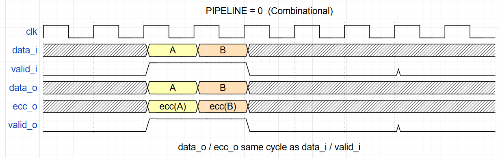

# CBB_ECC_ENC_UG

---

## 目录

- [1. 功能及应用场景](#1-功能及应用场景)
- [2. 规格](#2-规格)
- [3. 方案分析](#3-方案分析)
- [4. 配置参数](#4-配置参数)
- [5. 接口](#5-接口)
- [6. 时序图](#6-时序图)
- [7. PPA](#7-ppa)

---

## 1. 功能及应用场景

`CBB_ECC_ENC` 是一个参数化 ECC 编码器 IP，基于汉明码为数据生成校验位，实现 **SEC-DED**（单错纠正 + 双错检测）。模块采用穿通架构——数据位序不变直通输出，校验位附加在独立总线上。全模块为**纯组合逻辑**，无时钟、无复位、无流水线。

```
CPU / DMA  ──▶  [Interconnect]  ──▶  [CBB_ECC_ENC]  ──▶  [Memory Controller]  ──▶  DRAM
                                          │
                                   data_o (passthrough)
                                   ecc_o  (check bits)
```

**典型应用**：

- DDR4/DDR5 内存控制器写通路（数据走 DQ 总线，ECC 走 CB 引脚）
- 嵌入式 SRAM/DRAM 接口发送端
- 高可靠性存储系统中需防软错误的数据路径

---

## 2. 规格

该 CBB 的关键特性/规格覆盖功能、接口、配置和性能四类。每条规格以 DS 点编号标识，命名规则为 `DS.[IP_NAME].[TYPE][SPEC_ID]`，如 `DS.ECC_ENC.FUNC.001`。TYPE 按规格类型取值：`FUNC`（功能）、`PERF`（性能）、`INTF`（接口）、`CFG`（配置）。

**规格汇总表**：本 CBB 全部规格按 TYPE 分组，依 `INTF`（接口）→ `CFG`（配置）→ `FUNC`（功能）→ `PERF`（性能）的顺序排列。表中每一行对应下方一条详细规格分节（2.1 ~ 2.8），并保持相同顺序。

| DS 编号 | 类型 | 简述 |
|---------|:---:|------|
| `DS.ECC_ENC.INTF.001` | INTF | Valid 握手协议 |
| `DS.ECC_ENC.INTF.002` | INTF | ECC 校验位输出格式 |
| `DS.ECC_ENC.CFG.001` | CFG | 参数化数据位宽 |
| `DS.ECC_ENC.CFG.002` | CFG | 全局偶校验位固定使能（SEC-DED） |
| `DS.ECC_ENC.FUNC.001` | FUNC | SEC-DED 汉明码编码 |
| `DS.ECC_ENC.FUNC.002` | FUNC | 数据穿通输出 |
| `DS.ECC_ENC.FUNC.003` | FUNC | 偶校验规则 |
| `DS.ECC_ENC.PERF.001` | PERF | 吞吐率 |

> 规格明细分节（2.x）保持与汇总表相同的排序：INTF → CFG → FUNC → PERF。

### 2.1 Valid 握手协议 — DS.ECC_ENC.INTF.001

模块采用 valid-only 握手：上游 `valid_i = 1` 时 `data_i` 有效；模块为纯组合直通，`valid_o = valid_i`，与 `data_o`、`ecc_o` 同一时刻（经历组合传播延迟后）有效对齐，无流水延迟、无多拍时序。`valid_i = 0` 时 data_i 被忽略。

### 2.2 ECC 校验位输出格式 — DS.ECC_ENC.INTF.002

模块固定为 SEC-DED：`ecc_o = {p_global, p[k-1:0]}`，其中 `ECC_WIDTH = k + 1`。`p_global` 为全局偶校验位（固定使能），占 `ecc_o` 的最高位；`p[0]` 对应汉明码位置 1 的校验位。模块不提供仅 SEC 裁剪分支。

### 2.3 参数化数据位宽 — DS.ECC_ENC.CFG.001

`DATA_WIDTH` 取值范围 8~256，默认 64，典型值为 32 (SRAM) 和 64 (DDR)。校验位宽 `ECC_WIDTH` 由 `localparam` 自动推导（`ECC_WIDTH = HAMMING_CBITS + 1`），无需用户手动指定。

### 2.4 全局偶校验位固定使能（SEC-DED） — DS.ECC_ENC.CFG.002

模块固定采用 SEC-DED：`ECC_WIDTH = k + 1`。**不提供**关闭全局校验位的参数配置（无 SEC only 模式），也不提供 `PIPELINE`、`clk`、`rst_n` 配置。

### 2.5 SEC-DED 汉明码编码 — DS.ECC_ENC.FUNC.001

根据汉明码规则为输入数据计算校验位，实现单错纠正 (SEC) 和双错检测 (DED)。校验位数量 k 自动推导（满足 `2^k ≥ DATA_WIDTH + k + 1`），校验组采用偶校验。全局偶校验位覆盖全体数据位与全体汉明校验位，用于区分单错/双错。

### 2.6 数据穿通输出 — DS.ECC_ENC.FUNC.002

原始数据 `data_i` 不经修改地传输到 `data_o`，数据位序保持不变。穿通路径为纯组合直连（wire-through），无流水线寄存器、无打拍延迟，数据本身不参与编码逻辑。

### 2.7 偶校验规则 — DS.ECC_ENC.FUNC.003

所有校验组采用偶校验：组内全部比特（含校验位自身）的 XOR 结果为 0。偶校验保证全零状态为合法码字，避免存储介质复位/初始化后首笔读取触发假阳性纠错。

### 2.8 吞吐率 — DS.ECC_ENC.PERF.001

模块为纯组合逻辑，无流水线填充周期，吞吐率仅受限于输入数据速率。`data_o = data_i` 为穿通导线（零延迟）；`ecc_o` 为纯组合 XOR 树（64-bit 约 6 级 XOR），`valid_o` 与 `valid_i` 同拍直通。

---

## 3. 方案分析

### 3.1 原理分析

#### 3.1.1 纠错码选型

| 方案 | 能力 | 64-bit 校验开销 | 复杂度 |
|------|------|:---:|:---:|
| 奇偶校验 | 仅检 1 错 | 1 bit | 极低 |
| 汉明码 (SEC) | 纠 1 错 | 7 bit | 低 |
| **汉明码 + 全局校验 (SEC-DED)** | **纠 1 错 + 检 2 错** | **8 bit** | 低 |
| BCH 码 | 纠多错 | >10 bit | 高 |
| Reed-Solomon | 纠块错 | >16 bit | 很高 |

选型结论：DDR 存储保护场景以单粒子翻转为主要威胁，SEC-DED 汉明码以最小开销（12.5%）覆盖 >99% 的错误模式，且编解码均为纯 XOR 树，延迟极低。

#### 3.1.2 汉明码核心原理

校验位放在码字中 2 的幂次方位置 (1, 2, 4, 8, ...)，数据位填充剩余位置。每个校验位覆盖"位置编号的二进制中对应位为 1"的全部比特。以 4-bit 数据为例（需要 3 个汉明校验位）：

```
码字位置:  7    6    5    4    3    2    1
内容:     d3   d2   d1   p2   d0   p1   p0
```

- p0 (pos=1): 覆盖 d0, d1, d3  →  `p0 = d0 ⊕ d1 ⊕ d3`
- p1 (pos=2): 覆盖 d0, d2, d3  →  `p1 = d0 ⊕ d2 ⊕ d3`
- p2 (pos=4): 覆盖 d1, d2, d3  →  `p2 = d1 ⊕ d2 ⊕ d3`

解码时重新计算各组 XOR 并与存储值比对，不一致的组构成 syndrome，其二进制值直接指向出错位置。SEC-DED 在此基础上增加全局偶校验位覆盖全体数据与汉明位，区分单错（syndrome≠0、全局不一致）和双错（syndrome≠0、全局一致）。

#### 3.1.3 偶校验 vs 奇校验

| 维度 | 偶校验 (本模块) | 奇校验 |
|------|:---:|:---:|
| 门电路 | XOR 树直接输出 | XOR 树 + 反相器 |
| 全零上电 | 合法码字 | 非法，触发假阳性纠错 |
| 行业标准 | JEDEC DDR4/DDR5 | 几乎无采用 |

上电后存储单元（DRAM/SRAM）为全零，偶校验下全零码字合法——这是工程上的决定性优势。本模块为纯组合逻辑、无内部寄存器，不依赖复位状态。

### 3.2 设计方案

#### 3.2.1 模块层次

```
CBB_ECC_ENC (单文件, 纯组合)
├── gen_hamming_full  — 汉明校验位 XOR 树 (generate 循环, 纯组合)
├── 全局偶校验位      — (assign, 纯组合, 固定使能)
└── 输出直通          — data_o / ecc_o / valid_o / flag_o 纯组合 assign
```

#### 3.2.2 编码流程

```
             ┌── XOR Tree 0 ──▶ ecc_o[0]   (汉明校验位 p0)
             ├── XOR Tree 1 ──▶ ecc_o[1]   (汉明校验位 p1)
  data_i ────┼── XOR Tree 2 ──▶ ecc_o[2]   (汉明校验位 p2)
             │     ...
             ├── XOR Tree k-1 ─▶ ecc_o[k-1] (汉明校验位 pk-1)
             ├── Global XOR  ──▶ ecc_o[k]   (全局校验位, 固定使能)
             │
             ├── Passthrough ──▶ data_o     (数据穿通, 直接导线)
             ├── ──────────────▶ valid_o    (= valid_i, 直通)
             └── ──────────────▶ flag_o     (= {1'b0, valid_o})
```

校验位间的 XOR 组依赖关系在编译期由 generate 循环展开，综合为平衡 XOR 树。数据通路无任何修改。

#### 3.2.3 纯组合直通架构

模块**不含任何寄存器**，全部输出均为输入的组合函数：

| 信号 | 逻辑 |
|------|------|
| `data_o` | `= data_i`（穿通导线） |
| `ecc_o` | `= {ecc_global_full, ecc_hamming_full}`（XOR 树组合输出，`ECC_WIDTH = k+1`） |
| `valid_o` | `= valid_i`（直通） |
| `flag_o` | `= {1'b0, valid_o}`（bit1 固定为 0，bit0 为输出有效） |

无时钟、无复位、无流水线参数——时序收敛完全取决于外部环境（如需多拍对齐，可在模块外部自行插入寄存器或 FIFO）。

---

## 4. 配置参数

| 参数 | 配置范围 | 默认值 | 描述 |
|------|----------|:------:|------|
| `DATA_WIDTH` | 8 ~ 256 | 64 | 待编码的数据位宽 |

**自动推导 (localparam)**：

| 参数 | 公式 |
|------|------|
| `HAMMING_CBITS` | 满足 `2^k ≥ DATA_WIDTH + k + 1` 的最小 k |
| `ECC_WIDTH` | `HAMMING_CBITS + 1`（全局偶校验位固定使能） |

| DATA_WIDTH | HAMMING_CBITS | ECC_WIDTH | 额外开销 |
|:---:|:---:|:---:|:---:|
| 8 | 4 | 5 | 62.5% |
| 16 | 5 | 6 | 37.5% |
| **32** | **6** | **7** | 21.9% |
| **64** | **7** | **8** | 12.5% |
| 128 | 8 | 9 | 7.0% |
| 256 | 9 | 10 | 3.9% |

> 注：`HAMMING_CBITS` 为满足 `2^k ≥ DATA_WIDTH + k + 1` 的最小 k，同 RTL 查表一致（DW≤4→3, ≤11→4, ≤26→5, ≤57→6, ≤120→7, ≤247→8, 其余→9）。DW=64→k=7→ECC_WIDTH=8；DW=128→k=8→ECC_WIDTH=9；DW=256→k=9→ECC_WIDTH=10。

---

## 5. 接口

| 信号名 | 位宽 | I/O | 输出类型 | 描述 |
|--------|------|:---:|:------:|------|
| `data_i` | `DATA_WIDTH` | I | — | 待编码的原始数据 |
| `valid_i` | 1 | I | — | 输入有效指示，与 data_i 同拍对齐 |
| `data_o` | `DATA_WIDTH` | O | 组合直通 | `data_o = data_i`，穿通导线（无寄存器、无打拍） |
| `ecc_o` | `ECC_WIDTH` (=KC+1) | O | 组合 | `{p_global, p[k-1:0]}`，最高位为全局偶校验位，低位为汉明校验位 |
| `flag_o` | 2 | O | 组合 | `{1'b0, valid_o}`，bit1 固定为 0（保留位），bit0 = 输出有效 |
| `valid_o` | 1 | O | 组合 | `valid_o = valid_i`（直通） |

> **模块无 `clk` / `rst_n` 时钟与复位端口**，纯组合实现，不含任何寄存器。

---

## 6. 时序图

模块为**纯组合直通**，无时钟、无流水线：`data_o`/`ecc_o`/`valid_o` 均为输入 `data_i`/`valid_i` 的组合函数，输入稳定后经历组合传播延迟立即输出，**无多拍时序、无背靠背/气泡概念**（气泡仅可能由外部流水引入）。

### 6.1 组合直通（默认，唯一模式）



`data_o = data_i`、`ecc_o`（XOR 树生成）、`valid_o = valid_i` 全部为组合直通：输入稳定后经历 XOR 树传播延迟输出即有效，零周期延迟。

---

## 7. PPA

> 综合工具：Synopsys Design Compiler W-2024.09-SP3 | 日期：2026-07-23
> 工艺库：tcbn12ffcllbwp7d5t16p96cpd (12-track, SS 0.9V 125°C)
> 当前模块为**纯组合实现（无流水寄存器）**，以下给出组合逻辑实测参考值。

### 7.1 纯组合模式 (DW=64, SEC-DED)

**参数设置：**

| 参数 | 设置值 | 说明 |
|------|:------:|------|
| DATA_WIDTH | 64 | DDR4 典型位宽 |

**PPA 数据：**

| 项目 | 实测值 |
|------|:------|
| 频率 | ≥ 1 GHz (组合路径 slack +0.60ns) |
| 面积 | 54.3 µm² 组合 + 0 FF（无时序单元） |
| 单元数 | 147 cells (全组合) |
| 功耗 | 0.080 mW (动态 80 µW + 漏电 377 nW) |
| 综合状态 | ✅ PASS |

### 7.2 时序说明

- `data_o` 为穿通导线（内部逻辑级数 = 0）
- `ecc_o` 为纯组合 XOR 树输出（64-bit 约 6 级 XOR），最大关键路径为 `data_i → XOR 树 → ecc_o`
- 模块无内部寄存器；外部若需多拍对齐，可自行在模块前后插入寄存器
