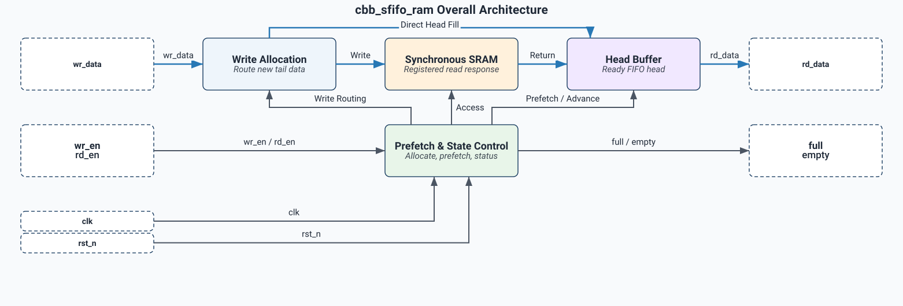
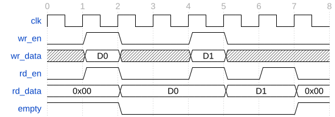
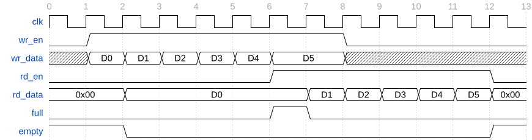

# CBB_SFIFO_RAM_UG

## 目录

- [1. 功能及应用场景](#1-功能及应用场景)
- [2. 规格](#2-规格)
- [3. 方案分析](#3-方案分析)
- [4. 配置参数](#4-配置参数)
- [5. 接口](#5-接口)
- [6. 时序图](#6-时序图)
- [7. PPA](#7-ppa)

---

## 1. 功能及应用场景

### 1.1 核心功能

`cbb_sfifo_ram` 是基于 SRAM 存储的参数化单时钟同步 FIFO，用于同一时钟域内较大容量的数据缓冲与读写流控。模块采用寄存 Show-ahead 读接口，适合需要 SRAM 存储资源的同步队列。

### 1.2 关键特性

- 采用 SRAM 存储，适合构建较大容量的同步数据缓冲。
- 采用寄存 Show-ahead 读接口，FIFO 非空时队首数据提前保持在输出端。
- 支持连续读写，兼顾存储容量和接口吞吐能力。

### 1.3 应用场景与适用边界

| 场景 | 适用性 | 说明 |
|---|:---:|---|
| 独立时钟域之间的数据传输 | 不适用 | 读写接口工作在同一时钟域。 |
| 需要空 FIFO 数据同周期透传 | 不适用 | 空状态写入的数据不能在同周期直接呈现在读端。 |
| 需要寄存 Show-ahead 读输出 | 适用 | 预取缓冲区的寄存队首直接驱动 `rd_data`。 |
| 需要缓存水位预警 | 不适用 | 仅提供满空状态，不提供近满和近空状态。 |
| 需要较大容量的 SRAM 缓冲 | 适用 | 使用 SRAM 作为 FIFO 存储体。 |
| 需要非 2 次幂存储深度 | 适用 | 支持不小于 4 的非 2 次幂深度。 |

---

## 2. 规格

**规格汇总：**

| 规格 ID | 类型 | 规格项 | 描述 |
|---|---|---|---|
| `DS.SFIFO_RAM.INTF.001` | INTF | 读数据有效条件 | 仅当 `empty=0` 时，`rd_data` 有效并表示当前队首。 |
| `DS.SFIFO_RAM.INTF.002` | INTF | 读输出类型 | `rd_data` 为寄存 Show-ahead 输出；有效队首无需先发起读请求即可观察。 |
| `DS.SFIFO_RAM.CFG.001` | CFG | 数据位宽 | `DATA_WIDTH>=1`。 |
| `DS.SFIFO_RAM.CFG.002` | CFG | 存储深度 | `DEPTH>=4`，支持非 2 次幂深度。 |
| `DS.SFIFO_RAM.FUNC.001` | FUNC | 先进先出语义 | 成功写入的数据按成功写入顺序被成功读取，无丢失、重复、乱序或覆盖。 |
| `DS.SFIFO_RAM.FUNC.002` | FUNC | 读写边界行为 | 请求按时钟沿前 `full`、`empty` 状态接受；空状态不旁路，满状态不借用同拍读释放的空间。 |
| `DS.SFIFO_RAM.FUNC.003` | FUNC | 复位状态 | 低有效异步复位时，`empty=1`、`full=0`，`rd_data` 无效。 |
| `DS.SFIFO_RAM.PERF.001` | PERF | 读写吞吐量 | 在 `clk` 域且不受空、满边界阻塞时，读端和写端均可连续每周期接受 1 个事务。 |

### 2.1 先进先出语义 — DS.SFIFO_RAM.FUNC.001

成功写入的数据进入队尾，成功读取的数据从队首移除。所有成功写入且尚未读取的数据保持原有顺序，不丢失、重复、乱序或被后写数据覆盖。

### 2.2 读输出语义 — DS.SFIFO_RAM.INTF.001、DS.SFIFO_RAM.INTF.002

`rd_data` 由预取缓冲区的寄存队首直接驱动。仅当 `empty=0` 时，`rd_data` 表示当前队首，无需先发起读请求即可观察。成功读请求消费沿前的当前队首；成功读取后若仍有数据，下一队首在沿后通过 `rd_data` 可见。非空且未成功读取时，`rd_data` 保持当前队首。

### 2.3 读写边界行为 — DS.SFIFO_RAM.FUNC.002

写请求仅在沿前 `full=0` 时成功，读请求仅在沿前 `empty=0` 时成功。边界行为如下：

| 沿前状态 | `wr_en` | `rd_en` | 写请求 | 读请求 | 外部行为 |
|---|:---:|:---:|---|---|---|
| 空 | 0 | 1 | 不接受 | 不接受 | 空读被拒绝，保持空状态。 |
| 空 | 1 | 0 | 接受 | 不接受 | 写入的数据在沿后成为队首。 |
| 空 | 1 | 1 | 接受 | 不接受 | 只写入，不发生空状态直通读取。 |
| 非空非满 | 0 | 1 | 不接受 | 接受 | 读出沿前队首。 |
| 非空非满 | 1 | 0 | 接受 | 不接受 | 将写数据加入队尾。 |
| 非空非满 | 1 | 1 | 接受 | 接受 | 读出沿前队首，同时将写数据加入队尾。 |
| 满 | 1 | 0 | 不接受 | 不接受 | 满写被拒绝，保持满状态。 |
| 满 | 0 | 1 | 不接受 | 接受 | 读出沿前队首。 |
| 满 | 1 | 1 | 不接受 | 接受 | 只读出，不使用本拍释放的空间接受写入。 |

### 2.4 复位状态 — DS.SFIFO_RAM.FUNC.003

`rst_n` 为低有效异步复位。复位时 `empty=1`、`full=0`，`rd_data` 无效。

### 2.5 读写吞吐量 — DS.SFIFO_RAM.PERF.001

在不受空、满边界阻塞时，写端和读端在 `clk` 域均可连续每周期接受 1 个事务。连续读取时，下一队首逐拍更新到 `rd_data`，稳态读吞吐量为 1 word/cycle。

---

## 3. 方案分析

### 3.1 原理分析与方案选择

本模块面向同一时钟域内较大容量的数据排队需求，以同步 SRAM 承载主体存储，并通过预取和队首缓冲吸收 SRAM 的读延迟，使队首能够及时就绪。

| 设计项 | 主流方案 | 主要取舍 | 本设计选择 |
|---|---|---|---|
| 存储实现 | 寄存器阵列；同步双端口 SRAM | 寄存器阵列控制直接但面积随深度增长；同步 SRAM 密度高、适合较大容量，但读数据需在时钟沿后返回。 | 采用同一时钟驱动的同步双端口 SRAM，写端口和读端口分别承担入队存储与队首预取。 |
| 同步 RAM 读延迟处理 | 按需读取；预取并设置队首缓冲 | 按需读取控制较简洁，但消费后可能等待下一字返回；预取与缓冲增加控制协同，可隐藏读延迟并维持连续吞吐。 | 采用预取与队首缓冲，提前将 SRAM 中最早的数据转移到可立即提供的队首位置。 |

写入分配根据当前数据所在位置，将新数据送往队首缓冲或 SRAM；只有在不存在更早的 SRAM 数据时，新写入的数据才可直接补入缓冲，从而保持先入先出顺序。

同步 SRAM 在读请求后的时钟沿返回数据。预取控制在消费队首且 SRAM 仍有数据时提前发起读取，返回的数据随后进入队首缓冲；并发写入与读返回也按原有先后次序合并处理，因此稳态连续读取不会因 SRAM 延迟产生气泡。

总体占用状态覆盖缓冲与 SRAM 中的全部有效数据，预取只改变数据所在位置而不改变 FIFO 总占用。满空状态由总占用形成，存储位置和在途返回则由预取控制协调。

### 3.2 总体架构

读写请求在同一时钟域内由预取与状态控制接收，并以总占用直接形成 `full` 和 `empty`。写入分配按当前数据位置将新数据直接补入队首缓冲或写入同步 SRAM；SRAM 中较早的数据经预取和寄存读返回进入队首缓冲，缓冲持续驱动 `rd_data`。

---

## 4. 配置参数

| 参数 | 配置范围 | 默认值 | 描述 |
|---|---|---:|---|
| `DATA_WIDTH` | `>=1` | 32 | 读写数据位宽。 |
| `DEPTH` | `>=4` | 16 | FIFO 存储深度（数据字）。 |

---

## 5. 接口

| 信号名 | 位宽 | I/O | 时钟域 | 描述 |
|---|---:|:---:|---|---|
| `clk` | 1 | I | — | 模块工作时钟，上升沿有效。 |
| `rst_n` | 1 | I | — | 异步复位，低有效。 |
| `wr_en` | 1 | I | `clk` | 写请求，高有效。 |
| `wr_data` | `DATA_WIDTH` | I | `clk` | 写数据，仅写事务成功时采样。 |
| `rd_en` | 1 | I | `clk` | 读请求，高有效。 |
| `rd_data` | `DATA_WIDTH` | O | `clk` | 寄存 show-ahead 队首，仅 `empty=0` 时有效。 |
| `full` | 1 | O | `clk` | 满标志，高有效组合输出。 |
| `empty` | 1 | O | `clk` | 空标志，高有效组合输出；`empty=0` 时 `rd_data` 有效。 |

---

## 6. 时序图

### 6.1 首字寄存呈现、保持与单项替换

结论：空态同拍读写只接受 D0 写入，D0 沿后成为寄存队首并可被 D1 无气泡替换。

### 6.2 DEPTH=5 的满边界重试与连续读出

结论：满态首拍拒绝 D5，下一拍重试后 D1–D5 仍以每周期一个字连续呈现。

---

## 7. PPA

### 7.1 宏综合配置（32×256，绑定 256×32 硬宏）

**参数设置：**

| 参数 | 设置值 | 说明 |
|---|---:|---|
| `DATA_WIDTH` | 32 | 与宏位宽一致。 |
| `DEPTH` | 256 | 与宏字深一致（`ADDR_WIDTH=8`）。 |

**SRAM 宏：**

| 项目 | 值 |
|---|---|
| Macro cell | `CBB_SRAM_256X32_2P` |
| Compiler | Memory Compiler（两端口寄存器堆） |
| 宏面积 | 4164.76 µm² |
| 宏 `.db` | `CBB_SRAM_256X32_2P_ss.db` |

**PPA 数据：**

| 项目 | 数值 |
|---|---|
| 频率 | 1 GHz 目标通过（Setup WNS +0.1001 ns，TNS 0.0000 ns） |
| 宏/黑盒面积 | 4164.76 µm² |
| 标准单元面积 | 229.80 µm² |
| 总 Cell 面积 | 4394.56 µm² |
| 动态功耗 | 784.86 µW |
| 泄漏功耗 | 501.44 µW |
| 布局前最差 hold slack | -0.16 ns |

### 7.2 时序说明

本次使用 Design Compiler `W-2024.09-SP3` 完成综合，目标库为 TSMC 12nm 标准单元库（0.9 V、125 °C worst corner）。统一约束为 1.0 ns 时钟周期、0.10 ns clock uncertainty、0.20 ns input/output delay、0.01 pF output load、max fanout 16，并将低有效复位设置为 false path。存储使用行为级 `CBB_RAM_TP` 的 `TSMC_12` 分支例化 `CBB_SRAM_256X32_2P` 硬宏，`set_dont_touch` 保护。
setup/max-delay/design-rule 门禁均通过，网表、DDC、SDC 和报告均非空。频率字段表示在上述 I/O 约束下 1 GHz 目标通过，不代表无约束最大 Fmax；功耗为布局前估算值。理想时钟条件下的 hold 负 slack 仅记录为后端事项，实际 CTS/布线后仍须完成 hold closure。

---

> **公开分发说明**：本文中的工艺宏型号、宏时序库名与工艺库角落名均以占位形式给出（`CBB_SRAM_*` / `CBB_ROM_*` / "TSMC 12nm 标准单元库"）。实际型号由后端 Memory Compiler 与所选工艺库决定；接入时请按宏 databook 复核固定接值（`RTSEL` / `WTSEL` / `PTSEL` / `BWEB*` 等）与端口极性，以及 `Port A/B` 的读写分工。
