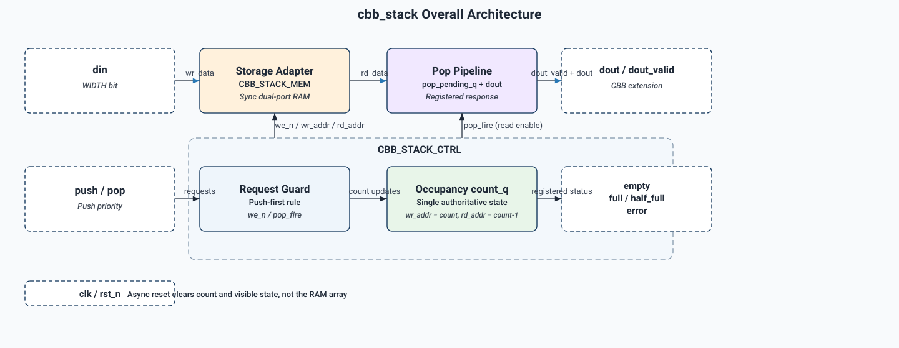
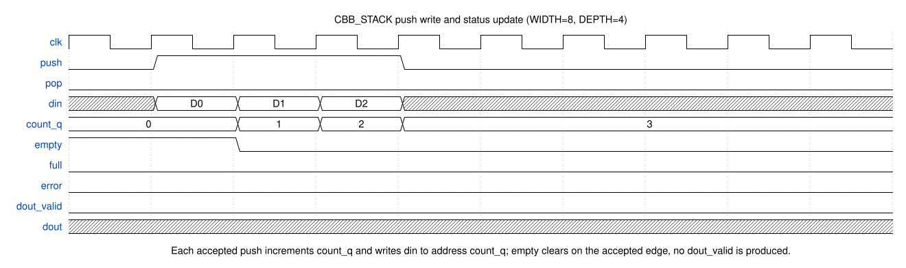
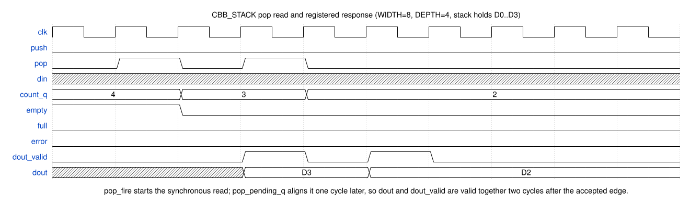
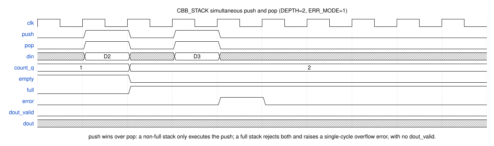

# CBB_STACK_UG

---

## 目录

- [1. 功能及应用场景](#1-功能及应用场景)
- [2. 规格](#2-规格)
- [3. 方案分析](#3-方案分析)
- [4. 配置参数](#4-配置参数)
- [5. 接口](#5-接口)
- [6. 时序图](#6-时序图)
- [7. PPA](#7-ppa)

---

## 1. 功能及应用场景

`CBB_STACK` 是单时钟同步 LIFO，解决小容量数据需要按后进先出顺序缓存的问题。

**核心功能与应用场景：**

| 项目 | 说明 |
|---|---|
| 核心功能 | Push 优先、严格 LIFO、一拍 Pop 响应、空满/半满状态及错误指示 |
| 解决问题 | 为嵌套状态和小容量数据提供确定时序的片上后进先出缓存 |
| 典型场景 | 返回地址、解析状态、嵌套事务上下文、小容量数据回退栈 |
| 产品边界 | 单时钟域；无响应反压、占用计数、CDC、FIFO 或 show-ahead 接口 |

典型应用包括：

- 函数调用或中断嵌套的返回信息保存；
- 协议解析、表达式求值和嵌套事务状态保存；
- 需要严格 LIFO 顺序的小容量片上缓存。

---

## 2. 规格

| 规格 ID | 可验证要求 |
|---|---|
| DS.CBB_STACK.INTF.001 | 单 `clk` 域，`rst_n` 低有效异步复位 |
| DS.CBB_STACK.CFG.001 | `WIDTH=1..256`、`DEPTH=2..256`、`MEM_IMPL=0/1`、`ERR_MODE=0/1` |
| DS.CBB_STACK.CFG.002 | ASIC 使用 64x4 双口 SRAM 硬宏（`TSMC_12` 分支，占位名 `CBB_SRAM_64X4_DP`） |
| DS.CBB_STACK.FUNC.001 | 合法 Push/Pop 保持严格 LIFO 顺序 |
| DS.CBB_STACK.FUNC.002 | 满栈 Push、空栈 Pop 被拒绝并产生 `error` |
| DS.CBB_STACK.FUNC.003 | `push && pop` 时 Push 优先，满栈时产生 overflow `error` |
| DS.CBB_STACK.PERF.001 | Pop 在接受后的下一上升沿产生 `dout_valid`，峰值每周期一个操作 |

### 2.1 时钟与复位 - DS.CBB_STACK.INTF.001

`clk` 是唯一功能时钟，`rst_n` 为低有效异步复位。复位清除占用状态、状态标志、`error`、
`dout` 和待响应标志，但不复位 SRAM 内容；接口不包含 CDC。

### 2.2 通用参数 - DS.CBB_STACK.CFG.001

通用 RTL 支持 `WIDTH=1..256`、`DEPTH=2..256`、`MEM_IMPL=0/1`、`ERR_MODE=0/1`。非法
参数由仿真检查和综合脚本明确拒绝；`MEM_IMPL` 保留为兼容参数，双口 wrapper 使用统一实现。

`ERR_MODE=0` 时错误保持到复位，`ERR_MODE=1` 时错误仅在检测到错误的周期有效。

### 2.3 存储实现 - DS.CBB_STACK.CFG.002

`CBB_STACK_MEM` 采用独立写端口和独立同步读端口。定义 `TSMC_12` 时实例化 TSMC
64x4 双口 SRAM 宏（占位名 `CBB_SRAM_64X4_DP`）：Port A 固定写、Port B 固定读，
两个端口连接同一个 `clk`。宏按 4 bit 横向切片、按 64 entry 纵向分 bank，因此覆盖
全部 `WIDTH=1..256`、`DEPTH=2..256` 配置。控制器按 DW 规则每周期只接受 Push 或
Pop，不会向宏发出同周期读写，避开宏模型定义为未知值的同址读写冲突。

FPGA 分支通过 RAM 属性推断 block RAM；未定义技术宏时，默认行为模型使用独立读写
端口的 `reg` 数组，并仅作为可移植 RTL 仿真模型。

### 2.4 LIFO 存取 - DS.CBB_STACK.FUNC.001

`count_q` 表示有效条目数，栈顶地址为 `count_q-1`。每个合法 Pop 返回最后一次合法
Push 写入且尚未弹出的数据；Pop 只减少有效条目数，不擦除物理存储，范围外存储内容
对集成逻辑不可见。

### 2.5 Push/Pop 边界 - DS.CBB_STACK.FUNC.002

合法 Push 的接受条件为 `push=1 && full=0`，接受沿写入 `din` 并将占用量加一。
满栈 Push 被拒绝并产生 overflow `error`，不访问 SRAM、不缓存且不自动重试。

### 2.6 同时请求 - DS.CBB_STACK.FUNC.003

`push && pop` 时按 DW_stack 规则由 Push 优先：非满时执行 Push，不执行 Pop；满栈时
拒绝 Push/Pop 并产生 overflow `error`。该组合不视为协议错误。

### 2.7 延迟与吞吐 - DS.CBB_STACK.PERF.001

合法 Pop 在接受沿发起同步读，数据在下一上升沿通过 `dout/dout_valid` 返回。连续合法
Pop 经过首拍延迟后可每周期返回一个条目；总请求吞吐上限为每周期一个操作。

| `push` | `pop` | 边界条件 | 本周期动作 | 下一占用量 | 响应 |
|---:|---:|---|---|---|---|
| 1 | 0 | `full=0` | 写 `din` 到地址 `count_q` | `count_q+1` | 无 |
| 1 | 0 | `full=1` | 拒绝，不访问存储 | 保持 | 无 |
| 0 | 1 | `empty=0` | 从地址 `count_q-1` 发起同步读 | `count_q-1` | 下一拍 `dout_valid=1` |
| 0 | 1 | `empty=1` | 拒绝，不访问存储，产生 underflow `error` | 保持 | 无 |
| 1 | 1 | `full=0` | 只执行 Push | `count_q+1` | 无 |
| 1 | 1 | `full=1` | 拒绝，产生 overflow `error` | 保持 | 无 |
| 0 | 0 | 任意 | 空闲 | 保持 | 无 |

---

## 3. 方案分析

| 方案 | 优点 | 代价 | 结论 |
|---|---|---|---|
| 全寄存器阵列 | 小深度下访问直接 | 面积和功耗随容量增长 | 仅作行为实现 |
| 双端口同步 RAM | 读写端口解耦，可直接连接 DW 风格硬宏 | 宏面积和 wrapper 复杂度更高 | 本设计采用 |

设计采用 `CBB_STACK_CTRL` 控制器加同步双端口存储。控制器中的 `count_q` 是唯一权威占用
状态，地址不保存为独立状态：
合法 Push 写地址由 `count_q` 直接得到，合法 Pop 读地址为 `count_q-1`。因此复位不需要
清空整个存储阵列，只需把占用量和可见响应状态清零。

**架构块说明：**

| 架构块 | RTL 归属 | 主要职责 | 状态/时序边界 |
|---|---|---|---|
| 请求守卫 | `CBB_STACK_CTRL` | 按 Push 优先规则检查空满边界，生成 `we_n/pop_fire` | 组合逻辑，不缓存请求 |
| 栈控制器 | `CBB_STACK_CTRL` | 复用 DW_stackctl 的计数、地址、状态、错误和请求优先级 | `rst_n` 异步清零；可独立连接外部 RAM |
| 占用与状态 | `count_q`、`empty/full/half_full/error` | 记录有效条目数并在接受沿更新状态 | `rst_n` 异步清零；上升沿更新 |
| 地址生成 | `wr_addr/rd_addr` | 由当前占用量预计算写地址和栈顶读地址 | 组合逻辑；非 2 次幂深度由 wrapper 再检查范围 |
| 存储适配 | `CBB_STACK_MEM` | 独立读写双口 RAM，选择 TSMC 硬宏/FPGA/行为实现 | 同步读一拍返回 |
| Pop 管线 | `pop_pending_q`、响应寄存器 | 将接受资格与存储读数据对齐，产生 `dout_valid` | `E(n)` 接受，`E(n+1)` 返回 |

**核心操作：**

1. Push 被接受时，`din` 写入当前 `count_q` 对应位置，之后占用量加一；写操作不产生响应。
2. Pop 被接受时，使用接受前的 `count_q-1` 作为地址发起读取，同时设置待响应标志并将占用量减一。
3. 下一上升沿，存储读数据写入 `dout`，`pop_pending_q` 转换为单周期 `dout_valid`。
4. 满栈 Push、空栈 Pop 不改变 `count_q`；同拍 Push/Pop 按 Push 优先处理。

状态标志基于接受前的边界值更新：Push 前 `count_q=DEPTH-1` 时本拍后置 `full`；Pop 前
`count_q=1` 时本拍后置 `empty`；`half_full` 的阈值为 `ceil(DEPTH/2)`。该写法避免把
`next_count` 加减法放入请求到状态输出的关键路径。

Xilinx/Altera 分支分别通过 `ram_style="block"` 和 `ramstyle="M10K"` 推断 block RAM；
默认分支用于可移植仿真。TSMC 分支使用完整硬宏交付物，包括 Verilog、Liberty/DB、
LEF、GDSII、SPICE 和 datasheet；常规 smoke 使用厂商 FPGA functional model，完整
模型 smoke 使用厂商 signoff Verilog model。

---

## 4. 配置参数

| 参数 | 配置范围 | 默认值 | 描述 |
|---|---|---|---|
| `WIDTH` | 1..256 | 8 | 栈数据位宽 |
| `DEPTH` | 2..256 | 16 | 栈逻辑深度 |
| `MEM_IMPL` | 0 或 1 | 0 | 默认行为模型选择；技术宏由编译宏选择 |
| `MEM_CONFIG` | 0..2 | 0 | 兼容保留；所有取值均映射同一种 64x4 双口宏拼接方案 |
| `ERR_MODE` | 0 或 1 | 0 | `0`：错误保持到复位；`1`：错误保持一个周期 |

---

## 5. 接口

| 信号名 | 位宽 | I/O | 时钟域 | 描述 |
|---|---|---|---|---|
| `clk` | 1 | I | `clk` | 上升沿工作时钟 |
| `rst_n` | 1 | I | 异步至 `clk` | 低有效异步复位 |
| `push` | 1 | I | `clk` | 高有效 Push 请求；与 `pop` 同时有效时 Push 优先 |
| `pop` | 1 | I | `clk` | 高有效 Pop 请求；仅在 `push=0` 时执行 |
| `din` | `WIDTH` | I | `clk` | Push 数据 |
| `dout` | `WIDTH` | O | `clk` | 最近一次合法 Pop 返回数据 |
| `dout_valid` | 1 | O | `clk` | Pop 响应有效脉冲，无反压 |
| `empty` | 1 | O | `clk` | 栈空指示 |
| `full` | 1 | O | `clk` | 栈满指示 |
| `half_full` | 1 | O | `clk` | 占用量达到 `ceil(DEPTH/2)` |
| `error` | 1 | O | `clk` | 满栈 Push 或空栈 Pop 的错误指示 |

**接口使用规则：**

| 规则 | 说明 |
|---|---|
| 请求采样 | `push/pop/din` 在 `clk` 上升沿采样；无 `ready` 或重试机制；同时请求 Push 优先 |
| Pop 响应 | `dout_valid` 仅保持一个周期；集成方必须在该周期采样 `dout` |
| 输出保持 | 无新 Pop 响应时 `dout` 保持最近一次有效返回值，不能据此推断新数据 |
| 状态含义 | `empty/full/half_full` 是接受沿后占用状态的寄存输出 |
| 复位 | `rst_n=0` 时占用、错误和可见输出复位；SRAM 阵列不清零 |

---

## 6. 时序图

### 6.1 Push 写入与状态更新

`push` 与 `din` 在同一个 `clk` 上升沿采样。非满且不存在 Push/Pop 冲突时，数据写入
当前栈顶地址，占用状态在采样沿后更新；Push 不产生 `dout_valid`。

### 6.2 Pop 读取与响应

Pop 在 `E0` 上升沿接受并发起同步读，在 `E1` 沿后更新 `dout` 并拉高 `dout_valid`。
复位在任意时刻拉低会取消待返回响应。

### 6.3 Push/Pop 同时请求

`push && pop` 在采样沿按 Push 优先处理；非满时写入 `din`，满栈时产生 overflow `error`。

以上时序图均使用 10 个等宽时槽，并以 `clk` 上升沿作为采样沿。

---

## 7. PPA

以下数据来自当前 TSMC 双口硬宏实现。存储库使用 64x4 双口 SRAM 宏的 SS `0.9 V/125 C` 时序库，面积包含标准单元和 SRAM 宏。

### 7.1 配置A：默认配置 8x16

**参数设置：**

| 参数 | 设置值 | 说明 |
|---|---|---|
| `WIDTH/DEPTH/MEM_IMPL/MEM_CONFIG` | `8/16/0/0` | 2 颗 64x4 双口 SRAM，按位宽切片 |

**PPA 数据：**

| 项目 | 数值 |
|---|---|
| 频率 | 默认最大 Fmax `1562.500000 MHz`（周期 `0.64 ns`）；setup `+0.00168318 ns`，hold `+0.000210211 ns` |
| 面积 | `3579.978190 um^2`，144 cells，2 x 64x4 双口 SRAM |
| 功耗 | `2.9177 mW`；动态 `2.4804 mW`，漏电 `0.4372877 mW`，vectorless 估算 |

### 7.2 配置B：跨 Bank 配置 9x65

**参数设置：**

| 参数 | 设置值 | 说明 |
|---|---|---|
| `WIDTH/DEPTH/MEM_IMPL/MEM_CONFIG` | `9/65/0/0` | 3 个位宽切片 x 2 个深度 bank，共 6 颗宏 |

**PPA 数据：**

| 项目 | 数值 |
|---|---|
| 频率 | 已验证最大 Fmax `1428.571429 MHz`（周期 `0.70 ns`）；setup `+0.00320193 ns`，hold `0 ns` |
| 面积 | `10671.920492 um^2`，205 cells，6 x 64x4 双口 SRAM |
| 功耗 | `4.2954 mW`；动态 `2.9840 mW`，漏电 `1.3114 mW`，vectorless 估算 |

### 7.3 配置C：宏数量规则

任意合法参数下，宏数量按下式静态展开：

`ceil(WIDTH/4) * ceil(DEPTH/64)`。

默认 8x16 因此为 2 颗，9x65 为 6 颗，最大 256x256 配置为 256 颗。该方案保持统一
硬宏类型，代价是非 4 bit 位宽或非 64 entry 深度时会有边缘容量浪费。

### 7.4 时序说明

本轮（2026-09-02）综合与 STA 使用 DC W-2024.09-SP3，标准
单元库及 SRAM NLDM 均采用 TSMC12 SS `0.9 V/125 C`；功能时钟周期 `0.64 ns`，内部
优化周期为 `0.64 ns`，uncertainty `0.1 ns`，输入/输出延迟各 `0.4 ns`，输出
负载 `0.01 pF`。两组 setup 均满足 `>=0.3 ns` 门槛，hold 非负，约束违例和未解析
black box 均为 0。输入/输出各保留 `0.4 ns` 外部组合逻辑预算。功耗来自 low-effort vectorless 活动率估算，未使用
SAIF/VCD，不是 signoff power。报告属于 pre-layout 综合/STA；CTS、提取 RC、OCV、
TT/FF 角和 post-layout signoff 均为 `NOT CHECKED`。

综合默认采用当前已验证的最大 Fmax 约束：SS `0.9 V/125 C`、`CLOCK_PERIOD_NS=0.64 ns`、
`SETUP_MARGIN_RATIO=0`，并要求 setup 与 hold slack 均非负。代表配置结果如下：

| 配置 | 已验证 PASS 周期 | 已验证 Fmax | 代表失败点 | 失败原因 | 证据 |
|---|---:|---:|---:|---|---|
| 8x16 | `0.64 ns` | `1562.500000 MHz` | `0.63 ns` | hold `-0.0024267 ns` | Fmax 扫描（细步长） |
| 9x65 | `0.70 ns` | `1428.571429 MHz` | `0.60 ns` | setup `-0.0325724 ns` | Fmax 扫描 |

综合默认按 8x16、`0.64 ns` 约束运行；其他配置可通过 `WIDTH`、`DEPTH` 和
`CLOCK_PERIOD_NS` 覆盖。上述 Fmax 是 pre-layout SS 证据，不等同于完整 PVT、CTS、RC、
OCV 或 post-layout signoff。

---

> **公开分发说明**：本文中的工艺宏型号、宏时序库名以占位形式给出（`CBB_SRAM_64X4_DP` / "TSMC 12nm 标准单元库"）。实际型号由后端 Memory Compiler 与所选工艺库决定；接入时请按宏 databook 复核固定接值与端口极性。
