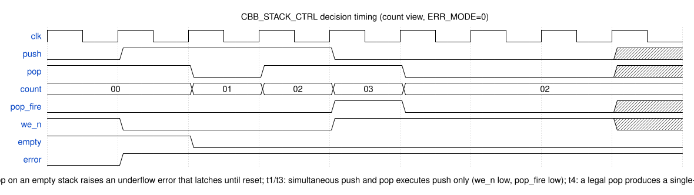

# CBB_STACK_CTRL_UG

---

## 目录

- [1. 功能及应用场景](#1-功能及应用场景)
- [2. 规格](#2-规格)
- [3. 方案分析](#3-方案分析)
- [4. 配置参数](#4-配置参数)
- [5. 接口](#5-接口)
- [6. 时序图](#6-时序图)
- [7. 使用约束](#7-使用约束)

---

## 1. 功能及应用场景

### 1.1 核心功能

`cbb_stack_ctrl` 是可复用的同步 LIFO 栈控制器，对齐 DW_stackctl 的控制职责：指针生成、空满边界、状态标志与错误报告全部由本模块承担，存储由外部 RAM（`cbb_stack_mem` 或用户自选的双口 SRAM）提供。控制与存储解耦后，控制器可以独立复用到不同存储实现上。

### 1.2 关键特性

- `count_q` 是唯一权威占用状态，写/读地址均由它组合算出，不保存独立指针。
- Push 优先规则写在接受条件里：`pop_fire = pop && !push && count_q > 0`。
- 状态标志（`empty`/`full`/`half_full`）为寄存器输出，用接受沿前的 `count_q` 直接判断，避开 `next_count` 加法器进关键路径。
- `error` 报告满栈 Push（overflow）与空栈 Pop（underflow），`ERR_MODE` 决定锁存或单拍。

### 1.3 应用场景与适用边界

| 场景 | 适用性 | 说明 |
|---|:---:|---|
| 作为 `cbb_stack` 的控制层 | 适用 | 与 `cbb_stack_mem` 配对使用。 |
| 自带 SRAM/寄存器阵列的 LIFO | 适用 | 输出低有效 `we_n` 与预计算地址，可直接对接 DW 风格宏。 |
| FIFO / 双端队列 | 不适用 | 只实现 LIFO 语义。 |
| 跨时钟域 | 不适用 | 单 `clk` 域。 |

---

## 2. 规格

| 规格 ID | 可验证要求 |
|---|---|
| DS.CBB_STACK_CTRL.INTF.001 | 单 `clk` 域，`rst_n` 低有效异步复位；不复位外部 RAM |
| DS.CBB_STACK_CTRL.CFG.001 | `DEPTH=2..256`，`ERR_MODE=0/1` |
| DS.CBB_STACK_CTRL.FUNC.001 | 合法 Push/Pop 保持严格 LIFO 顺序；`push && pop` 时 Push 优先 |
| DS.CBB_STACK_CTRL.FUNC.002 | 满栈 Push、空栈 Pop 被拒绝并产生 `error`；`ERR_MODE=0` 锁存到复位，`=1` 单拍 |
| DS.CBB_STACK_CTRL.FUNC.003 | `wr_addr` 指向下一写入位置（=`count_q`）；`rd_addr` 指向当前栈顶（=`count_q-1`），空栈保持 0 防地址下溢 |
| DS.CBB_STACK_CTRL.PERF.001 | 地址与状态随占用状态在接受沿更新；Pop 接受资格由 `pop_fire` 组合给出 |

### 2.1 Push 优先 — DS.CBB_STACK_CTRL.FUNC.001

`push && pop` 同拍时由 Push 优先：非满栈只执行 Push（`we_n=0` 写入，`pop_fire=0` 不发起读），满栈时两者都拒并产生 overflow `error`。优先级由 `pop_fire` 的 `!push` 项直接实现——斗在一起的拍 Pop 连读都不会发起，从根上消除"同时操作同一地址"的歧义。

### 2.2 错误模式 — DS.CBB_STACK_CTRL.FUNC.002

| `ERR_MODE` | 行为 |
|---|---|
| 0 | `error` 锁存到复位（DW err_mode=0 语义） |
| 1 | `error` 仅在检测到错误的周期有效（单拍脉冲） |

---

## 3. 方案分析

### 3.1 一个数管所有事

FIFO 需要写/读两个指针加空满判据；栈只需要 `count_q`——有效条目数。栈顶读地址是 `count_q-1`，下次写入地址是 `count_q`，两个地址都从这一个数组合算出。收益：复位只清占用与可见状态、不用清存储阵列；不存在"两指针失步"的 bug 类别；空满判据退化为一次比较。

### 3.2 状态输出与计数更新拆路径

直观写法是先算 `next_count` 再推状态标志，会把"加法器 → 比较器 → 状态寄存器"串成一条以请求为起点的长路径。本设计改为在接受沿直接用沿前 `count_q` 判断：`push_fire` 时 `count_q == DEPTH-1` 置 `full`，`pop_fire` 时 `count_q == 1` 置 `empty`。同样的语义下，`count_q` 到状态输出只隔一个比较器，加法器只留在占用寄存器自己的输入侧。

### 3.3 决策信号共用一次比较

`push_fire`、`pop_fire`、`overflow_request`、`underflow_request`、`we_n` 五个决策信号全部由同一次 `count_q` 边界比较派生，无重复比较逻辑。

---

## 4. 配置参数

| 参数 | 配置范围 | 默认值 | 描述 |
|---|---|---:|---|
| `DEPTH` | 2..256 | 16 | 栈深度（entry 数），决定地址与占用计位宽 |
| `ERR_MODE` | 0/1 | 0 | 错误保持模式：0 锁存到复位，1 单拍 |

---

## 5. 接口

| 信号名 | 位宽 | I/O | 时钟域 | 描述 |
|---|---:|:---:|---|---|
| `clk` | 1 | I | — | 工作时钟，上升沿有效 |
| `rst_n` | 1 | I | — | 异步复位，低有效；只清控制器状态，不复位外部 RAM |
| `push` | 1 | I | `clk` | Push 请求，高有效 |
| `pop` | 1 | I | `clk` | Pop 请求，高有效；与 Push 同拍时让位 |
| `pop_fire` | 1 | O | `clk` | Pop 接受资格，组合输出；同时是外部 RAM 的读使能 |
| `we_n` | 1 | O | `clk` | 写使能，低有效（= `~push_fire`） |
| `wr_addr` | `$clog2(DEPTH)` | O | `clk` | 写地址，指向下一写入位置 |
| `rd_addr` | `$clog2(DEPTH)` | O | `clk` | 读地址，指向当前栈顶；空栈保持 0 |
| `empty` | 1 | O | `clk` | 空标志，寄存输出 |
| `full` | 1 | O | `clk` | 满标志，寄存输出 |
| `half_full` | 1 | O | `clk` | 半满标志（阈值 `ceil(DEPTH/2)`），寄存输出 |
| `error` | 1 | O | `clk` | overflow/underflow 指示，模式见 2.2 |

---

## 6. 时序图

结论（`ERR_MODE=0`）：t0 空栈 Pop 产生 underflow `error` 并锁存到复位；t1/t3 同拍 `push && pop` 只执行 Push（`we_n=0`、`pop_fire=0`）；t4 合法 Pop 输出单拍 `pop_fire`。地址与状态在接受沿后更新。

---

## 7. 使用约束

- 本模块不含存储；`we_n`/`wr_addr`/`rd_addr`/`pop_fire` 直接对接外部 RAM 的写口与读口（参考 `cbb_stack` 的接法）。
- 控制器保证 `count_q` 只会在 `0..DEPTH` 范围内，非法请求（满栈 Push、空栈 Pop）被接受条件天然拦截；但非 2 幂深度的越界地址编码仍需存储侧（`cbb_stack_mem`）的 `addr_valid` 拦截。
- 复位不清外部存储阵列；栈语义下范围外存储内容对集成逻辑不可见。
- 本模块不单独交付综合数据；面积、时序与功耗随 `cbb_stack` 顶层配置计入 `cbb_stack_ug.md` 第 7 节。

---

> **公开分发说明**：本文中的工艺宏型号、宏时序库名以占位形式给出（`CBB_SRAM_64X4_DP` / "TSMC 12nm 标准单元库"）。实际型号由后端 Memory Compiler 与所选工艺库决定；接入时请按宏 databook 复核固定接值与端口极性。
