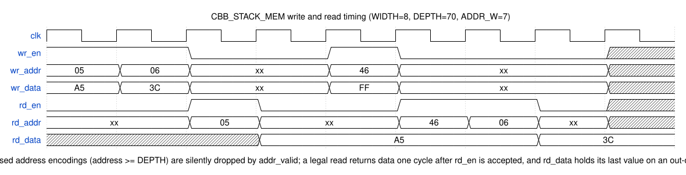

# CBB_STACK_MEM_UG

---

## 目录

- [1. 功能及应用场景](#1-功能及应用场景)
- [2. 规格](#2-规格)
- [3. 方案分析](#3-方案分析)
- [4. 配置参数](#4-配置参数)
- [5. 接口](#5-接口)
- [6. 时序图](#6-时序图)
- [7. 使用约束](#7-使用约束)

---

## 1. 功能及应用场景

### 1.1 核心功能

`cbb_stack_mem` 是 `cbb_stack` 的存储层：一个独立写端口 + 独立同步读端口的单时钟双口 RAM wrapper。它把"位宽切片 × 深度分 bank"的宏拼接逻辑收在一个模块里，向上层提供一条干净的 `wr_en/wr_addr/wr_data` 与 `rd_en/rd_addr/rd_data` 接口。

### 1.2 关键特性

- 独立写端口与独立同步读端口，读数据在接受读请求后的下一周期返回。
- 非 2 的幂深度时，越界地址编码由 `addr_valid` 静默拦截，不访问存储。
- `TSMC_12` 分支按 4 bit 横向切片、64 entry 纵向分 bank，覆盖 `WIDTH=1..256`、`DEPTH=2..256` 全部配置。
- FPGA 分支推断 block RAM；默认行为级分支使用独立读写端口的 `reg` 数组。

### 1.3 应用场景与适用边界

| 场景 | 适用性 | 说明 |
|---|:---:|---|
| 作为 `cbb_stack` 的存储层 | 适用 | 与 `cbb_stack_ctrl` 配对使用。 |
| 独立用作 1 写 1 读简单双口存储 | 适用 | 读写端口地址、使能完全分离。 |
| 同一端口既读又写 | 不适用 | 单端口无地址复用；上层需自行分时。 |
| 真双口并发访问 | 不适用 | 请使用 `cbb_ram_dp`。 |
| 跨时钟域 | 不适用 | 两端口共享同一 `clk`；跨域请用 `cbb_ram_tp`。 |

---

## 2. 规格

| 规格 ID | 可验证要求 |
|---|---|
| DS.CBB_STACK_MEM.INTF.001 | 单 `clk` 域；模块自身无复位端口，存储内容与读数据在合法读前无效 |
| DS.CBB_STACK_MEM.PERF.001 | 合法同步读在 `rd_en` 接受后的下一周期返回 `rd_data` |
| DS.CBB_STACK_MEM.FUNC.001 | 非 2 的幂深度时，地址 ≥ `DEPTH` 的读写请求被 `addr_valid` 拦截，不访问存储 |
| DS.CBB_STACK_MEM.FUNC.002 | 写端口与读端口地址、使能完全分离，无同周期读写冲突（上层控制器保证不同时发起） |

### 2.1 地址守卫 — DS.CBB_STACK_MEM.FUNC.001

非 2 的幂深度（如 `DEPTH=70`、`ADDR_W=7`）时，地址编码空间大于有效深度。模块将地址零扩展到 `ADDR_W+1` 位后与 `DEPTH` 比较，生成 `rd_addr_valid` / `wr_addr_valid`；无效请求不产生宏片选，`rd_data` 保持上一次的返回值。2 的幂深度时该比较被生成分支直通为常真，不占逻辑。

### 2.2 读延迟 — DS.CBB_STACK_MEM.PERF.001

`rd_en` 在时钟沿被接受，宏输出为同步读数据，`rd_data` 在下一周期有效。宏分支额外寄存一拍请求 bank 编号（`rd_bank_select_q`），用于在返回周期选择对应 bank 的 QB，不增加读延迟。

---

## 3. 方案分析

### 3.1 宏拼接结构

`TSMC_12` 分支以 64x4 双口 SRAM 宏（本仓库以占位名 `CBB_SRAM_64X4_DP` 表示）为基本单元：

- 位宽方向：`ceil(WIDTH/4)` 个切片，写数据高位补零对齐宏位宽；
- 深度方向：`ceil(DEPTH/64)` 个 bank，地址高位作 bank 选择、低 6 位作宏行地址；
- 每颗宏 Port A 固定写、Port B 固定读，控制信号均为低有效（`CEBA`/`CEBB`）；
- 读返回数据经 bank 选择多路器（1~4 bank 静态展开）汇合后截取 `WIDTH` 位输出。

宏数量为 `ceil(WIDTH/4) × ceil(DEPTH/64)`，统一宏类型的代价是非 4 bit 位宽或非 64 entry 深度时存在边缘容量浪费（详见 `cbb_stack_ug.md` 第 7 节）。

### 3.2 FPGA 与行为级分支

`FPGA_XILINX` / `FPGA_ALTERA` 通过 `ram_style`/`ramstyle` 属性推断 block RAM；默认行为级分支使用独立读写端口的 `reg` 数组，同址读写时读出写入前数据（非阻塞赋值语义），仅作为可移植仿真模型。

---

## 4. 配置参数

| 参数 | 配置范围 | 默认值 | 描述 |
|---|---|---:|---|
| `WIDTH` | 1..256 | 8 | 数据位宽 |
| `DEPTH` | 2..256 | 16 | 存储深度（entry 数） |
| `ADDR_W` | `$clog2(DEPTH)` | 4 | 地址位宽，须与 `DEPTH` 匹配 |
| `MEM_IMPL` | 0/1 | 0 | 兼容保留参数，两种取值映射同一实现 |
| `MEM_CONFIG` | 0..2 | 0 | 兼容保留参数，均映射同一 64x4 双口宏拼接方案 |

---

## 5. 接口

| 信号名 | 位宽 | I/O | 时钟域 | 描述 |
|---|---:|:---:|---|---|
| `clk` | 1 | I | — | 工作时钟，上升沿有效；两端口共用 |
| `wr_en` | 1 | I | `clk` | 写使能，高有效 |
| `wr_addr` | `ADDR_W` | I | `clk` | 写地址，指向写入位置 |
| `wr_data` | `WIDTH` | I | `clk` | 写数据 |
| `rd_en` | 1 | I | `clk` | 读使能，高有效；接受后下一拍 `rd_data` 有效 |
| `rd_addr` | `ADDR_W` | I | `clk` | 读地址 |
| `rd_data` | `WIDTH` | O | `clk` | 同步读返回数据；无有效读时保持上一次的值 |

---

## 6. 时序图

结论（`WIDTH=8, DEPTH=70, ADDR_W=7`，行为级实测）：合法写 0x05/0x06 两笔后，合法读 0x05 一拍出数；越界地址 0x46（≥ `DEPTH`）的写与读均被 `addr_valid` 拦下，`rd_data` 保持上一次的合法返回值。

---

## 7. 使用约束

- 模块自身无复位端口；复位只清上层控制器的占用状态，不清存储阵列（见 `cbb_stack_ug.md`）。
- 上层须保证同一周期不同时发出 `wr_en` 与 `rd_en`（`cbb_stack_ctrl` 的 Push 优先规则天然满足）。
- 本模块不单独交付综合数据；面积、时序与功耗随 `cbb_stack` 顶层配置计入 `cbb_stack_ug.md` 第 7 节。
- 工艺宏型号、宏时序库名以占位形式给出，实际型号由后端 Memory Compiler 决定；接入时请按宏 databook 复核固定接值与端口极性。

---

> **公开分发说明**：本文中的工艺宏型号、宏时序库名以占位形式给出（`CBB_SRAM_64X4_DP` / "TSMC 12nm 标准单元库"）。实际型号由后端 Memory Compiler 与所选工艺库决定；接入时请按宏 databook 复核固定接值与端口极性。
